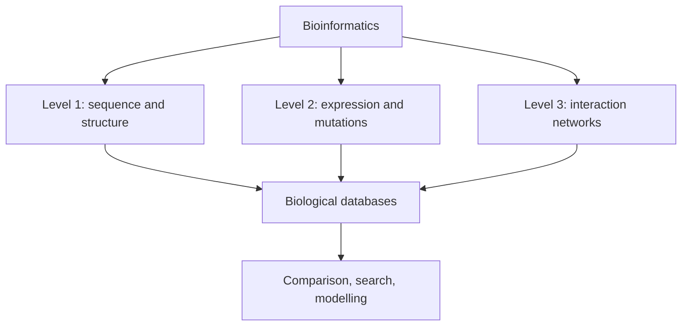
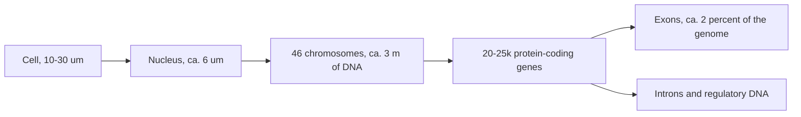

# L01 — Bioinformatics and the Cell

## Scope

The opening session of *Grundlagen der System-Biologie* (GSB) defines what bioinformatics
is, which levels of biological information it works on, and the cellular substrate those
levels live in. It introduces the prokaryote/eukaryote distinction, the physical
organisation of the genome, the [[central-dogma]] of molecular biology, and the
quantitative facts about the human genome that motivate computational approaches
(≈ 3 m of DNA packed into a ≈ 6 µm nucleus; ≈ 20–25 000 protein-coding genes in
3 Gbp of sequence). It closes with the observation that most biological knowledge is
stored in public databases, which is why the discipline exists at all.

## Key points

- **Bioinformatics** analyses biological information at three levels:
  1. **Sequence and structure** — DNA, RNA and protein sequences, and the 3D structures
     they fold into.
  2. **Gene and protein expression, and DNA mutations** — which genes are active, how
     strongly, and how the sequence differs between individuals or tissues
     (see [[dna-mutation]]).
  3. **Networks of interactions** — who binds, regulates or reacts with whom
     (see [[interaction-network]]).
- The data live in **biological databases** (sequence archives, structure archives,
  expression repositories, pathway/interaction resources). Finding and comparing entries
  in them is the everyday task that drives [[sequence-alignment]] and [[blast]].
- **Prokaryotic vs eukaryotic cells**: prokaryotes have no nucleus and carry a circular
  chromosome; eukaryotes keep linear chromosomes inside a membrane-bound nucleus. The
  full comparison is worked through in [[E01-cell-biology-and-gene-expression]].
- **Scale**: a eukaryotic cell is roughly 10–30 µm across, its nucleus roughly 6 µm, and
  it contains about 3 m of DNA in total. Packing at that ratio requires the chromatin
  hierarchy described in [[genome-organization]].
- **The [[central-dogma]]**: DNA →(transcription)→ mRNA →(translation)→ protein. The
  [[genetic-code]] reads mRNA in triplets (codons); translation starts at **AUG** and
  stops at **UAA**, **UAG** or **UGA**.
- **Coding vs non-coding**: the human genome is ≈ 98 % non-coding and ≈ 2 % protein
  coding; separately, only ≈ 7–9 % of the genome as a whole is estimated to be
  **functional**. Bacteria are the opposite
  extreme with only ≈ 2 % non-coding DNA. Eukaryotic genes are split into **exons**
  (retained in mRNA) and **introns** (removed by [[splicing]]) — see
  [[genome-organization]].
- **Reconciliation with "98 % is not junk".** [[population-genetics]] records the later
  statement that the non-coding 98 % is *not junk, because functionality has been
  discovered*. The two figures are not the same claim and do not strictly contradict
  each other:
  - **7–9 % functional** is a *constraint-based* estimate — the fraction of the genome
    under measurable purifying selection across species.
  - **"98 % not junk"** is a *biochemical-activity* claim in the ENCODE sense — most of
    the genome is transcribed, bound or marked at some point, which refutes the older
    "junk DNA" reading of non-coding.
  Both readings are kept on this wiki as written in the notes. Which one the lecture
  intends as *the* functional fraction is still listed in [[open-questions]].
- Because the regulatory layer lives largely in that non-coding fraction, the course
  later needs [[gene-regulation]] and [[epigenetics]].

## Diagram

The three levels of biological information that bioinformatics operates on, all mediated by public databases.

From cell to gene: the packing problem that makes genome analysis a computational task.

## Open questions

- See [[open-questions]] — the precise definition of the "7–9 % functional" figure is
  stated in the notes without a citation.

## See also

- [[L05-sequence-comparison-and-networks]] — takes up the third level of biological
  information introduced here, interaction networks.
- [[promoter]] — the element of the non-coding regulatory layer that this lecture only
  flags; it is developed in [[L02-gene-expression-and-regulation]].

## Sources

- `raw/module1/gsb_part1.pdf`, pp. 1–3.
