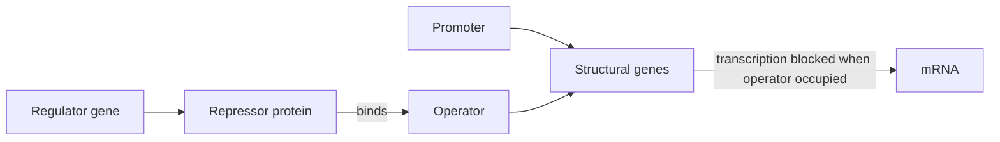
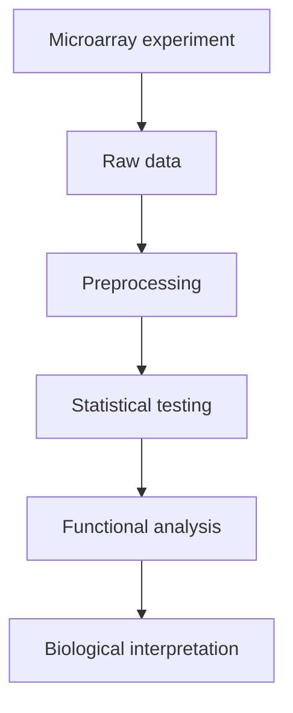

# L02 — Gene Expression and Regulation

## Scope

This session moves from "what is in the genome" to "what the genome is doing". It defines
gene, gene expression and the gene-expression microarray, walks through the microarray
experiment and its analysis pipeline, and then contrasts prokaryotic regulation (the
operon model, with the *lac* and *trp* examples) against eukaryotic regulation
(promoter / RNA-coding sequence / terminator, enhancers, activators and repressors).

## Key points

- **Gene** — a stretch of DNA that is transcribed into a functional RNA product; in the
  protein-coding case the chain chromosome → gene → mRNA → protein applies
  ([[central-dogma]]).
- **Gene expression** — the process by which the information in a gene is used to make a
  gene product. **Comparative gene-expression analysis** compares that quantity between
  two conditions (e.g. tumour vs healthy tissue).
- **Gene-expression (micro)array** — a solid substrate carrying probes for many genes at
  once, allowing expression of thousands of genes to be measured in one experiment. The
  full method is on [[microarray-expression-analysis]].
- **Prokaryotic regulation (the operon)**:
  - A **regulator gene** produces a repressor protein.
  - The **[[promoter]]** is where RNA polymerase binds.
  - The **operator** is the switch the repressor binds to; when bound, transcription of
    the downstream **structural genes** is blocked.
  - An **operon** is the whole unit of promoter + operator + structural genes transcribed
    together.
  - **Inducible operon** (*lac*): normally off, switched on by a substrate.
    **Repressible operon** (*trp*): normally on, switched off by the end product.
- **Levels of control** in prokaryotes: transcriptional → translational →
  post-translational.
- **Eukaryotic gene structure**: promoter — RNA-coding sequence — terminator, with
  distant **enhancers** acting on the promoter. Regulation is **positive** (an activator
  increases transcription) or **negative** (a repressor decreases it). Details on
  [[gene-regulation]].
- Mutations in a promoter change transcription-factor binding and therefore expression
  level; mutations in exons may change the protein; intronic mutations usually have no
  effect, because [[splicing]] removes the intron from the mature mRNA anyway — worked
  through in [[E01-cell-biology-and-gene-expression]] and [[dna-mutation]].

## Diagram

The prokaryotic operon: a repressor bound to the operator prevents transcription of the structural genes.

The standard expression-analysis pipeline introduced in this session.

## Open questions

- See [[open-questions]] — the notes name *lac* and *trp* but do not give the full
  molecular detail of induction.

## See also

- [[L01-bioinformatics-and-the-cell]] — the preceding lecture, which introduces the cell,
  the genome and the [[central-dogma]] that this lecture turns into a regulated process.

## Sources

- `raw/module1/gsb_part1.pdf`, pp. 4–6.
