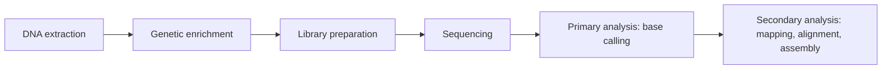
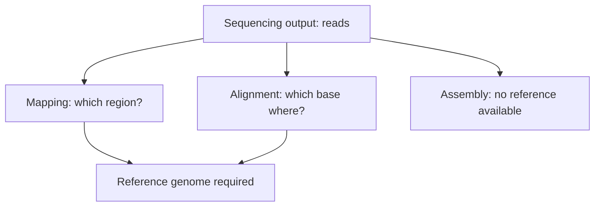

# L03 — Sequencing and Genomics

## Scope

This session defines genomics as the study of whole genomes and contrasts it with
classical genetics, then follows the technology from classical [[shotgun-sequencing]]
through Sanger sequencing to [[next-generation-sequencing]] and single-molecule long-read
platforms. It quantifies how dramatically cost and time collapsed between the Human
Genome Project and modern instruments, enumerates the sources of sequencing bias, and
fixes the vocabulary — mapping, alignment, assembly — that the rest of the module uses.

## Key points

- **Genomics vs genetics** — genetics studies individual genes and inheritance; genomics
  studies entire genomes, which only becomes possible once sequencing is cheap. See
  [[genome-organization]] for the objects being sequenced.
- **Reference numbers from the notes**: human ≈ 3 Gbp over 46 chromosomes with ≈ 25 000
  genes; *E. coli* ≈ 4.6 Mbp on 1 circular chromosome with ≈ 3200 genes. An average human
  chromosome is ≈ 130 Mbp and carries ≈ 300 genes; an average gene spans 1148 bp to
  37.7 kb.
- **Cost collapse**: the Human Genome Project took ≈ 10 years and ≈ $3 billion with Sanger
  sequencing. Today an equivalent genome costs under $4000 and takes less than two weeks
  on an NGS instrument (e.g. HiSeq) — and is more accurate.
- **Sequencing by synthesis**: a single strand is copied by DNA polymerase which
  incorporates four differently labelled bases; the incorporation events are read out in
  real time.
- **PacBio SMRT** uses fluorescently labelled nucleotides on single molecules:
  long reads, short run time, no amplification bias, direct detection of base
  modifications (relevant to [[epigenetics]]), but a large and expensive instrument.
- **Short-read limitations**: GC bias; mapping to repetitive elements; discriminating
  paralogous sequences; phasing alleles. Long reads give higher consensus accuracy and
  can detect epigenetic modifications.
- **Sources of bias**: GC-extreme regions are under-covered because of the PCR step
  during library construction; homopolymers (e.g. `AAAA`) are miscounted; strand-specific
  bias; terminator-free chemistries cannot resolve long homopolymers; PacBio shows the
  lowest bias; and the analysis itself introduces bias. Covered in detail in
  [[next-generation-sequencing]].
- **Vocabulary** (exam-relevant, stated verbatim in the notes):
  - **Mapping** — finding the region where a read is placed relative to a reference.
  - **Alignment** — the exact positioning of each base of a read within a target region
    (see [[sequence-alignment]]).
  - **Assembly** — merging reads to reconstruct an unknown sequence (see
    [[L04-genome-assembly]]).

## Diagram

The NGS pipeline as given in the notes, from sample to interpreted reads.

The three read-processing tasks and whether they need a reference.

## Open questions

- See [[open-questions]] — Sanger chemistry itself is only named, never explained in the
  notes.

## Sources

- `raw/module1/gsb_part1.pdf`, pp. 7, 12–14.
