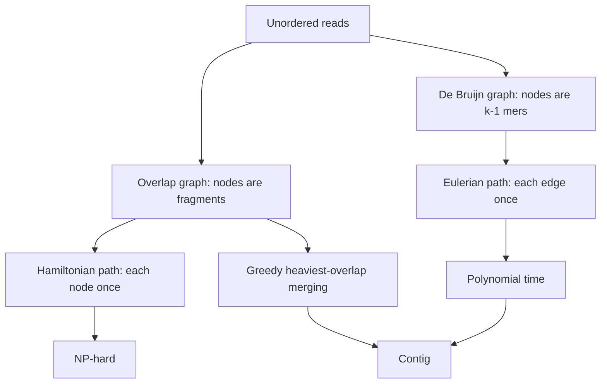
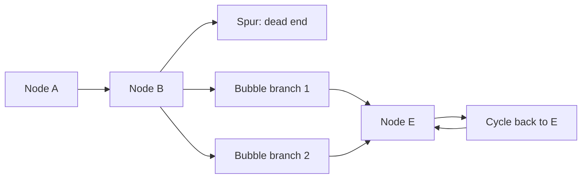

# L04 — Genome Assembly

## Scope

Assembly is the problem of reconstructing an unknown sequence from a large set of short,
unordered reads. This session states the two biological settings in which it is needed
(DNA and RNA), reformulates it as a graph problem, and then contrasts the two classical
solutions: the overlap/[[greedy-assembly]] route, which leads to a Hamiltonian-path
formulation and is NP-hard, and the [[de-bruijn-assembly]] route, which leads to an
Eulerian-path formulation solvable in polynomial time. It also catalogues the
characteristic graph artifacts — spurs, bubbles, cycles and frayed ropes.

## Key points

- **When assembly is needed**:
  - DNA: (I) *de novo* genome reconstruction when no reference exists;
    (II) local reconstruction of regions containing insertions/deletions
    (see [[dna-mutation]]).
  - RNA: (I) messenger RNA; (II) microRNA — the transcript-reconstruction step of
    [[rna-seq]].
- **Graph formulation**: nodes are sequence fragments, edges are overlaps between them —
  an **overlap graph**. Three strategies follow: *greedy*, *Hamiltonian* and
  *de Bruijn*.
- **[[hamiltonian-and-eulerian-paths|Hamiltonian path]]** — visits each **node** exactly
  once. Finding one is **NP-hard**.
- **[[hamiltonian-and-eulerian-paths|Eulerian path]]** — visits each **edge** exactly
  once. Finding one is solvable in **polynomial time** (see [[algorithmic-complexity]]
  and [[L07-algorithms-and-complexity]]).
- **Greedy assembly**: (I) compute the overlap of every fragment's suffix with every
  other fragment's prefix; (II) merge the pair joined by the heaviest edge;
  (III) iterate until a single node remains. Worked in
  [[E02-greedy-assembly]].
- **Greedy's weakness**: repeat regions. Greedy optimises locally and therefore collapses
  or misplaces repeats; NGS also gives repeats artificially increased coverage.
- **De Bruijn approach**: read all *k*-mers from the reads, count their occurrences, and
  build the [[de-bruijn-graph]] in which an edge joins two (k−1)-mers when one results
  from the other by shifting one character left and appending a new character. Assembly
  becomes "find an Eulerian path". Worked in [[E03-de-bruijn-assembly]].
- **Graph artifacts**:
  - **Spur** — a short dead-end branch, typically a sequencing error at a read end.
  - **Bubble** — two paths that diverge and reconverge; a true variant, a mid-read
    sequencing error, or a PCR artifact.
  - **Cycle** — a repeat.
  - **Frayed rope** — paths that converge then diverge again, indicating repeated
    elements.
- **Eulerian trade-off**: (+) no explicit alignment computation, so it is fast;
  (+) far less complex, polynomial time; (−) the Eulerian path is usually **not unique**.

## Diagram

The two routes from reads to contigs and their complexity consequences.

Spur, bubble and cycle artifacts as they appear in an assembly graph.

## Open questions

- See [[open-questions]] — the notes do not state how assemblers choose between the
  multiple valid Eulerian paths.

## See also

- [[L03-sequencing-and-genomics]] — produces the short unordered reads that assembly
  takes as input, and defines assembly as one of the three read-processing tasks.
- [[genome-organization]] — describes the chromosomes and genes that a de novo assembly
  is trying to reconstruct.

## Sources

- `raw/module1/gsb_part1.pdf`, pp. 15–16, 19–20.
