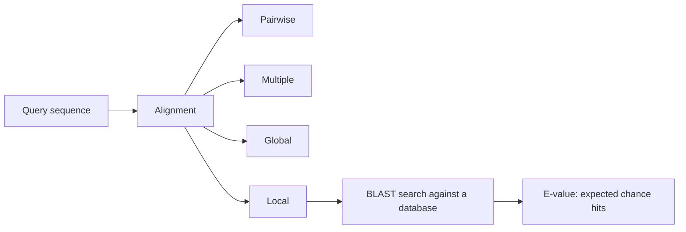
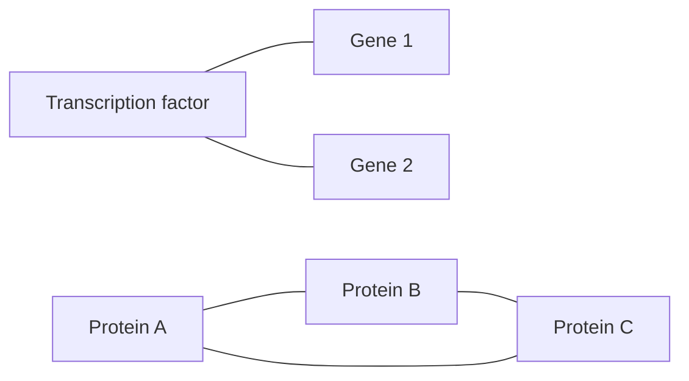

# L05 — Sequence Comparison, Mutations and Networks

> Part 2 of the notes revisits alignment in much greater depth — the four alignment
> types, [[needleman-wunsch]], [[smith-waterman]], [[substitution-matrix|scoring
> matrices]] and the BLAST program family. See
> [[L09-sequence-alignment-and-homology]].

## Scope

Once sequences exist, the next question is how to compare them. This session introduces
sequence alignment and its axes (pairwise/multiple, local/global), gaps and gap
penalties, and the [[blast]] search tool with its E-value. It then turns to the
structural [[dna-mutation|DNA mutations]] seen in cancer, to [[chip-seq]] as the
experimental route to protein–DNA binding and [[epigenetics]], and finally to
[[interaction-network|interaction networks]] as the third level of biological
information introduced in [[L01-bioinformatics-and-the-cell]].

## Key points

- **Sequence alignment** arranges two or more sequences so that corresponding positions
  line up, revealing similarity. Axes:
  - **pairwise** (two sequences) vs **multiple** (three or more),
  - **global** (end-to-end) vs **local** (best-matching sub-region).
  - See [[sequence-alignment]].
- **Gaps** model insertions and deletions. Because arbitrary gaps would make any two
  sequences alignable, each gap carries a **gap penalty**.
- **BLAST** = *Basic Local Alignment Search Tool* — a heuristic local-alignment search of
  a query against a database. Its **E-value** is the number of hits of at least the
  observed score expected by chance in a database of that size; lower is better.
- **DNA mutations** relevant in cancer, as structural rearrangements: **deletion**,
  **duplication**, **inversion**, **insertion**, **translocation**.
- **ChIP-Seq** — experimental detection of protein–DNA binding: genomic fragments that
  co-precipitate with a DNA-binding protein are sequenced. It detects
  **transcription-factor binding sites (TFBS)** and **histone modifications**, which
  makes it a key technology of epigenetics and a direct experimental handle on
  [[gene-regulation]].
- **Interaction networks** come in two experimental flavours: **binary** interactions
  (pairwise, e.g. yeast two-hybrid) and **co-complex** associations (membership of the
  same purified complex).

## Diagram

How the alignment vocabulary of this session fits together, ending in a BLAST database search.

A small interaction network mixing a regulatory edge set with a protein co-complex triangle.

## Open questions

- See [[open-questions]] — the scoring matrices (PAM/BLOSUM) are supplied by part 2 in
  [[substitution-matrix]], but the statistical derivation of the E-value is still
  missing.
- The ChIP-Seq sketch here is continued in [[L16-epigenetics]], where the reads are
  turned into regions by [[peak-calling]] and the biology of [[epigenetics]] is developed
  in full.

## See also

- [[network-alignment]] — **module 2** lifts the sequence comparison of this lecture up
  to the interaction networks introduced beside it: the same global/local split, applied
  to mappings between nodes instead of between residues.

## Sources

- `raw/module1/gsb_part1.pdf`, pp. 8–9.
- `raw/module1/gsb_part2.pdf`, pp. 11–18 — the deeper treatment continued in
  [[L09-sequence-alignment-and-homology]].
- `raw/module1/gsb_part4.pdf`, pp. 4–6 — the epigenetics continuation of the ChIP-Seq
  thread.
