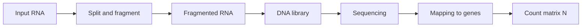
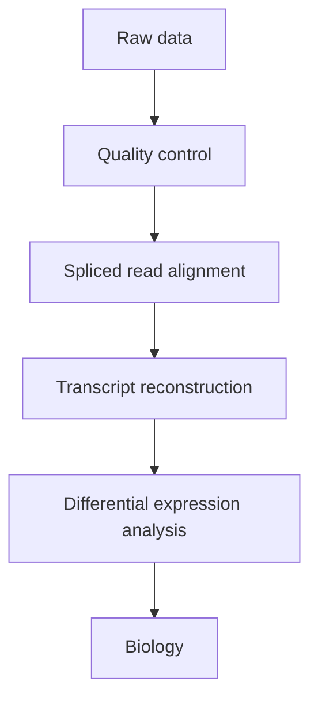

# L06 — Expression Profiling

## Scope

This session covers the two generations of transcriptome measurement: hybridisation-based
[[microarray-expression-analysis]] and sequencing-based [[rna-seq]]. It explains how a
two-colour cDNA array reports a ratio of gene expression between an experimental and a
control sample, why raw array intensities cannot be compared without normalisation, which
normalisation methods exist and what they assume, and how the RNA-Seq pipeline produces a
count matrix instead of intensities.

## Key points

- **Microarray** — an experimental format based on the synthesis or attachment of probes
  representing genes on a solid substrate, which is then exposed to target molecules. It
  provides a quantitative measure of mRNA, i.e. of [[gene-regulation|gene expression]].
- The **hybridisation level** between probes and targets is reported by fluorescence and
  measured by image analysis. Many types of expression microarray exist; they share the
  principle and differ in operational detail.
- **cDNA (two-colour) technology**: samples from an experimental and a control condition
  are overlaid on the same array and compete for each spotted probe. Three outcomes:
  (I) expressed only in the control, (II) expressed only in the experiment, and
  (I)&(II) expressed in both — the readout is the **ratio** of gene expression.
- **Data pre-processing** has three stages: background subtraction → normalisation →
  collapsing/imputation.
- **Why normalise?** To adjust the intensities from each array so that meaningful
  biological comparisons can be made. The confounders are: unequal quantities of starting
  RNA; differences in labelling and hybridisation efficiency; differences in detection
  efficiency between the fluorescent dyes; and systematic bias. **Without normalisation
  many genes appear upregulated when in reality they are not.**
- **Normalisation methods**: scaling, LOESS, RMA.
  **Assumption**: there are no global changes in gene expression between samples.
- **RNA-Seq applications**: transcript quantification, transcript discovery, expression
  profiling.
- **RNA-Seq count matrix**: `N` of size n × m, where `N[i,j]` is the number of reads from
  gene *i* sequenced in experiment *j*. This replaces the array's continuous intensity.
- Because reads cross exon–exon junctions, RNA-Seq analysis requires **spliced** read
  alignment, linking back to intron/exon structure
  ([[splicing]], [[genome-organization]], [[central-dogma]]).

## Diagram

The RNA-Seq wet-lab-to-data route as drawn in the notes.

The RNA-Seq data-analysis pipeline, ending in biological interpretation.

## Open questions

- See [[open-questions]] — LOESS and RMA are named as normalisation methods but not
  described in the notes; no concrete test (t-test, Wilcoxon, …) is named anywhere.
- ~~No multiple-testing correction is named.~~ **Resolved by part 3**: see
  [[multiple-testing-correction]].

Part 3 fills in the preprocessing side of this pipeline:
[[L11-normalization-pca-and-batch-effects]] covers [[data-normalization]],
[[principal-component-analysis]] and the [[batch-effect]] that threatens any multi-day
expression experiment; [[L15-gwas-eqtl-and-multiple-testing]] links expression levels to
genotypes via [[expression-qtl]].

## See also

- [[L10-biostatistics-and-statistical-testing]] — supplies the statistical-testing stage
  that this pipeline only names as a box.
- [[enrichment-analysis]] — **module 2's** answer to what happens *after* this pipeline:
  the list of differentially expressed genes produced here is the input to the
  enrichment test.
- [[single-cell-rna-seq]] — the module-2 successor of the bulk assays used here; it
  measures the same transcriptome one cell at a time instead of as a population average.

## Sources

- `raw/module1/gsb_part1.pdf`, pp. 24–26 (and p. 4 for the array pipeline).
- `raw/module1/gsb_part2.pdf`, pp. 19–29 — the biostatistics behind the testing stage.
- `raw/module1/gsb_3.pdf`, pp. 1, 3–4, 27–30 — normalization, PCA, batch effects, eQTLs
  and multiple-testing correction.
