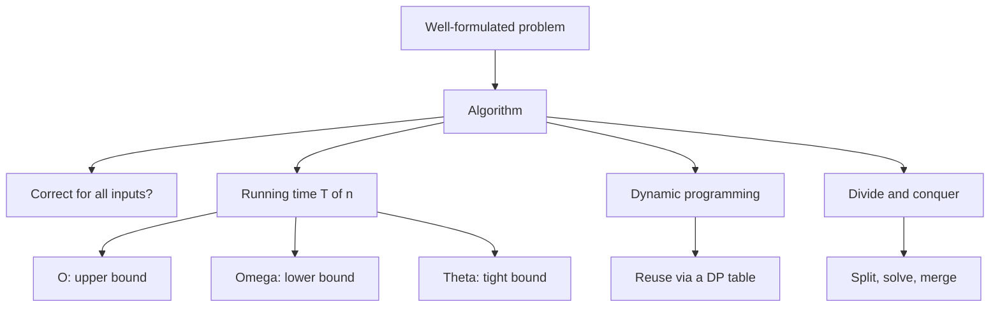

# L07 — Algorithms and Complexity

> The design patterns introduced here are applied immediately afterwards: string search
> in [[L08-exact-string-matching]] and dynamic-programming alignment in
> [[L09-sequence-alignment-and-homology]].

## Scope

The computational half of the module starts here. This session defines what an algorithm
is, what it means for one to be correct, and how to describe its running time
asymptotically with O, Ω and Θ. It fixes the standard growth hierarchy, separates
polynomial from exponential runtime — the distinction that made the Hamiltonian/Eulerian
contrast in [[L04-genome-assembly]] matter — and introduces the two algorithmic design
patterns used throughout the course: dynamic programming and divide and conquer.

## Key points

- **Algorithm** — a sequence of instructions that must be performed in order to solve a
  well-formulated problem.
- **Correctness**: an algorithm is *correct* if **for all** inputs it produces a correct
  output; it is *incorrect* if **there exists** an input producing an incorrect output.
  A single counterexample suffices to disprove correctness.
- **Asymptotic bounds** (see [[algorithmic-complexity]]):
  - `O(f(x))` — upper bound: `f(x) ≤ c·g(x)` for all `x ≥ x₀`.
  - `Ω(f(x))` — lower bound: `f(x) ≥ c·g(x)` for all `x ≥ x₀`.
  - `Θ(f(x))` — tight bound: `f(x) = O(g(x))` **and** `f(x) = Ω(g(x))`.
- **Growth hierarchy**:
  `O(1) < O(log n) < O(n) < O(n log n) < O(n²) < O(2ⁿ) < O(n!)`.
- **Polynomial** runtime is `O(nᵖ)`; **exponential** runtime is `O(pⁿ)`. Only the former
  scales to genome-sized inputs — this is the separation behind the
  [[hamiltonian-and-eulerian-paths|Hamiltonian versus Eulerian]] contrast of
  [[L04-genome-assembly]].
- **[[dynamic-programming|Dynamic programming]]** — break a problem into subproblems and
  solve them, keeping track of repeated computation in a *dynamic programming table*. It
  is applicable only when the overlapping-subproblems property (Bellman's principle)
  holds. This is the pattern behind optimal [[sequence-alignment]], worked out in full in
  [[needleman-wunsch]] and [[smith-waterman]].
- **Divide and conquer** — divide into smaller subproblems, solve them, then merge the
  results; the canonical cost is `O(n log n)`.
- **Preprocessing** is the third pattern the course relies on, although it is not named
  here: [[knuth-morris-pratt]] and [[boyer-moore-string-search]] both buy a fast search
  with an `O(m)` table built from the pattern alone.
- Asymptotics are only half the story: for a bounded input size a formally worse bound can
  win, as demonstrated in [[E04-complexity-and-majority-element]].

## Diagram

How the session's vocabulary hangs together: from problem to algorithm to its asymptotic cost and design pattern.

## Open questions

- See [[open-questions]] — the master theorem for divide-and-conquer recurrences is not
  covered in the notes, only the `O(n log n)` result.

## See also

- [[boyer-moore-majority-vote]] — the `O(n)` time, `O(1)` space majority algorithm whose
  divide-and-conquer alternative exercises both design patterns of this lecture in
  [[E04-complexity-and-majority-element]].

## Sources

- `raw/module1/gsb_part1.pdf`, p. 27.
- `raw/module1/gsb_part2.pdf`, pp. 1–15 — the applications of these patterns in
  [[L08-exact-string-matching]] and [[L09-sequence-alignment-and-homology]].
