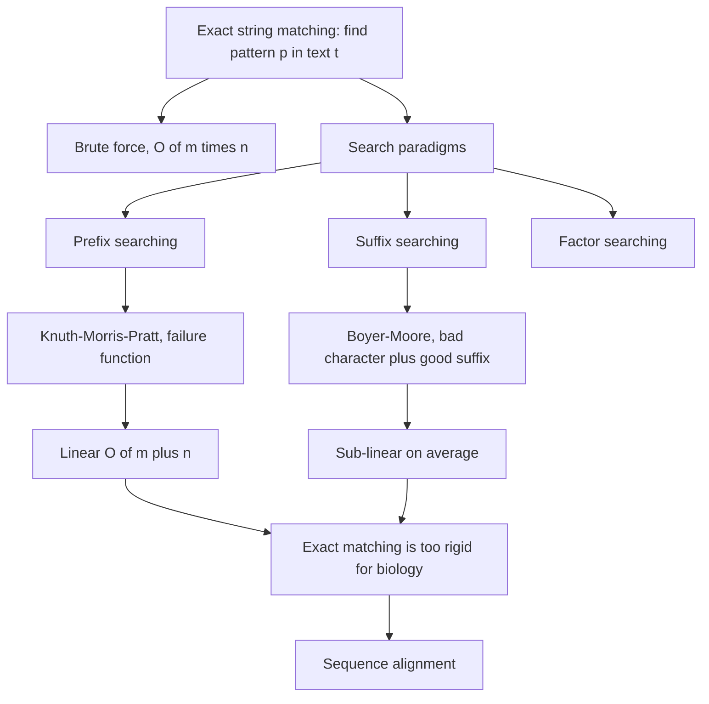

# L08 — Exact String Matching

## Scope

The first properly algorithmic session of part 2. Biological sequences are strings, and
many biological questions — where does a transcription factor bind, where does a primer
anneal, where does a motif occur — reduce to finding a pattern inside a much longer text.
This session formalises the **exact string matching** problem, contrasts the four search
paradigms, and develops the two classical algorithms in full: **Knuth–Morris–Pratt**
(prefix-based) and **Boyer–Moore** (suffix-based). It closes with the observation that
biology rarely wants *exact* matches, which motivates [[L09-sequence-alignment-and-homology]].

## Key points

- **Motivation**: patterns are recognition elements in biological processes. A
  transcription factor recognises a short DNA pattern; finding every occurrence of that
  pattern in a genome is a string-search problem (see [[gene-regulation]]).
- **Problem statement**: given a text (target) `t` of length `n` and a pattern `p` of
  length `m`, decide whether `p` occurs in `t` and return the position(s).
- **Brute force** compares the pattern at every offset: `O(m · n)`
  (see [[algorithmic-complexity]]). The worst case is a
  highly repetitive text, e.g. `t = xxxx…x` with `p = xxxy` — every window matches
  almost completely before failing on the last character.
- **Four search paradigms** (see [[string-matching]]):
  - **Prefix searching** — scan the window left to right; on failure use the longest
    suffix of the search window that is also a prefix of the pattern. Used by
    [[knuth-morris-pratt]].
  - **Suffix searching** — scan the window right to left, matching a suffix of the window
    against a suffix of the pattern. Because characters can be skipped entirely, this is
    **sub-linear on average**. Used by [[boyer-moore-string-search]].
  - **Factor searching** — scan backwards, using the longest suffix of the window that is
    also a factor (substring) of the pattern.
  - Vocabulary: a **prefix** starts at the beginning, a **suffix** ends at the end, a
    **factor** is any contiguous substring.
- **Knuth–Morris–Pratt** — never re-examines a text character. A **failure function**
  `F(j)` precomputed in `O(m)` says how far the pattern may slide after a mismatch:
  `F(j)` is the length of the largest prefix of `P(0..j)` that is also a suffix of
  `P(1..j)`. Total runtime `O(m + n)`.
- **Boyer–Moore** — compares right to left and combines two shift rules:
  - **bad character rule** — align the mismatching text character with its rightmost
    occurrence in the pattern, or jump past it entirely if it does not occur;
  - **good suffix rule** — reuse the already-matched suffix of the pattern.
  The shift actually taken is the **maximum** of the two. Worst case `O(m · n)`, but the
  fastest exact matcher in practice on long targets.
- **KMP vs Boyer–Moore**

  | | KMP | Boyer–Moore |
  |---|---|---|
  | Guarantee | linear `O(m + n)` | `O(m · n)` worst case |
  | Average behaviour | linear | sub-linear |
  | Repetitive strings | handled like any other | problematic |
  | Direction | prefix-based, left to right | suffix-based, right to left |
  | In practice | can be slower than naive search | fastest |

- **Conclusion drawn in the notes**: exact string matching is rarely what biology
  actually needs — sequences mutate, so approximate comparison is required. That is the
  bridge to [[sequence-alignment]].

## Diagram

From the exact matching problem through the two classical algorithms to the limitation that motivates alignment.

## Open questions

- See [[open-questions]] — the good-suffix table written on p. 10 of the source is
  partly overwritten and could not be transcribed with confidence.
- ~~Factor-searching algorithms are named but never developed.~~ **Resolved by part 3**:
  [[L13-suffix-trees-and-arrays]] develops the [[suffix-tree]] and the
  [[suffix-array]].

## See also

- [[L07-algorithms-and-complexity]] — supplies the O-notation and the preprocessing idea
  that both algorithms here are costed with.
- [[E05-kmp-string-matching]] — the exercise sheet that builds this lecture's KMP failure
  function by hand and runs the search on a text.
- [[boyer-moore-majority-vote]] — a different algorithm by the same authors; it finds a
  majority element in an array and shares nothing but the name with
  [[boyer-moore-string-search]].

## Sources

- `raw/module1/gsb_part2.pdf`, pp. 1–10.
- `raw/module1/gsb_3.pdf`, pp. 13–15 — the factor-searching paradigm continued in
  [[L13-suffix-trees-and-arrays]].
