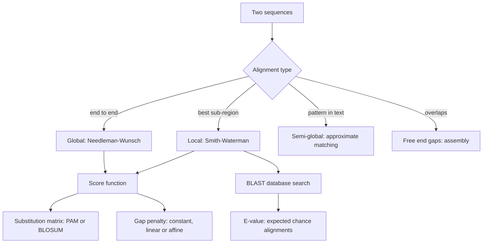

# L09 — Sequence Alignment, Homology and Database Search

## Scope

Exact search ([[L08-exact-string-matching]]) fails as soon as sequences differ, and
biological sequences always differ. This session develops **approximate** comparison: why
alignment is needed, the four alignment types, the evolutionary vocabulary of
**homology**, the two dynamic-programming algorithms [[needleman-wunsch]] (global) and
[[smith-waterman]] (local), the scoring machinery of
[[substitution-matrix|substitution matrices]] and gap penalties, and finally
[[blast]] with its E-value. It deepens the overview already given in
[[L05-sequence-comparison-and-networks]].

## Key points

- **Where [[sequence-alignment|alignment]] is used**: finding sequence features such as
  binding sites; mapping
  NGS reads to a reference genome ([[next-generation-sequencing]]); building the overlap
  graph for de novo assembly ([[greedy-assembly]]); searching sequence databases.
- **Alignment types**
  - **global** — align two complete strings end to end ([[needleman-wunsch]]);
  - **local** — find local similarities ([[smith-waterman]]);
  - **semi-global** — approximate pattern matching, one sequence embedded in the other;
  - **free end gaps** — finding overlaps, as needed by assembly.
- **Homology vocabulary** (see [[homology]]): two proteins are **homologous** when they
  share a common ancestor; **orthologs** arise by speciation, **paralogs** by gene
  duplication; **identity** is invariance, **conservation** is a change that preserves
  physico-chemical properties, **similarity** = identity + conservation.
- **Pairwise alignment** is defined as lining up two sequences to achieve maximal
  identity, in order to assess the degree of similarity and the possibility of homology.
  Formally — **In**: a pair of sequences plus a cost/score function. **Out**: a
  correspondence between substrings that maximises the similarity score.
- **Protein versus DNA**: protein sequences can be more informative, because amino acids
  share biophysical properties and because changes at the third codon position are often
  synonymous ([[central-dogma]], [[genetic-code]]); DNA can be more informative for
  non-coding regions.
- **Sequence variation** that alignment must model: substitution `ACGA → AGGA`, deletion
  `ACA → AC`, insertion `AC → AGC` — the last two producing **gaps**
  (see [[dna-mutation]]).
- **Dynamic programming**: break the problem into smaller subproblems, solve each
  optimally and combine them into the global optimum. Only applicable when the
  overlapping-subproblems property holds (Bellman's principle)
  — see [[dynamic-programming]], [[algorithmic-complexity]] and
  [[L07-algorithms-and-complexity]].
- **Scoring**: an `N × N` **substitution matrix** scores replacing one residue by
  another, combined with a **gap-penalty scheme** — constant, linear or affine
  (`g = o + (λ−1)·e`). DNA matrices are chemical (transition versus transversion),
  protein matrices evolutionary: **PAM** derived from global and **BLOSUM** from local
  alignments. The full matrices, the worked penalty schemes and the choice guidance are
  tabulated in [[substitution-matrix]].
- **BLAST** — *Basic Local Alignment Search Tool*, finds regions of local similarity
  between biological sequences and attaches a significance score. The **E-value** is the
  number of different alignments with a score equal to or higher than `S` that one can
  expect to occur **by chance** in a database search; the lower, the more significant.
  The `G` parameter controls gapping, and the program family (`blastn`, `blastp`,
  `blastx`, `tblastn`, `tblastx`) with its query/database combinations is tabulated in
  [[blast]].

## Diagram

The alignment decision tree, the scoring machinery it depends on, and the database search built on top of it.

## Open questions

- See [[open-questions]] — the derivation of the E-value statistics and the construction
  of the PAM/BLOSUM matrices themselves are still not given in the notes.

## See also

- [[E07-alignment-and-homology]] — the exercise sheet that labels orthologs and paralogs
  on a globin gene tree and runs a Needleman–Wunsch alignment by hand.

## Sources

- `raw/module1/gsb_part2.pdf`, pp. 11–18.
