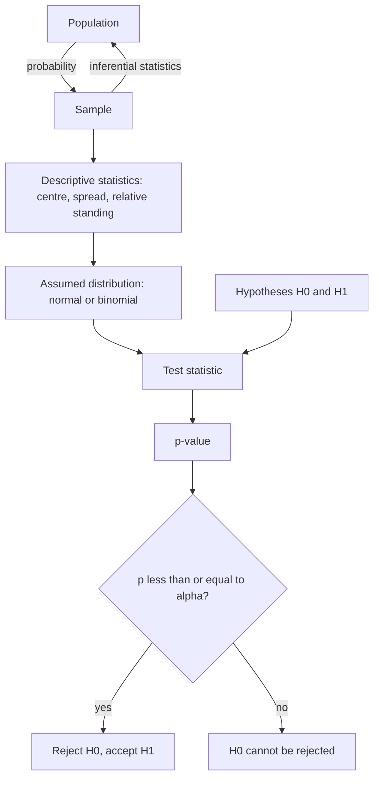

# L10 — Biostatistics and Statistical Testing

## Scope

Omics experiments produce numbers, and numbers need statistics. This session covers the
statistical half of part 2: how biological data are typed, how a sample is described
([[descriptive-statistics]]), which [[probability-distribution|distributions]] the data
are assumed to follow, and how a biological claim is turned into a testable hypothesis
and decided with a p-value ([[statistical-testing]]). It supplies the machinery that the
expression-profiling pipeline of [[L06-expression-profiling]] only named.

## Key points

**Data types**

- **Quantitative**: *discrete* (counts — e.g. the read counts of an [[rna-seq]] data
  matrix) or *continuous* (gene expression values, metabolite concentrations).
- **Categorical / qualitative**: *binary* (0/1 metadata), *nominal* (order unimportant,
  e.g. single/married), *ordinal* (order important, e.g. low < medium < high, or
  healthy/disease). Correlation with a clinical outcome is approached by regression.
- **Data** are the observed values of a **variable**; a variable is a characteristic of a
  population (e.g. one gene); the **values of the variable** are its range of possible
  values. The **dimension** of the data is the number of variables:
  **univariate** (one per subject), **bivariate** (two), **multivariate** (many).

**Population and sample**

- From population to sample is a matter of **probability**; a sample is summarised by
  **descriptive statistics**; the step back from sample to population is
  **inferential statistics**.
- Different samples can lead to different results — this is the whole reason statistical
  testing exists.

**Describing data** (see [[descriptive-statistics]])

- **Central tendency** (centre / location): mean, median, mode.
- **Variability** (spread): variance, standard deviation; `SEM = σ/√n` describes the
  precision of the mean.
- **Relative standing** (position within the spread): quantiles, range, IQR.
- **Covariance** measures how two variables change together.
- The **[[z-score]]** says how many standard deviations a value lies away from the mean.

**Distributions** (see [[probability-distribution]])

- **Normal (Gaussian)**: symmetric, centred on `μ`, characteristic width `σ`. Most sets
  of biological and physical measurements approximate it, because a large set of small
  independent measurements is approximately normal — the **central limit theorem**.
- **Binomial**: a fixed number `n` of repeated, identical, independent trials with
  success probability `p`; `P(X) = C(n, X) · pˣ · (1−p)ⁿ⁻ˣ`, `E(X) = n·p`,
  `Var(X) = n·p·(1−p)`.
- Shapes: unimodal versus bimodal.
- A **[[qq-plot|QQ-plot]]** checks whether two datasets come from populations with a
  common distribution.

**Statistical testing** (see [[statistical-testing]])

- A **hypothesis** is a statement that can be tested; a **test** is an experiment
  returning true/false; a **statistical hypothesis** is one for which a probability of
  being true or false can be given.
- **Alternative hypothesis** `H₁` (or `H_A`) versus **null hypothesis** `H₀`; the two are
  mutually exclusive. Example: `H₁`: mice treated with drug X live longer,
  `E(T_X) > E(T_untreated)`; `H₀`: `E(T_X) ≤ E(T_untreated)`.
- **Principle**: I) find a *test statistic*, a function modelling the distribution;
  II) compare the observed sample values with that distribution. A large deviation means
  `H₀` is rejected and `H₁` accepted; a small deviation means `H₀` **cannot be rejected**
  and `H₁` cannot be accepted.
- **Type I error** — `H₁` falsely accepted, a **false positive**. **Type II error** —
  `H₁` falsely rejected, a **false negative**. Reducing one increases the other.
- The **p-value** is the probability of a type I error, and the **significance level α**
  is the cut-off against which it is compared: `p ≤ α` → reject `H₀`; usually
  `α = 0.05`, equivalently a confidence level of `1 − α`.
- The confusion matrix, the `sensitivity` / `specificity` / `accuracy` formulas, the α
  trade-off and the one- versus two-sided rejection regions are worked out in full on
  [[statistical-testing]]; this page does not repeat them.

## Diagram

The route from a population to a test decision, and the two errors that lurk at the end of it.

## Open questions

- See [[open-questions]] — no concrete test (t-test, Wilcoxon, …) is named in the notes.
- ~~No multiple-testing correction is named, although the
  [[microarray-expression-analysis]] pipeline depends on it.~~ **Resolved by part 3**:
  Bonferroni and Benjamini–Hochberg are given in [[multiple-testing-correction]] and
  [[L15-gwas-eqtl-and-multiple-testing]]; Fisher's exact test, the Cochran–Armitage trend
  test and logistic regression are named in [[genome-wide-association-study]].

Part 3 continues this thread with [[L11-normalization-pca-and-batch-effects]]:
[[data-normalization]] makes the data fit the distributional assumptions used here.

## See also

- [[fishers-exact-test]] — **module 2's** first fully specified test: the abstract
  p-value defined here computed exactly on a 2×2 contingency table.
- [[gene-set-enrichment-analysis]] — the same decision taken by permutation when no
  closed-form null distribution is available.

## Sources

- `raw/module1/gsb_part2.pdf`, pp. 19–29.
- `raw/module1/gsb_3.pdf`, pp. 1–2 — the z-score as normalization, and items 3 and 4 of
  the same exercise sheet.
