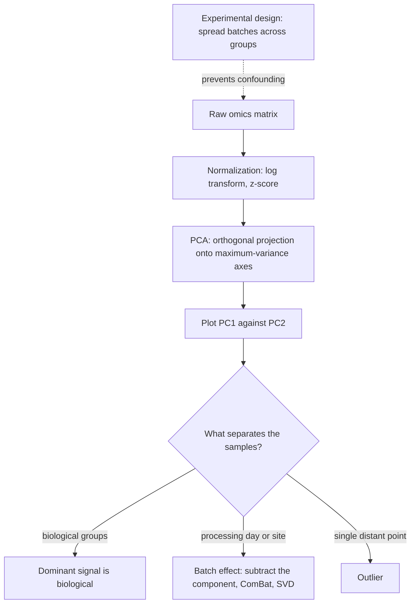

# L11 — Normalization, PCA and Batch Effects

## Scope

Part 3 of the notes opens where [[L10-biostatistics-and-statistical-testing]] stopped: a
test is only as good as the data fed into it. This session covers the three preparatory
steps of any omics analysis — making the data fit the model
([[data-normalization]]), compressing it so it can be looked at
([[principal-component-analysis]]), and recognising the systematic bias that neither of
the two can fix ([[batch-effect]]).

## Key points

**Data normalization** — see [[data-normalization]]

- Statistical models usually expect **normally distributed** data (see
  [[probability-distribution]]).
- A **skewed** distribution (e.g. exponential) has many extreme values far from the mean;
  useful statistical tests are hard to run on it.
- **Log transform** turns a right-skewed variable into an approximately normal one.
- **Outliers** must be identified separately.
- **[[z-score]] / standard score** — the number of standard deviations by which an
  observation deviates from the mean, `z = (X − μ)/σ` (see [[descriptive-statistics]]).
  Replacing values by z-scores is called **standardizing** or **normalizing**.

**Principal Component Analysis** — see [[principal-component-analysis]]

- Purpose: reduce dimensions and complexity to visualize in 2D/3D; show the most dominant
  signal; detect biologically important signal; **quality control** — spot experimental
  artifacts; identify **outliers**.
- A statistical algorithm transforming possibly correlated variables into **uncorrelated
  linear combinations**, the **principal components (PCs)**, capturing most of the
  variance; the new axes are **eigenvectors**.
- Formally an **orthogonal linear transformation** into a coordinate system where the
  greatest variance lies on the first coordinate, the second greatest on the second, and
  so on: `t_1 = a_11·x_1 + … + a_1n·x_n`, …
- The **first component is the most dominant signal**; the standard plot is PC1 against
  PC2.
- PCA is an **unsupervised** technique. Contrast with **MDS**: PCA takes scaled vectors
  in `n`-dimensional space and projects onto maximum-variance directions, whereas MDS
  takes **pairwise distances** and produces a 2D/3D projection preserving them.

**Batch effects** — see [[batch-effect]]

- Biased measurements, e.g. day-to-day variation; a big challenge in biomedical research
  leading to **misinterpretations**.
- The problem is **confounding**: batch effects that correlate with the outcome of
  interest; the bias can suppress the real signal.
- ⇒ **Normalization does not remove batch effects.**
- ⇒ **Combining different datasets introduces batch effects.**
- Avoidance is a matter of **experimental design**: distribute batches and other sources
  of experimental variation across the biological groups to minimize confounding; record
  changed personnel; keep healthy and unhealthy samples equally distributed over
  processing times.
- Statistical approaches: **PCA** (subtract the component representing the batch effect),
  **SVD**, **ComBat**, **standardization**.

## Diagram

The preprocessing chain, and the three different things a PCA plot can reveal.

## Open questions

- See [[open-questions]] — the notes name SVD, ComBat and standardization as batch
  correction methods without describing how any of them works.

## See also

- [[L06-expression-profiling]] — the expression pipeline whose pre-processing stage these
  three steps fill in.
- [[microarray-expression-analysis]] — array intensities are one of the two data types
  that have to be normalized before any comparison is meaningful.
- [[rna-seq]] — the count matrix is the other such data type.
- [[E09-binding-sites-pwm-and-pca]] — the exercise sheet that asks for the definition of
  PCA and the PCA-versus-MDS distinction made here.
- [[t-sne]] — the **module-2** non-linear successor of the PCA introduced here; it
  preserves local neighbourhoods rather than global variance.
- [[umap]] — the other module-2 embedding; in the single-cell pipeline PCA runs first
  and UMAP embeds its leading components.

## Sources

- `raw/module1/gsb_3.pdf`, pp. 1, 3–4, 12.
