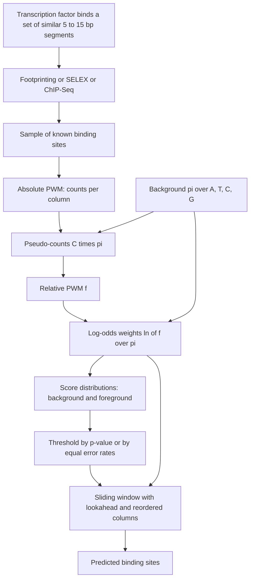

# L12 — Binding Sites and Position Weight Matrices

## Scope

How does a protein find its place on the genome, and how does an algorithm find it
afterwards? This session defines the
[[transcription-factor-binding-site|transcription factor binding site]], explains why its
**degeneracy** makes exact [[string-matching]] useless, and develops the
[[position-weight-matrix]] as the probabilistic answer: construction with pseudo-counts,
log-odds scoring, threshold selection via the background score distribution, and the
lookahead trick that makes a genome-wide scan affordable.

## Key points

**Why DNA sequence recognition matters** — see
[[transcription-factor-binding-site]]

All biological functions of DNA are realized by the interaction of proteins with specific
DNA sequences:

1. **Gene expression** by RNA polymerase and the associated transcription factors
   ([[gene-regulation]]).
2. **Genome re-arrangements** by site-specific recombination and transposition.
3. **Restriction and modification** of DNA by sequence-specific endonucleases.

**TFBS properties**

- A DNA sequence segment a transcription factor binds to, via Van der Waals forces
  (Van-der-Waals-Kräfte).
- A TF binds a **set of similar segments**, not one word.
- Short: **5–15 bp**.
- **Sequence degeneracy causes different levels of regulation.**
- Prediction: experimentally by **traditional footprinting** or **high-throughput
  SELEX**; in silico by **degenerate consensus sequences** or a **PWM/PSSM**.

**Building a PWM** — see [[position-weight-matrix]]

- Columns `j ∈ [0, M−1]`, `M` = motif length.
- **Background model** `π_i ∈ [0,1]` for `i ∈ {A,T,C,G}` with `Σ π_i = 1`.
- **Absolute PWM** `f*_ij ∈ ℕ` — counts from a sample of known binding sites.
- **Relative PWM** `f′_ij = f*_ij / Σ_a f*_aj`.
- **Pseudo-counts** suppress zeros: `f^P_ij = f*_ij + C·π_i`, then
  `f_ij = f^P_ij / Σ_a f^P_aj`.

**Scoring**

- Log-odds over a window:
  `S_{start,end} = Σ_{j=start}^{end} ln( f_{nuc(j),j} / π_{nuc(j)} )`.
- Compute `S_{0,M−1}` at every sliding-window position; report every match with
  `S > threshold`.

**Choosing the threshold**

- `λ_B(X)` — score distribution on random background sequences; `λ_T(X)` — score
  distribution on sequences drawn from the PWM model.
- `P_Z(X ≥ s) = Σ_{i=s}^{max} P_Z(X = i)`.
- **p-value rule**: `p = P_B(X ≥ s)`; set `th = s` such that `P_B(X ≥ s) = p`.
- **Balanced-error rule**: choose `s` with `P_B(X ≥ s) = P_T(X ≤ s)`, equalising false
  positives and false negatives.
- `p ≤ 0.05` → reject `H₀`, accept `H₁` ([[statistical-testing]]); the typical cutoff is
  about `0.05`.

**Speeding up a genome-wide scan**

- The naive moving window is **`O(M·N)`**.
- **Lookahead algorithm**: with the prefix score `S_d`, the maximum possible remaining
  score `σ_d` and the intermediate threshold `th_d = th − σ_d`, the equivalence
  `S_d ≥ th_d ⟺ S_{0,M−1} ≥ th` lets a hopeless window be abandoned early.
- **Even faster**: each column has a highest score `M_j = S_max(j)` and a background
  expectation `E_j = Σ_a S_{a,j}·π_a`; order the columns by `M_j − E_j` and evaluate the
  most discriminative — "most dangerous" — columns first.
- Indexing the genome with a [[suffix-tree]] removes redundant rescanning altogether
  (see [[L13-suffix-trees-and-arrays]]).

## Diagram

From a degenerate biological signal to a thresholded, statistically justified genome scan.

## Open questions

- See [[open-questions]] — the notes do not say how the background score distribution
  `λ_B(X)` is actually computed, and the exercise sequences on p. 11 are only partly
  legible.

## See also

- [[chip-seq]] — the high-throughput assay that delivers the sets of bound regions from
  which a PWM can be built, and which appears in this lecture's diagram alongside
  footprinting and SELEX.
- [[promoter]] — the regulatory element bound by RNA polymerase and by the transcription
  factors whose degenerate sites are modelled here.
- [[M2L02-sequence-motifs-and-motif-discovery]] — **continued in module 2**: this
  lecture assumes the matrix is known and scans with it; module 2 asks where the matrix
  comes from and derives the model de novo.
- [[sequence-motif]] — the general concept behind the binding sites modelled here.
- [[sequence-logo]] — the **module-2** picture of exactly the matrix built in this
  lecture; the column heights show how constrained each position is.
- [[information-content]] — the entropy measure that turns this lecture's column
  frequencies into those heights.
- [[em-motif-discovery]] — module 2's answer to the question this lecture leaves open:
  how to obtain the matrix when the sites are not yet known.

## Sources

- `raw/module1/gsb_3.pdf`, pp. 5–9, 14.
- `raw/module2/csb_1.pdf`, pp. 14–16 — the module-2 continuation: motif representations,
  sequence logos and the information-content view.
