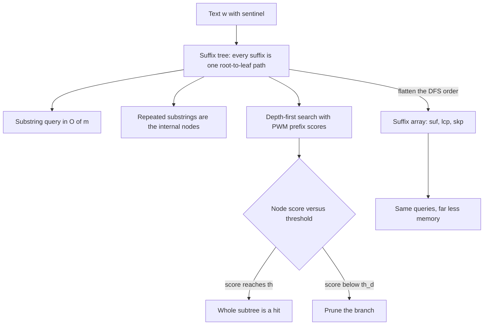

# L13 — Suffix Trees and Suffix Arrays

## Scope

[[L08-exact-string-matching]] preprocessed the **pattern**; this session preprocesses the
**text**. The [[suffix-tree]] stores every suffix of a sequence as a root-to-leaf path and
turns substring queries into a walk of length `|P|`; the [[suffix-array]] flattens the
same information into three integer arrays. The payoff for this module is the
[[position-weight-matrix]] scan of [[L12-binding-sites-and-position-weight-matrices]],
which becomes a pruned depth-first search instead of a sliding window.

## Key points

**Suffix tree** — see [[suffix-tree]]

1. A data structure representing all suffixes of a string.
2. Every suffix is **exactly one path**.
3. It makes string operations efficient — e.g. checking whether a pattern of length `m`
   is a substring costs `O(m)` ([[string-matching]], [[algorithmic-complexity]]).

Features for `w[0..m−1]`:

- `m` leaves numbered `0 … m−1`;
- at least **two children** per internal node;
- each **edge label is a substring** of `w`;
- **no two edges out of a node start with the same character**.

**Growing a suffix tree — `O(n²)`**

1. Start with the whole string as one root-to-leaf edge.
2. Generate the suffixes `w[1..n−1]$`, `w[2..n−1]$`, … and push each into the tree:
   a. if matching cannot continue from a node, create a new node;
   b. if a mismatch occurs in the middle of an edge `e = (u, v)`, **split** the edge.

Worked on the sheet with `xabxac$`.

**PWM/PSSM scoring using a suffix tree**

1. Allocate memory.
2. Construct the suffix tree from the target sequence.
3. DFS → calculate the prefix scores `p(x ≤ d)` along the edge labels.
4. Analyse the scores; one of two conditions can hold at a node:
   a. if a score at a node reaches `th`, **all** substrings represented by that subtree
      reach `th`;
   b. if a score falls below `th_d`, the whole subtree branch can be **ignored**.

**From suffix tree to suffix array** — see [[suffix-array]]

- **`suf`** — the array of first-character indices of each suffix, sorted
  lexicographically (`a < c`; with the sentinel ranked last, the longer suffix comes
  before the shorter one at equal prefix).
- **`lcp`** — `lcp[0] = 0`, `lcp[i] = |LCP(S_suf[i−1], S_suf[i])|`: the length of the
  longest common prefix of two adjacent suffixes.
- **`skp`** — the skip array: `skp[i]` is the next index `j` with `lcp[j] < lcp[i]`.

## Diagram

One index, two representations: a tree for intuition, three arrays for memory.

## Open questions

- See [[open-questions]] — the notes give only the quadratic construction; the
  linear-time algorithms (Ukkonen, DC3) are not covered, and the role of the `skp` array
  in an actual search is only sketched.

## Sources

- `raw/module1/gsb_3.pdf`, pp. 13–15.
