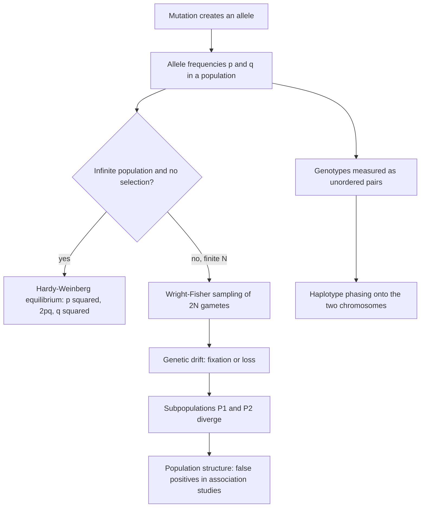

# L14 — Population Genetics

## Scope

The module turns from single sequences to **populations**: what allele frequencies do
over generations, what they do when nothing acts on them, and what they do when only
chance acts on them. The session introduces [[population-genetics]] vocabulary, the
[[wright-fisher-model]] and the [[genetic-drift]] it produces, the confounder of
population structure, [[haplotype-phasing]], and the
[[hardy-weinberg-equilibrium]] that serves as the null model for
[[L15-gwas-eqtl-and-multiple-testing]].

## Key points

**Definitions** — see [[population-genetics]]

- Population genetics studies the distributions of and changes in **allele frequency** in
  a population; frequencies are subject to four evolutionary processes: **natural
  selection, genetic drift, [[dna-mutation|mutation]], gene flow**.
- **Allele** (Allel) — different variants of a gene at a particular position on a
  chromosome.
- **Allele frequency** (Allelfrequenz) — relative frequency of a particular allele in a
  population.
- **Locus** — a fixed position on the chromosome (fester Ort auf dem Chromosom);
  **linkage** between two loci means they are associated with each other.
- **Genotypes**: **heterozygous** (`aA`) versus **homozygous** (`AA`).
- **[[snp|SNP]]** — single-nucleotide polymorphism.

**The human genome in numbers** — see [[genome-organization]]

- 3 billion bases; 20,000–25,000 genes.
- 2 % encodes genes; the other 98 % is **not junk** — functionality has been discovered.
- Chromosome set: pairs 1–22 plus XY (male) or XX (female); **diploid**.
- Inheritance as treated here concerns the **autosomes 1–22** only.

**Wright–Fisher model** — see [[wright-fisher-model]]

- `N` individuals (generation `t`) → an infinite number of gametes → a random sample of
  `2N` gametes → `N` individuals (generation `t+1`).
- Assumptions: constant size `N < ∞`, random mating, non-overlapping generations, no
  migration, no mutation, no selection.
- `p = n_A/2N`, `q = n_a/2N = 1 − p`, and
  `P{n_A′ = k} = B_{2N,p}(k) = C(2N,k)·p^k·(1−p)^{2N−k}`.
- ⇒ the change of allele frequency between generations in a finite population due to
  random sampling alone is **[[genetic-drift]]**.
- `0 < p < 1` segregating; `p = 1` allele `A` **fixed**; `p = 0` allele `A` **lost**.

**Speed of drift**

- Binomial `B_{n,p}` (see [[probability-distribution]]): mean `np`, variance `np(1−p)`,
  sd `√(np(1−p))`, hence `p′ = p ± √(p(1−p))/√(2N)`.
- The variance of allele frequencies grows over generations; isolated populations
  **drift apart**. For `N → ∞` the effect becomes smaller.

**Population structure**

- Cases and controls may be drawn from different subpopulations `P1`/`P2`.
- Goal: avoid **false-positive hits** — match the background of cases and controls as
  well as possible, remove SNP positions known for ethnic differences, and correct for
  population structure (in practice with [[principal-component-analysis]]).

**Phasing** — see [[haplotype-phasing]]

- A genotype such as `G/T`, `A/C` admits several possible phasings onto the two
  chromosomes.
- Task: reconstruct a pair of chromosomes given **genotype data** for a large number of
  individuals, or given **sequencing data** ([[next-generation-sequencing]]).

**Hardy–Weinberg principle** — see [[hardy-weinberg-equilibrium]]

- Describes the distribution of the genotypes `AA`, `Aa`, `aa`.
- Assumptions: diploid organisms with sexual reproduction; allele frequencies identical
  for male and female; two alleles at the locus; non-overlapping generations; random
  mating; large (→ ∞) population; no migration, mutation or selection.
- The **Punnett square** of male gametes (`A`: p, `a`: q) against female gametes gives,
  after one change of generations (Generationswechsel): `AA`: `P′ = p²`, `Aa`:
  `Q′ = 2pq`, `aa`: `R′ = q²`.
- Back-conversion: `P(A) = P(AA) + ½P(Aa)`, `P(a) = P(aa) + ½P(aA)`.

## Diagram

The ideal null model, the finite-population reality, and the two problems that reality creates.

## Open questions

- See [[open-questions]] — natural selection and gene flow are named as forces but never
  modelled; linkage disequilibrium is never quantified.

## Sources

- `raw/module1/gsb_3.pdf`, pp. 20–24.
