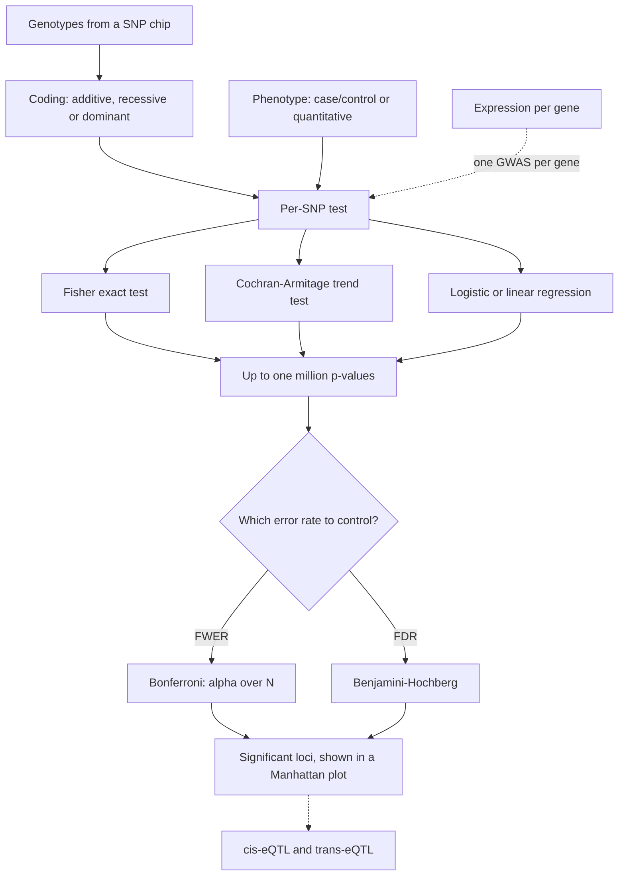

# L15 — GWAS, eQTL and Multiple Testing

## Scope

The payoff session of part 3: the population-genetics machinery of
[[L14-population-genetics]] is turned into a study design. A
[[genome-wide-association-study]] tests a million SNPs against a phenotype; an
[[expression-qtl|eQTL]] analysis does the same for the expression of every gene; and
because both run so many tests at once, [[multiple-testing-correction]] decides what may
be called a result at all.

## Key points

**Human genetic variation**

- Example claim: *variant A increases the risk for a certain disease*.
- **1000 Genomes Project** → goal: identify genetic causes of disease.

**GWAS** — see [[genome-wide-association-study]]

- **Detect disease risk** ⇒ better monitoring of risk patients.
- *Untersuchung der genetischen Variation des Genoms eines Organismus.*
- **Personalized treatment** against a disease.
- **Data**: ideally the full genome; in practice [[snp|SNP]] chips with
  ~600,000–~2,500,000 sites.
- **SNP coding**: `0` homozygous major allele (`G/G`), `1` heterozygous (`A/G` or `G/A`),
  `2` homozygous minor allele (`A/A`) — the **additive** model. **Recessive** codes
  `0, 0, 2`; **dominant** codes `0, 2, 2`.
- **Linkage**: SNPs in proximity are very often correlated. Cause: not enough time for
  evolution, and possible lethal effects. ⇒ only **one SNP per region of strong linkage**
  is needed.
- **Single-SNP analysis**: a genotype × phenotype contingency table, e.g. cases
  `23 / 41 / 351` versus controls `104 / 208 / 103`, tested with **Fisher's exact test**
  (which tests a 2×2 table for bias).
- **Linear models**: one allele is considered the **risk allele** and risks are assumed
  **additive** — the heterozygous genotype lies halfway between the two homozygous
  genotypes. Models that test for **zero slope** of a line fitted to the three genotypic
  risk estimates: the **Cochran–Armitage test**. Caveat: such a test **will not detect a
  higher disease risk of heterozygotes**.
- **Logistic regression** is used for GWAS with a binary outcome.

**Quantitative traits and eQTLs** — see [[expression-qtl]]

- QTs: height, longevity, gene expression; usually determined by an interplay of
  environment and genetics.
- **Many genetic loci** contribute to the heritability of a QT → the **Manhattan plot**,
  each dot a SNP, ordered along the chromosomes.
- **QTLs** are the loci that control quantitative traits.
- **eQTL**: an independent GWAS for the expression of each gene.
  **cis-eQTL** — the eQTL maps near the physical position of the gene; **trans-eQTL** —
  it does not.
- Definitions: *expression* = number of RNA molecules deriving from a position in the
  genome; *polymorphism* = at least two allelic states at a locus in a population, one of
  which can be traced back to a mutation event; the allelic states defined by that
  original mutation event define the **causal polymorphism** of the eQTL.

**Multiple hypothesis testing** — see [[multiple-testing-correction]]

- Under the null hypothesis, p-values are **uniformly distributed**; with cutoff
  `α = 0.05`, `P(FP) = α` (see [[statistical-testing]]).
- Performing many tests, a fraction `α` will have a positive result by chance ⇒ **control
  for multiple testing**.
- **FWER** — family-wise error rate: the probability of at least one false positive.
- **FDR** — false discovery rate: the fraction of false positives among the rejected null
  hypotheses, `FDR = E(V/R)`.
- **Bonferroni correction** controls the FWER: with `N` tests and level `α`, use the
  cutoff `α/N` and reject `H₀` if `p_i ≤ α/N`. **Reduced power** when many hypotheses are
  tested.
- **Benjamini–Hochberg** controls the FDR, bounded by `(M₀/M)·α ≤ α`: order the p-values
  `p₁ ≤ … ≤ p_M`, compute `L = max{ j : p_j ≤ (j/M)·α }`, and reject all `H₀j` with
  `p_j ≤ p_L`. Good trade-off between stringency and power for large numbers of tests.

## Diagram

A genome-wide scan produces p-values by the million; the correction step decides which of them survive.

## Open questions

- See [[open-questions]] — logistic regression is named for GWAS but its model equation
  is never given, and the notes do not say how linkage blocks are defined when choosing
  the one SNP per region.

## See also

- [[L10-biostatistics-and-statistical-testing]] — defines the p-value and the
  significance level `α` that this lecture now has to control a million times over.
- [[L06-expression-profiling]] — where the per-gene expression values used as the
  quantitative trait of an eQTL analysis are measured.
- [[rna-seq]] — the count-based readout of the "number of RNA molecules deriving from a
  position in the genome" that this lecture defines as expression.

## Sources

- `raw/module1/gsb_3.pdf`, pp. 25–30.
