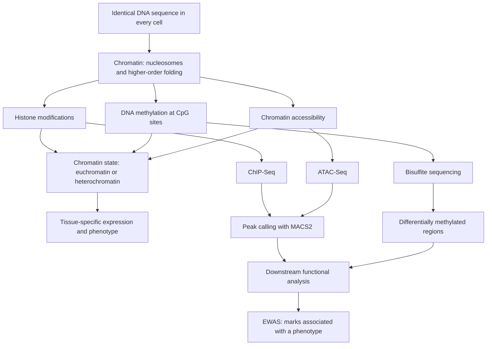

# L16 — Epigenetics

## Scope

The epigenetics block of module 1, and the point at which the course's experimental and
computational threads meet. It starts from the observation that every cell of an organism
carries the *same* DNA sequence yet behaves differently, and derives the whole field from
it: information must be stored somewhere other than in the sequence. That storage is
[[chromatin]] — DNA wrapped around histone octamers — and the two chemical mark types it
carries, [[histone-modification]] and [[dna-methylation]]. The lecture then turns to how
these marks are measured and analysed: [[chip-seq]] followed by [[peak-calling]] with
MACS2 for histone marks and binding sites, [[bisulfite-sequencing]] followed by DMR
detection for methylation, and finally the population-scale design, the
[[epigenome-wide-association-study]].

## Key points

**What epigenetics is**

- *How environmental influences on developmental events can affect the phenotype.*
- **Alteration of gene function without changes in the DNA sequence itself**, which may
  lead to functional changes — by chemical modification of the DNA or of the histones
  instead. See [[epigenetics]].
- **Mitotic stability** — the marks are stable and transmitted to the daughter cells.
  **Meiotic stability** — marks pass to the next generation, but there is
  **reprogramming in the gametes**.
- The DNA sequence is the same in every tissue; the expression is tissue-specific.

**Packing** — [[chromatin]]

- Nucleosome = **146 bp of DNA wrapped around a core histone complex** (p. 2 gives
  160 bp including linker), the basic unit of chromatin, followed by higher-order folding.
- **Euchromatin** (less densely packed, less electron dense, euchromatic marks) versus
  **heterochromatin** (densely packed, electron dense, Feulgen-stained, heterochromatic
  marks).
- **Interphase** nucleus: chromosome territories, hard to tell apart.
  **Prometaphase**: highly condensed, easily distinguishable chromosomes.

**Marks on the histones** — [[histone-modification]]

- Established and removed while histones sit in nucleosomes, or by **histone exchange**;
  controlled by specific enzymes in forward and reverse: **methylation, acetylation,
  phosphorylation**.
- Altered **acetylation** opens or closes chromatin for transcription.
- **Readers** recruit proteins; repressors and activators recognize the marks.
- Three nucleosome-exchange mechanisms: general chaperones assemble new nucleosomes;
  specific chaperones swap modified dimers/tetramers for unmodified histones or
  **histone variants**; **nucleosome remodeling** slides nucleosomes to expose or hide a
  sequence.
- **Open problem stated in the notes**: how are the marks inherited when a *new,
  unmodified* nucleosome is formed?
- Analysis: Western blot and indirect immunofluorescence at cell level; **[[chip-seq]]**
  for qualitative and quantitative analysis at specific regions.

**From reads to regions** — [[peak-calling]]

- Peak calling identifies **enriched (signal) regions** in ChIP-Seq; the standard tool is
  **MACS2**.
- Four steps: estimate fragment length `d` and adjust read positions; estimate the
  **dynamic local background** `λ_local = max(λ_BG, λ_1k, λ_5k, λ_10k)`; call regions
  with `p < PVALUE` and place the summit at maximum read density; estimate the **FDR**
  (see [[statistical-testing]]).
- Quality measures: **FRiP**, **PBC**, relative strand cross-correlation, **NSC**
  (`> 1.1` = enrichment) and **IDR** for replicate consistency and artifact detection.

**Marks on the DNA** — [[dna-methylation]] and [[cpg-island]]

- DNMT transfers a methyl group from **SAM** (which becomes **SAH**) onto cytosine;
  base pairing is unaffected; the mark is sequence-context specific, symmetrical on both
  strands, and almost exclusively confined to the **CpG** context.
- Roles: genome stability, developmental control, tissue-specific expression,
  **imprinting** (mono-allelic expression by parental origin) and **X-chromosome
  inactivation** (calico cats).
- Cancer: **hypermethylation of tumour-suppressor genes**, **hypomethylation of oncogene
  promoters**; therapy with **epigenetic modifier inhibitors**.
- CpG islands sit at [[promoter|promoters]]; CpG-poor regions (except enhancers) are
  typically methylated; CpG-poor promoters are silenced with closed chromatin; gene-body
  methylation correlates with *high* expression.

**Measuring methylation** — [[bisulfite-sequencing]]

- Unmethylated C → U, methylated C stays C; PCR turns U → T, so the two are
  discriminated in the read.
- Downstream: global methylation status of every individual C, and identification of
  **differentially methylated regions (DMRs)** — *find the maximal DMR with at most `k`
  exceptions*, with `ex ≤ 2`, `p ≤ 0.05` and window size `S`.

**Interpretation at scale** — [[epigenome-wide-association-study]]

- Primary analysis yields peak locations and CpG islands; functional analysis compares
  different groups, or different regions of the same dataset, against public reference
  epigenomes such as **IHEC**.
- **EWAS**: an examination of a genome-wide set of quantifiable epigenetic marks, such as
  DNA methylation, in different individuals, to derive associations between epigenetic
  variation and a particular identifiable phenotype.

**A third readout the notes only name** — [[atac-seq]]

- **ATAC-Seq** appears on p. 9 solely as one of the data types MACS2 can call peaks on.
  It measures **chromatin accessibility** rather than a mark, and so completes the triple
  *who binds* ([[chip-seq]]) / *what is reachable* ([[atac-seq]]) / *what is methylated*
  ([[bisulfite-sequencing]]). The assay itself is described on its own page as content
  added beyond the lecture notes.

## Diagram

The logic of the lecture: one sequence, two mark types plus accessibility, three assays, one association study.

## Open questions

- The nucleosome DNA length is given as **146 bp** on p. 1 and **160 bp** on p. 2 — both
  readings are kept, and reconciled as *core-wrapped* versus *core + linker* in
  [[chromatin]]. See [[open-questions]].
- The notes state both that CpG islands sit at promoters and that they are "constantly
  methylated"; the tension is reconciled in [[cpg-island]] and cross-referenced from
  [[dna-methylation]].
- How histone marks are inherited across replication is raised in the notes and left
  unanswered.
- No concrete statistical test is named for the per-site DMR comparison; the standard
  candidates are now given, marked as added beyond the notes, in
  [[bisulfite-sequencing]].
- The **imprinting mechanism** is described only by its effect in the notes; the
  erasure/establishment/reading cycle is supplied, marked, in [[dna-methylation]].

## See also
- [[M2L09-non-coding-rnas]] — the module-2 lecture that answers the same question —
  identical DNA, different cell types — with a regulatory layer written in RNA.
- [[L05-sequence-comparison-and-networks]] — introduces ChIP-Seq as the experimental
  route to protein–DNA binding; this lecture continues that thread.
- [[E12-epigenetics-and-peak-calling]] — the terminology sheet that tests this lecture's
  vocabulary, the histone-mark nomenclature and the MACS2 facts.
- [[gene-regulation]] — the sequence-encoded control layer that these marks modulate
  without changing the sequence itself.
- [[genome-organization]] — the DNA-packing hierarchy whose chromatin level carries the
  marks described here.
- [[transcription-factor-binding-site]] — the other class of ChIP-Seq target besides
  histone marks, called with the same [[peak-calling]] step.
- [[next-generation-sequencing]] — the sequencing step shared by ChIP-Seq, ATAC-Seq and
  bisulfite sequencing.
- [[probability-distribution]] — the background read-count model that MACS2's local `λ`
  turns into a p-value.
- [[batch-effect]] — the systematic bias to guard against when an EWAS dataset is
  compared with public reference epigenomes such as IHEC.

## Sources

- `raw/module1/gsb_part4.pdf`, pp. 1–9.
