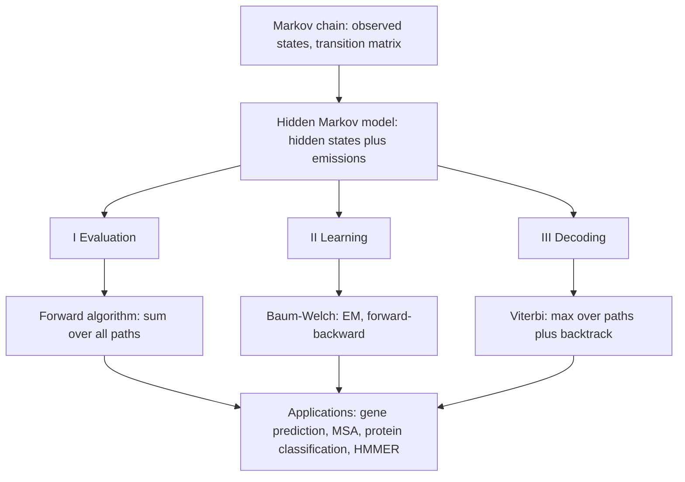

# L17 — Markov chains and hidden Markov models

## Scope

The final block of module 1 and its probabilistic climax. Having modelled motifs with a
[[position-weight-matrix]] — which treats every position independently — the course now
introduces models with **memory**: the [[markov-chain]], a stochastic process whose next
state depends on a limited history, and its generalization the
[[hidden-markov-model]], in which the states are no longer observed and must be inferred
from the emitted symbols. The lecture then works through the three canonical HMM problems
and the algorithm that solves each: **evaluation** with the [[forward-algorithm]],
**learning** with the [[baum-welch-algorithm]], and **decoding** with the
[[viterbi-algorithm]]. The biological applications are gene prediction and, via profile
HMMs, protein family modelling with **HMMER**.

## Key points

**Markov chains** — [[markov-chain]]

- Idea: a **stochastic process for modeling state changes by knowing a limited history**;
  used by hidden Markov models.
- Properties: **memoryless**, **homogeneous**, **time-discrete / stationary process**,
  described by a **transition matrix**.
- Random variables `Y = (X_t)` with `X_t ∈ Q = {q₁, …, q_n}`; first-order chain
  `P(X_{t+1} = q_{j,t+1} | X_t = q_{j,t})`; transition probabilities
  `p_ij(t) = T(X_{t+1} = q_j | X_t = q_i)`; an `n`-th order chain conditions on `n`
  previous states.

**Hidden Markov models** — [[hidden-markov-model]]

- A generalization of the Markov chain with **two types of probability**: states of the
  model (**hidden state**, transition probability `T(r | q)`) and observable events
  (**observable state**, emission probability `P(x | q)`). The probability depends only
  on the previous state.
- Three assumptions: **Markov** (next state depends only on the current state),
  **stationary** (transitions independent of time) and **output independence** (the
  current observation is independent of previous observations).
- Example: determining **coding versus non-coding regions** in DNA — gene prediction.
- **Profile HMMs** for protein sequence generation: **match** states (a position in the
  protein, from an MSA), **insert** states with self-loops, and **delete** states.

**Problem I — evaluation** → [[forward-algorithm]]

- *Given a model and an output sequence, what is the probability that the model generated
  that output?* Requires a sum over **all possible paths**:
  `P(x₁…x_L, q₀…q_{N+1} | model) = T(q_{N+1}|q_N) · ∏ T(q_i|q_{i-1}) · P(x_i|q_i)`.
- The trellis recursion is **previous · transition · emission**.

**Problem II — learning** → [[baum-welch-algorithm]]

- *Given a model and a set of observed sequences, how do we set the parameters so that it
  has a high probability of generating them?*
- **EM algorithm = forward–backward algorithm**, taking the HMM topology and the data as
  input.
- **[[maximum-likelihood]]**: `P(seq's|model) = ∏_j P(s(j)|model) → max`, reported as
  `NLL-score = −log P(seq's|model)`. **MAP**:
  `P(model|seq's) = P(seq's|model)·P(model)/P(seq's)`, so maximise
  `P(seq's|model)·P(model)`.
- Four steps: initialise from prior knowledge; count transitions from `q` to `r` and
  symbols aligned to `q`; replace the estimates; repeat until convergence.

**Problem III — decoding** → [[viterbi-algorithm]]

- *Given a model and an output sequence, what is the most likely state sequence?* Gives a
  way to match an observed sequence to the states of the model.
- Dynamic programming (see [[dynamic-programming]]):
  `P_ℓ(i, x) = e_ℓ(i) · max_k ( P_k(i−1, x) · P_kℓ )`.
- **Use log** to work with sums instead of products; **backtrack the path from the last
  maximum entry to the start**.
- With intergenic / start-stop / coding states the model **predicts coding DNA regions**.

**Summary, advantages and limits**

- Forward/backward gives the probability of each state at each position (sum over all
  joint probabilities); EM refines the parameters from data; Viterbi gives the optimal
  state pathway (max joint probability).
- **Advantages**: statistics, transparency, modularity, prior knowledge.
- **Disadvantages**: state independence, local maxima, over-fitting, speed.
- **Good solutions for**: MSA ([[sequence-alignment]]), sequence clustering, protein
  classification, protein domain identification. Tool: **HMMER**.

## Diagram

From the observed-state chain to the three HMM problems and their applications.

## Open questions

- The **backward** recursion itself is never written out in the notes — only the
  forward trellis and the name "forward–backward algorithm". The backward pass given in
  [[forward-algorithm]] is the standard formulation.
- The **Baum–Welch E-step** is described in the notes as plain *counting* of transitions
  and alignments, which is Viterbi training; the expected-count form is the standard EM
  version. Flagged in [[open-questions]].
- The transition matrix of the exercise on p. 19 is left mostly blank — only two entries
  are computed. See [[E13-markov-chains-and-viterbi]].

## See also

- [[probability-distribution]] — transition and emission probabilities are distributions
  over the hidden states and the observable symbols respectively.
- [[algorithmic-complexity]] — the cost vocabulary for the trade the trellis makes,
  replacing the sum or maximum over all paths by a table
  ([[E13-markov-chains-and-viterbi]]).
- [[expectation-maximization]] — **module 2's** general statement of the scheme that
  [[baum-welch-algorithm]] applies to the HMM learning problem raised here.
- [[maximum-likelihood]] — the objective behind the learning problem, and the bridge to
  module 2, where the same criterion reappears as a tree-reconstruction method in
  [[M2L08-molecular-evolution-and-phylogeny]].

## Sources

- `raw/module1/gsb_part4.pdf`, pp. 13–18.
