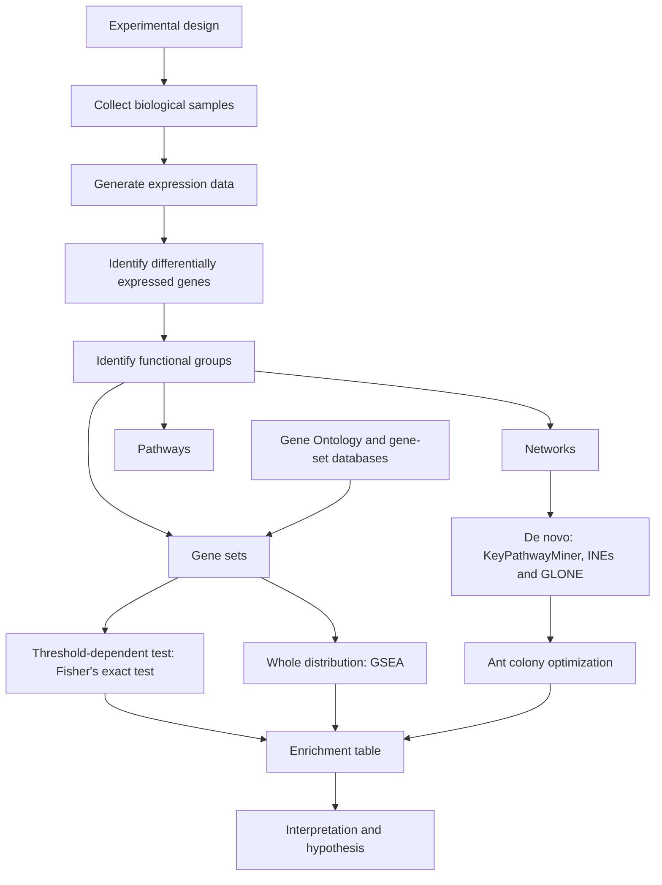
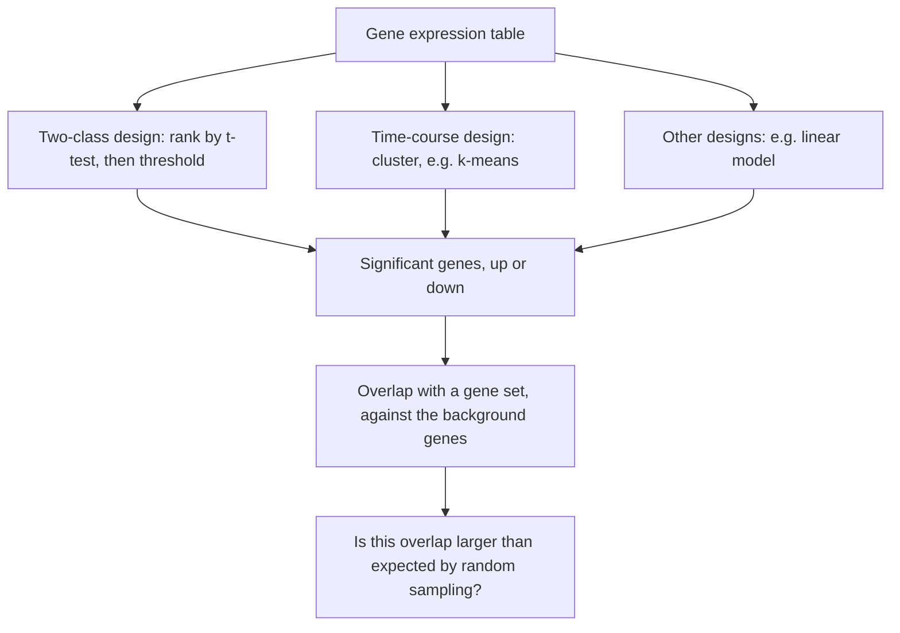

# M2L01 — Enrichment Analysis

## Scope

The opening lecture of module 2 asks a single question: once a microarray or RNA-Seq
experiment has produced a list of differentially expressed genes, **how do you turn that
list into biological meaning?** The answer is *enrichment*: relate the expression data to
pre-defined groups of genes and test whether any group is over-represented. The lecture
walks the full workflow — experimental design, differential expression, functional
grouping — then introduces the vocabulary that makes grouping possible
([[gene-ontology]]), the two families of enrichment test
(threshold-based [[fishers-exact-test]] versus whole-distribution
[[gene-set-enrichment-analysis]]), and finally abandons pre-defined sets altogether in
favour of *de novo* network enrichment with [[keypathwayminer]], solved by
[[ant-colony-optimization]].

## Key points

- **The goal** is identifying functional patterns in (gene) expression data. The
  workflow: define the experimental design → collect the biological samples → generate
  the expression data → identify the differentially expressed genes → identify the
  functional groups. See [[enrichment-analysis]].
- **Three ways to define a functional group**: [[gene-set]] (score the set from the
  expression of its member genes), **network** (visual, or identify modules satisfying a
  joint gene-expression *and* topology requirement — see [[interaction-network]]), and
  **pathway** (visual, or score the pathway exploiting expression *and* topology).
- **Gene-set enrichment analysis**, informally: break down cellular functions into gene
  sets; every set of genes is associated with a specific cellular function, process,
  component or pathway. Formally, a method to identify classes of genes over-represented
  in a large set of genes that may associate with different phenotypes, and that
  determines whether an **a priori defined** set of genes shows statistically significant
  differences between two biological states.
- **[[gene-ontology]]** supplies the a priori sets: a structured controlled vocabulary,
  a collection of terms describing gene products, their definitions and the logical
  relationships between them. It is a **DAG**, not a tree; relations `is a` and
  `part of` are **not symmetrical**; it consists of three ontologies — **cellular
  component, molecular function, biological process**.
- **The data flow**: microarray experiment → gene expression table → enrichment test
  (fed by gene-set databases carrying *a priori knowledge plus existing experimental
  data*) → enrichment table → interpretation and hypothesis. See
  [[microarray-expression-analysis]].
- **Experimental designs** determine what is ranked or selected:
  **two-class** (rank genes by a differential statistic such as a
  [[statistical-testing|t-test]], then select by threshold),
  **time-course** (cluster genes, e.g. k-means), and **others** such as a linear model.
- **[[fishers-exact-test]]** answers "is this overlap larger than expected by randomly
  sampling the array genes?" without actually performing the sampling — it is based on a
  theoretical null-hypothesis distribution, the hypergeometric 2×2 formula.
- **Threshold-dependent versus whole-distribution.** Whole-distribution methods are more
  stable and statistically powerful: there is no *natural* value for the threshold,
  different thresholds give different results, and thresholding loses information so that
  strengths can no longer be resolved. **Use whole-distribution whenever possible.**
- **[[gene-set-enrichment-analysis]]** in four steps: calculate the ES score; generate
  the ES distribution under the null hypothesis by permutation; calculate the empirical
  p-value; calculate the FDR. A **high ES score ⟺ high local enrichment**.
  The **p-value depends only on the single gene set's performance; the FDR depends on
  the performance of all gene sets** — see [[multiple-testing-correction]].
- **De novo network enrichment** with [[keypathwayminer]]: *look at the graphs, not at
  the genes any more*. The **INEs** model applies the case-exception budget `L` to each
  node individually; the **GLONE** model applies it globally as a sum over the
  subnetwork. Both seek **maximal connected subnetworks** with at most `K` gene
  exceptions.
- **[[ant-colony-optimization]]** searches that intractable space: ants placed randomly
  on the graph construct solutions by random walks, and successful ants update the
  pheromone on the edges they visited. The standard example is the
  [[travelling-salesman-problem]].

## Diagram

The lecture in one picture: from design to differentially expressed genes to functional groups, and the three routes from a group to an enrichment result.

The three experimental designs all converge on the same question about an overlap.

## Open questions

- **k-means** is named as the clustering method for time-course designs but never
  described.
- **Pearson correlation** and **linear models** are named as alternative ranking
  statistics but not developed.
- The **ant transition probability** `P(ant s at u moves to v)` and the pheromone-update
  rule are referred to but the formulae are not written out.
- The **magnitude** of the positive and negative ES contributions is not given, only
  their signs.

All recorded in [[open-questions]].

## Relations
- [[M2E01-enrichment-analysis-and-keypathwayminer]] — the exercise sheet for this
  lecture.
- [[algorithmic-complexity]] — why the network models need a metaheuristic rather than
  exhaustive enumeration.
- [[hamiltonian-and-eulerian-paths]] — the graph vocabulary behind the travelling
  salesman example used to introduce ant colony optimisation.
- [[rna-seq]] — one of the assays that produces the expression matrix this workflow
  starts from.
- [[M2L05-network-based-disease-modules]] — reuses [[keypathwayminer]]'s network constraint and [[ant-colony-optimization]]'s colony in [[grandforest]] and [[bicon]].

## See also

- [[statistical-testing]] — the **module-1** page defining `H0`/`H1`, the p-value and the
  significance level that the enrichment test of this lecture applies.
- [[multiple-testing-correction]] — the module-1 FWER/FDR machinery the FDR step of the
  enrichment workflow depends on.
- [[microarray-expression-analysis]] — the module-1 assay that produces the expression
  matrix this workflow starts from.

## Sources

- `raw/module2/csb_1.pdf`, pp. 1–9.
