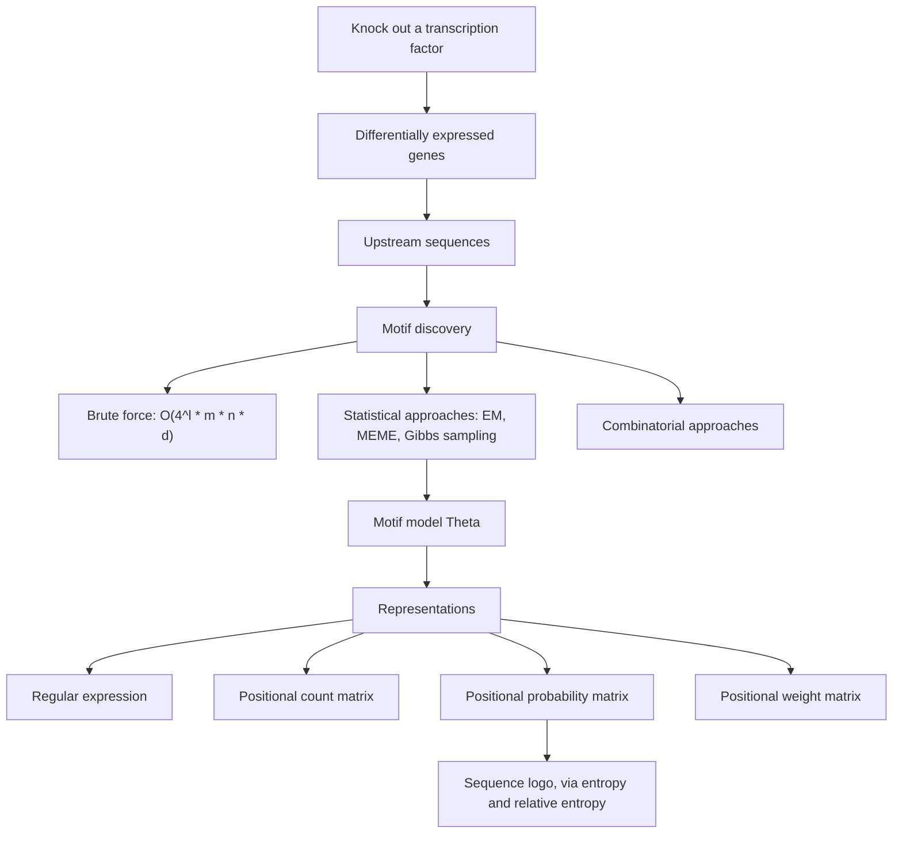
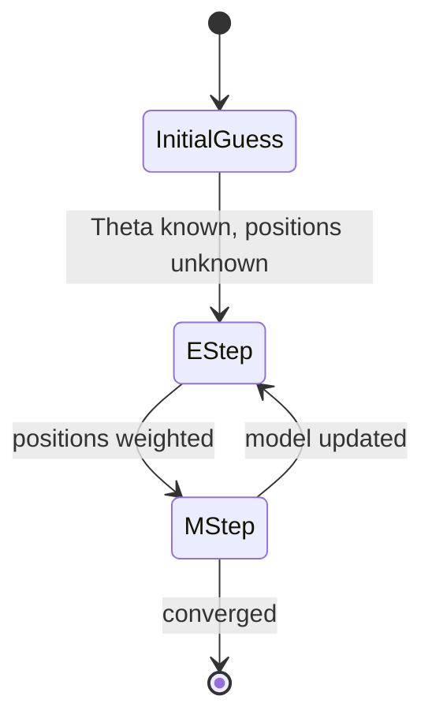

# M2L02 — Sequence Motifs and Motif Discovery

## Scope

The second lecture of module 2 is about finding short conserved patterns in long
sequences. It begins with what a [[sequence-motif]] is and why finding one is hard, then
works through the four ways of **representing** a motif — regular expression, count
matrix, probability matrix, [[position-weight-matrix|weight matrix]] — and their visual
form, the [[sequence-logo]], whose construction is derived from entropy and
[[information-content]]. The second half is **de novo discovery**: the
[[planted-motif-problem]], the brute-force bound, and then the probabilistic attack —
[[expectation-maximization]] explained on a coin-flip example, applied to motifs in
[[em-motif-discovery]], extended by MEME, and finally randomised into
[[gibbs-sampling]].

## Key points

- **Sequence motifs** are short, conserved sequences shared among a group of related
  sequences, typically associated with a particular biological function. See
  [[sequence-motif]].
- **Motif discovery** is the identification of [[transcription-factor-binding-site]]s —
  a procedure for finding enriched sets of similar short sequences in a large sequence
  dataset. Applications: gene regulation, protein binding, evolutionary analysis,
  protein motifs. The [[central-dogma]] frames where the regulation acts.
- **Where the input sequences come from**: [[gene-knockout]] of a specific transcription
  factor → observe the differentially expressed genes → they are likely controlled by
  that factor → their **upstream sequences** are likely to contain the binding sites.
- **The task**: given a set of long sequences likely to contain a short conserved motif,
  find the most prominent motif. **Problems**: the position of binding sites can vary,
  and the common features are typically very short.
- **Four representations**: regular expressions (consensus `AAGAAA`; degenerate
  `A[A/T]BW`), **positional count matrix**, **positional probability matrix**, and
  **positional weight matrix** with `s = log₂(P_ij / π_j)` plus a **pseudo-count** — all
  on [[position-weight-matrix]].
- **[[sequence-logo]]**: shows which positions are more important than others; any DNA,
  RNA or protein sequence can be drawn as one. It conveys the consensus, the order of
  predominance of residues, their relative frequencies, the amount of information at
  every position **in bits**, and significant locations such as an initiation or cut
  point.
- **[[information-content]]**: for a profile `P_i`, entropy
  `H(P_i) = −Σ_j P_ij log₂ P_ij` is 0 when only one residue occurs and maximal when all
  are equally frequent; information content is `I(P_i) = log₂|AAs| − H(P_i)`; relative
  entropy compares the column against the **background frequencies** `π`. A residue's
  contribution is `P_ij · H(P_i‖π)`, letter heights are proportional to contributions
  and the **stack height to the relative entropy**.
- **Background frequencies** come either from counting residues in **all known
  proteins** or only in **the proteins of the superfamily under consideration**.
- **Why not the wet lab**: experiments to verify binding sites are expensive and
  time-consuming (mutating the binding site, observing functional changes), with bad
  resolution — only approximate positions are known. One therefore **assumes binding
  sites are evolutionarily conserved**. Remaining issues: motifs can differ, the
  sequences are very short inside large DNA, and the signal-to-noise (foreground to
  background) ratio is bad.
- **[[planted-motif-problem]]**: a motif is an `(l,d)`-motif if it has length `l` and at
  most `d` mutations. Given `S` sequences of length `n` and `d < l < n`, find a pattern
  `M` such that each sequence contains a substring transformable into `M` with at most
  `d` substitutions. Brute force costs `O(4^l · m · n · d)` — see
  [[algorithmic-complexity]].
- **[[expectation-maximization]]** enables parameter estimation in probabilistic models
  with **incomplete data**. With complete information MLE is a count ratio; without it,
  guess the parameters, compute which hidden alternative is more likely for each datum,
  re-estimate by MLE, and repeat. **Use probabilities for data completion and use MLE.**
- **[[em-motif-discovery]]**: assume a fixed motif width `W`, a probability function for
  the motif and a *different* one for the background. The unknowns are the motif model
  `Θ` and the motif positions `Z`. E-step updates `Z`, M-step updates `Θ`.
- **EM's five weaknesses** — absorbing zero probabilities, local maxima, exactly one
  motif per sequence, only one motif, no prior knowledge — and **MEME's extensions**:
  pseudo-counts, a one-EM-step search over all distinct `W`-mers for a good start, and
  prior knowledge.
- **[[gibbs-sampling]]** is the stochastic analogue: instead of a distribution `Z_i` per
  sequence it keeps **one** start `a_i` and **resamples** it, which lets the search leave
  a local maximum.

## Diagram

From a knock-out experiment to a motif model and the four ways of writing it down.

EM as a two-state cycle: the E-step fills in the hidden positions, the M-step re-estimates the model.

## Open questions

- The **relative entropy** on p. 16 is written with a leading minus sign,
  `H(P_i‖π) = −Σ_j P_ij log₂(P_ij/π_j)`, which is the negative of the standard
  Kullback–Leibler divergence and would make a conserved column have *negative* stack
  height.
- **Combinatorial approaches** to motif discovery are named but never described.
- The **pseudo-count** formula is named on p. 15 but not written out there.

Recorded in [[open-questions]].

## Relations
- [[M2E02-motif-discovery-and-expectation-maximization]] — the exercise sheet for this
  lecture: definitions, the GC likelihood, and a full EM iteration.
- [[L12-binding-sites-and-position-weight-matrices]] — the module-1 lecture this one
  continues: there the matrix is given and used to scan, here it is learned.
- [[rna-seq]] — the assay that produces the differentially expressed genes whose
  upstream sequences are searched here.

## See also

- [[hidden-markov-model]] — the other probabilistic sequence model of the wiki; a PWM assumes independent columns, an HMM adds state-to-state dependence.
- [[string-matching]] — the planted motif problem is approximate string matching with mismatches, the module-1 problem relaxed.
- [[chip-seq]] — ChIP-Seq peaks are the sequence sets that de novo motif discovery is run on.
- [[position-weight-matrix]] — the **module-1** canonical page for the matrix
  hierarchy and the log-odds scan named here; module 1 scans with a known matrix,
  this lecture estimates it.

## Sources

- `raw/module2/csb_1.pdf`, pp. 14–22.
