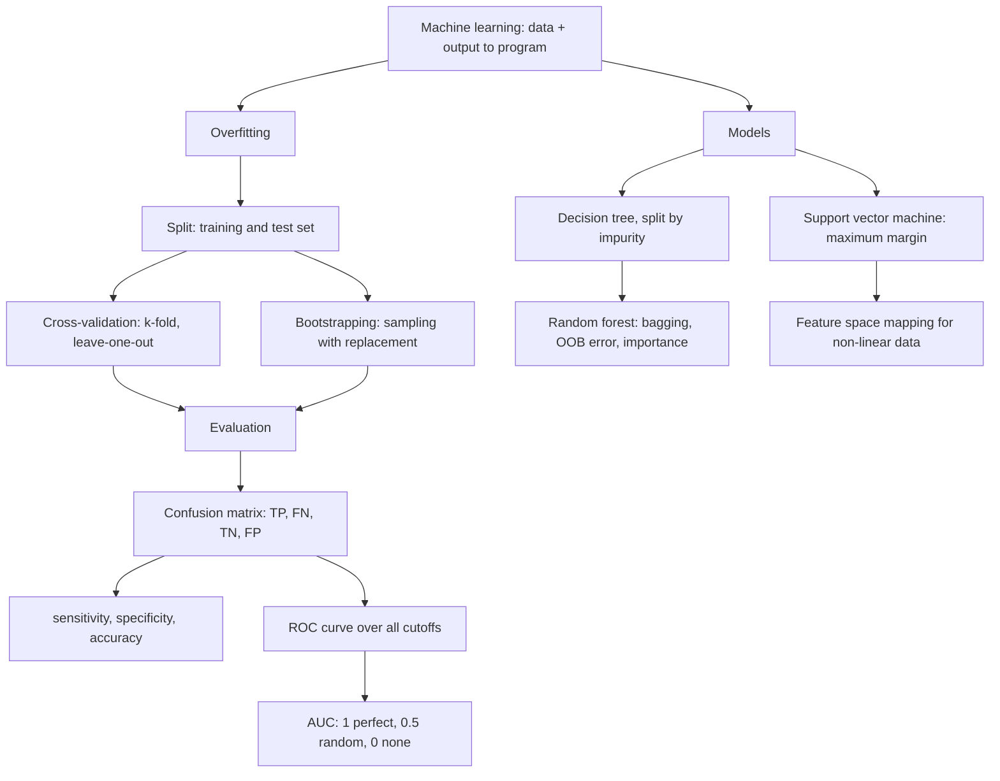
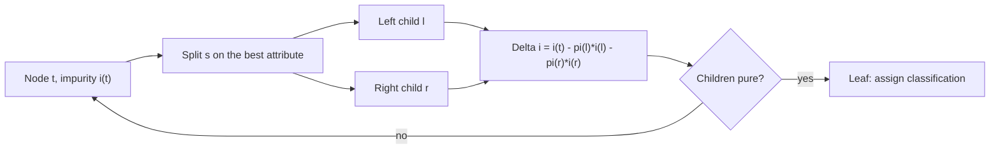

# M2L03 — Machine Learning and Classification

## Scope

The third lecture of module 2 turns from *finding patterns in sequences* to *learning
models from data*. It opens with what [[machine-learning]] is — the inversion of normal
programming — then the linear/non-linear divide and [[overfitting]], the failure mode
that structures everything after it. The middle of the lecture is **honest evaluation**:
splitting the data, [[cross-validation]] in its k-fold and leave-one-out forms,
[[bootstrapping]], the TP/FN/TN/FP confusion matrix, and the [[roc-curve|ROC curve and
AUC]]. The last third is three concrete classifiers: the [[decision-tree]] with its
[[node-impurity]] criterion, the [[random-forest]] that ensembles it with an out-of-bag
error estimate and a feature-selection procedure, and the
[[support-vector-machine]] with its margin and its feature-space mapping.

## Key points

- **[[machine-learning]] inverts normal programming.** Normal: `data + program →
  computer → output`. ML: `data + output → computer → program`. **Learning**, for binary
  classification, means **changing the coordinates of a hyperplane**.
- **Linear problems** — data points can be separated by a linear function; e.g. **linear
  regression**, **SVM**. **Non-linear problems** — a complex separation function is
  needed; e.g. **random forest**, **neural network**.
- **[[overfitting]]**: the final model **perfectly explains the training data but
  performs badly on never-seen data**. Remedy: split into **training** and **test** set,
  train exclusively on training data, validate on test data; bad test performance
  reveals the overfit.
- **The problem with one test set**: on a small dataset a large part is wasted, and the
  model looks different depending on which samples were used for training → **create
  multiple splits**.
- **[[cross-validation]]**, k-fold, in six steps: permute the samples, pick `k`, split
  into `k` equal parts, use `k−1` folds for training and one for testing, repeat until
  every fold was the test set once, identify the best model by the average score, repeat
  with the next permutation. **Leave-one-out** is `k = #samples`.
- **[[bootstrapping]]**: draw samples of size `n` repeatedly from the original data by
  **simple random sampling with replacement**. **Lower variance but larger bias than
  cross-validation.**
- **Measuring classification performance**: assess the classifier on **new, unseen data
  with known class labels**; the test data has both positive and negative samples; the
  model outputs a value between 0 and 1 per sample, turned into a label by a **cutoff**;
  compare against the **ground truth** → **TP, FN, TN, FP**, and
  `sens = TP/(TP+FN)`, `spec = TN/(TN+FP)`, `acc = (TP+TN)/n` — the module-1 vocabulary
  of [[statistical-testing]].
- **[[roc-curve|ROC and AUC]]**: sensitivity and specificity computed **for numerous
  cutoffs**; `AUC(x) = ∫₀¹ ROC(x)`; `=1` perfect classifier, `=0.5` tossing a coin
  (random), `=0` no classifier.
- **[[decision-tree]]**: each **node** tests an attribute, each **branch** corresponds to
  a value range, each **leaf** assigns a classification. Requires attribute–value pairs
  and a **discrete** target function. **Top-down induction** in five steps, recursing
  until the training examples are perfectly classified.
- **[[node-impurity]]**: `i(t) = Φ(p₁,…,p_J)`; `Φ` symmetric, maximal for an even
  distribution, minimal for a single class. Split quality
  `Δi(s,t) = i(t) − π(l)i(l) − π(r)i(r)`. Three instances: **resubstitution error**
  `1 − max_j p(j|t)`, **Gini** `Σ_j p(j|t)(1−p(j|t))`, **entropy**
  `−Σ_j p(j|t) log p(j|t)` — the same formula as in [[information-content]].
- **[[random-forest]]**: popular, efficient, reports **variable importance**, gives an
  **unbiased estimate of the generalization error during forest building** (the
  **out-of-bag error rate**), **robust to overfitting** and **to unbalanced class
  sizes**. Feature selection in two stages: preliminary ranking by Gini importance and
  elimination, then variable selection *for interpretation* (smallest OOB error among
  nested models) or *for prediction* (stepwise ascending models).
- **[[support-vector-machine]]**: `f(x) = sign(wáµ€x + b)`; the distance from `x_i` to the
  separator is `r = (wᵀx_i + b)/‖w‖`; the closest examples are the **support vectors**;
  the **margin `ρ`** is the distance between them. **Maximum-margin classification** gives
  good accuracy for **PAC** learning, and **only the support vectors matter**. If the
  data is not separable, the **original feature space can be mapped to a
  higher-dimensional feature space** where it is.
- Extended in [[M2L06-deep-learning]]: the same supervised-learning frame, scaled up to [[neural-network]]s trained by [[gradient-descent]] and [[backpropagation]]; [[bias-variance-tradeoff]] restates the overfitting discussion as a diagnostic procedure.
- [[bootstrap-tree-assessment]] reuses this lecture's [[bootstrapping]] idea on alignment columns instead of samples.

## Diagram

The lecture in one picture: overfitting forces honest evaluation, and three classifiers are then built and scored.

Top-down induction of a decision tree, driven by the impurity drop.

## Open questions

- The ROC sketch on p. 4 labels the horizontal axis **`spec`**, while the exercise on
  p. 10 draws the same curve against the **FP rate** `= 1 − spec`. Only the latter makes
  `AUC = 1` the perfect classifier.
- The **number of features sampled per node** in a random forest is never given, only
  "a subset of the features".
- No **convergence or stopping criterion** is given for the random-forest
  feature-selection loops, and the **RF importance score** is identified only as
  "Gini index".
- The **SVM optimisation** itself is never written down — only the geometry of the
  margin. No kernel function is named.
- The bottom of p. 7 (the `Loud/Drunk/Victory` out-of-bag illustration) is partly
  cramped; the transcription in [[random-forest]] follows what is legible.

Recorded in [[open-questions]].

## Relations

- [[mirna-target-prediction]] — a concrete application of this lecture's pipeline:
  features, feature selection, scoring and independent testing on PAR-CLIP data.
- [[M2E03-machine-learning-and-classification]] — the exercise sheet for this lecture.
- [[M2L04-clustering]] — the unsupervised sequel: no labels, so no confusion matrix.
- [[M2L05-network-based-disease-modules]] — applies the random forest of this lecture to
  a network in [[grandforest]].
- [[statistical-testing]] — the module-1 lecture that already defined sensitivity,
  specificity and accuracy; here they are computed at every cutoff instead of one.
- [[E08-test-errors-and-z-score]] — the module-1 exercise on the same confusion matrix.
- [[principal-component-analysis]] — the module-1 unsupervised technique that usually
  precedes any of these classifiers.

## See also

- [[M2E06-deep-learning]] — the exercise that carries the classification vocabulary into neural networks.
- [[deep-learning]] — deep learning is the parametric, high-capacity end of the classifier spectrum introduced in this lecture.
- [[generative-adversarial-network]] — the adversarial pair is two classifiers trained against each other.

## Sources

- `raw/module2/csb_part2.pdf`, pp. 1–8 — machine learning, linear/non-linear problems,
  overfitting and data splitting, cross-validation, bootstrap, classification
  performance, ROC and AUC, decision trees and impurity, random forest, SVM.

