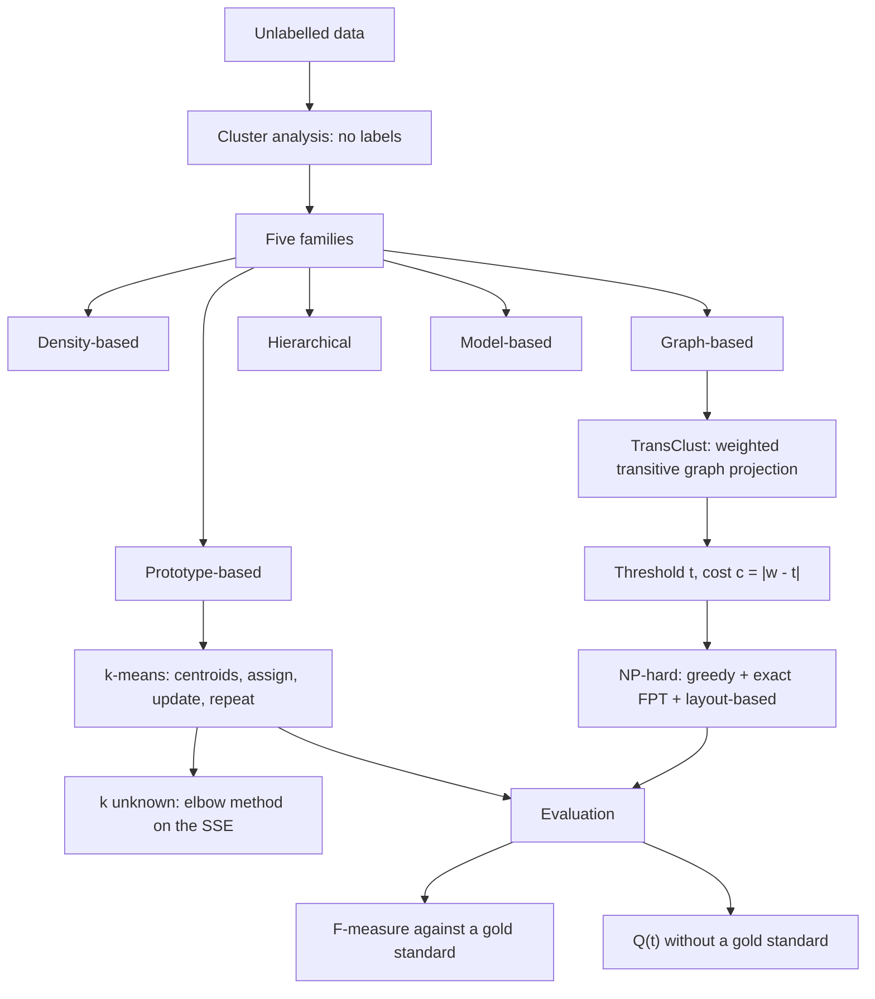
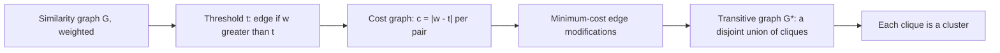

# M2L04 — Clustering

## Scope

The fourth lecture of module 2 is the unsupervised counterpart of
[[M2L03-machine-learning-and-classification]]: there are **no labels**, so the task is to
find the groups themselves. It defines [[cluster-analysis]] and its goal — minimise
intra-cluster, maximise inter-cluster differences — lists the five families of methods,
and then develops two of them in full: [[k-means]] as the **prototype-based** algorithm
with its elbow method and its long list of weaknesses, and [[transclust]] as the
**graph-based** one, which needs only a similarity function and turns clustering into a
minimum-cost **transitive graph projection**. It closes with evaluation: the
[[f-measure]] against a gold standard, and the quality curve `Q(t)` when no gold standard
exists.

## Key points

- **Clustering is unsupervised learning: no labels.** **Clusters** are groups of data
  objects that are **more similar to each other than to objects from other groups**. See
  [[cluster-analysis]].
- **Clustering goal**: given a set of unlabelled data objects, group them so that the
  **intra-cluster differences are minimized** and the **inter-cluster differences are
  maximized**.
- **Why cluster**: it can **reveal hidden relationships between the observations and
  features** — objects in one group highly similar, objects in different groups highly
  dissimilar.
- **Five method families**: density-based, **graph-based** ([[transclust]]),
  hierarchical, model-based, **prototype-based** ([[k-means]]).
- **[[k-means]]** is a **partitional** algorithm that partitions the data into `k`
  clusters **fixed a priori**: pick `k`; select `k` points as **centroids**
  `C = {c₁,…,c_k}`; measure the distance of every point to every centroid (e.g.
  Euclidean); assign each point to the closest centroid
  `argmin_{c_j ∈ C} dist(c_j, x)²`; update each centroid to the mean
  `c_i = (1/|S_i|) Σ_{x_i ∈ S_i} x_i`; **repeat until convergence**.
- **If `k` is unknown — the elbow method**: run the algorithm for different `k`, compute
  the **sum of squared error (SSE)** — the sum of squared distances between a centroid
  and each member of its cluster — plot it, and take the `k` at the **elbow point**.
- **k-means pros**: easy implementation and interpretation; fast for low-dimensional
  data, `O(t·k·n)`. **Cons**: may need multiple runs with different initializations;
  lacks consistency; sensitive to noise and outliers; `k` must be known; no guaranteed
  global convergence; unsuitable for complex data structures; **problematic if objects
  are not described by feature vectors**.
- **[[transclust]]** is a **clustering tool for biomedical datasets**, based on
  **Weighted Transitive Graph Projection**: it **transforms a given graph into a disjoint
  union of cliques by using a minimum number of edge modifications**. Input: a set of
  objects `M` and a similarity function `s : (M choose 2) → ℝ`.
- **The TransClust construction**: build the similarity graph `G` (nodes = points,
  edges = weighted similarities); apply an **edge-weight threshold `t`** — edge if
  `w > t`, no edge if `w < t`; the **cost of modifying an edge** is `c = |w − t|`
  (equivalently `w' = w − t` in the modified similarity graph, `w'' = |w'|` in the cost
  graph); then project `G'` onto a **transitive graph `G*` with minimal cost**.
- **TransClust is NP-hard** and therefore uses three algorithms together: a **greedy
  algorithm** (fast, no quality guarantee), an **exact fixed-parameter algorithm**
  (guaranteed exact, but exponential), and a **graph-layout-based algorithm** (a good
  heuristic in polynomial time). Pipeline: input → similarity network → cost graph →
  greedy → upper bound → semi-greedy → layout-based → exact FP → re-cluster subdivisions
  → output.
- **Evaluation by [[f-measure]]**: `precision = TP/(TP+FP)` (how many selected items are
  relevant), `recall = TP/(TP+FN)` (how many relevant items are selected), and their
  **harmonic mean** `F = 2·(precision·recall)/(precision+recall) ∈ [0,1]`. The higher
  the better the clusters (predicted groups) match a given **gold standard** (known
  groups). It can also be used for supervised classifiers.
- **Finding the right density parameter**: *with* a gold standard the quality measure is
  derived from it; *without* one, use `Q(t) = 2·k_t(1−u_t)/(k_t + (1−u_t))` as a quality
  measure for each clustering threshold `t`, plot it, and take the maximum as the optimal
  threshold.
- **Missing values and speed**: set the missing similarity values to the threshold `t`.

## Diagram

The lecture's structure: the clustering goal, two concrete algorithms from two families, and the two ways of judging the result.

TransClust in five steps: thresholding turns similarities into costs, and the cheapest repair to transitivity is the clustering.

## Open questions

- The **`Q(t)` formula** on p. 16 is legible, but the meaning of its two inputs — `k_t`
  ("clusters in peak") and `u_t` ("unspecific items") — is only sketched next to a small
  plot and cannot be reconstructed with certainty.
- The ROC-style axis labelling and the cluster-size plot on p. 16 are drawn without
  numbers.
- No **convergence criterion** is given for k-means beyond "repeat until convergence",
  and no distance measure other than Euclidean is specified.
- The **semi-greedy** step of the TransClust pipeline is named in the flow diagram but
  never described.

Recorded in [[open-questions]].

## Relations

- [[M2E04-k-means-and-transclust]] — the exercise sheet for this lecture.
- [[M2L03-machine-learning-and-classification]] — the supervised predecessor; this
  lecture is explicitly set against it ("unsupervised learning: no labels").
- [[M2L05-network-based-disease-modules]] — clustering under a network constraint, to
  produce [[endophenotype|endophenotypes]].
- [[principal-component-analysis]] — the module-1 unsupervised projection usually applied
  before clustering.
- [[interaction-network]] — a weighted graph of the same kind TransClust clusters.
- [[algorithmic-complexity]] — the NP-hardness argument behind TransClust's hybrid
  pipeline.

## See also

- [[machine-learning]] — clustering is the unsupervised half of machine learning.
- [[data-normalization]] — expression values must be normalized before any distance between samples is meaningful.
- [[microarray-expression-analysis]] — the module-1 expression matrix is the input that gets clustered.
- [[principal-component-analysis]] — the **module-1** unsupervised projection routinely
  run before clustering; it supplies the low-dimensional space the clusters are found
  and drawn in.

## Sources

- `raw/module2/csb_part2.pdf`, pp. 12–16 — clustering and its goal, method families,
  k-means with the elbow method, pros and cons, TransClust, and evaluation by F-measure
  and `Q(t)`.
