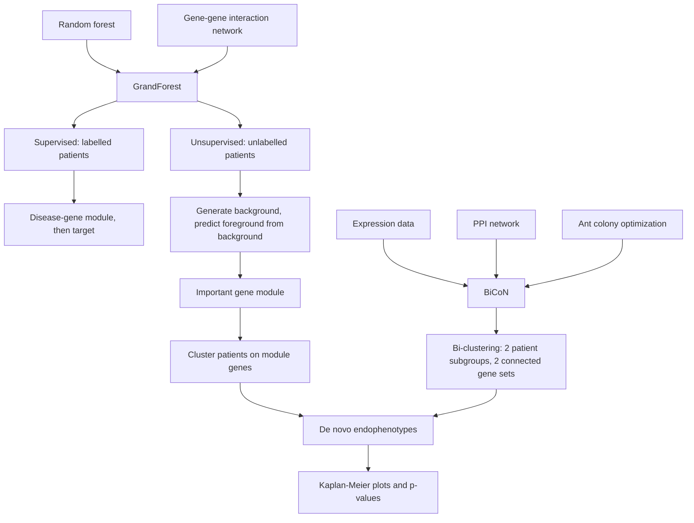

# M2L05 — Network-Based Disease Modules

## Scope

The fifth lecture of module 2 combines the two previous ones with the
[[interaction-network]] of module 1. It presents two tools that constrain a machine-
learning search by the network so that the answer is always a **connected subnetwork**:
[[grandforest]], a graph-based [[random-forest]] that finds disease-gene modules and —
in unsupervised mode — **de novo [[endophenotype|endophenotypes]]**; and [[bicon]]
(earlier *BiGAnts*), a network-constrained **bi-clustering** driven by
[[ant-colony-optimization]] that splits patients and genes at the same time. The lecture
closes the loop that [[keypathwayminer]] opened in part 1: the network is not only a
display, it is the search space.

## Key points

- **Main idea of graph-based random forest**: an **ensemble learning method for
  discovering disease-associated modules from genomic profiling data**, **based on the
  random forest algorithm**. The notes draw a network `v₁…v₈` being unrolled into a tree
  whose descent follows network **edges**.
- **[[random-forest]] recap**: it **combines the output of multiple
  [[decision-tree|decision trees]] to reach a single result**; its **advantage over a
  decision tree is that it avoids and prevents overfitting by using multiple trees**.
- **The equation of the lecture**: **Random Forest + Network ⇒ GrandForest (new
  network)**.
- **[[grandforest]] supervised analysis**: patients are **labelled** → experimental data
  + response variable, together with the **gene–gene interaction network**, go into
  GrandForest → a **disease-gene module** → network → target.
- **[[grandforest]] unsupervised analysis**: patients are **unlabelled** → experimental
  data is used to **generate a background**; data + background + network go into
  GrandForest → an **important gene module** → **cluster into endophenotypes**. In four
  steps: 1) generate background from input, 2) concatenate into a single dataset,
  3) train the GF model to predict foreground from background, 4) **cluster the input
  only on the genes in the module**.
- GrandForest **uploads expression data unlabelled**, **clusters the dataset recursively
  on computed pathways** → **de novo endophenotypes**, **also allows for survival
  analysis**, and **computes [[kaplan-meier-plot|Kaplan–Meier plots]] and p-values**.
- **[[bicon]] motivation**: **supervised methods are biased to current disease
  definitions**; **disease subtypes may exist**; **different mechanotypes require
  different treatments**; **shelved drugs might be effective and/or repurposable**.
- **Canonical approaches are not integrative enough**: clustering (rows/columns),
  bi-clustering, community detection.
- **[[bicon]] idea**: **input** = expression data **and** interaction network;
  **output** = a **bi-clustering with `k` genes inside the bi-clusters that induce a
  connected subnetwork**. Two constraints: the genes in the bi-clusters are **restricted
  to be functionally related (connected in the network)**, and the method **maximizes the
  expression differences of these two gene sets between two subgroups of patients**.
- **The BiCoN pipeline**: gene expression data + PPI network → **joint network** →
  **local optimization (ant)** → **construction of a set of solutions** → **global
  objective evaluation** → **reinforcement of the best solution** → **iterations until
  convergence to a single solution**.
- **Used to**: identify patient subgroups and biomarkers and/or disease-correlated genes.
  **Robustness to noise**: it **considers only connected subnetworks**.
- **[[endophenotype]] vocabulary**: a **phenotype** is the set of observable
  characteristics of an organism; an **endophenotype** is a measurable trait more closely
  linked to the genetic factors underlying a disorder; **de novo endophenotyping**
  (`de novo` = new) is the process of identifying and characterizing newly recognized or
  previously unknown measurable traits believed to be **intermediate markers of the
  underlying genetic factors of a disorder**.

## Diagram

Two routes from an expression matrix and a network to de novo endophenotypes, both validated by survival curves.

The BiCoN loop, an ant-colony search over a joint expression/interaction network.

## Open questions

- The **objective function** that BiCoN maximizes is described in words ("maximizes the
  expression differences of these two gene sets between two subgroups of patients") but
  never written as a formula.
- GrandForest's **background generation** (step 1 of the unsupervised pipeline) is named
  but not specified.
- The **recursive clustering "on computed pathways"** on p. 22 is not explained — it is
  unclear which pathway database or which recursion is meant.
- The blue crossed-out word on p. 23 above "Network constraint bi-clustering" is
  illegible.
- No complexity figures, convergence criteria or parameter defaults are given for either
  tool.

Recorded in [[open-questions]].

## Relations

- [[M2E05-grandforest-and-bicon]] — the exercise sheet for this lecture.
- [[M2L03-machine-learning-and-classification]] — supplies the random forest and the
  supervised/unsupervised distinction.
- [[M2L04-clustering]] — supplies the clustering step both tools end with.
- [[M2L01-enrichment-analysis]] — [[keypathwayminer]] and
  [[ant-colony-optimization]] come from there; BiCoN reuses the ants.
- [[interaction-network]] — the shared constraint.
- [[expression-qtl]] — the module-1 idea closest to an endophenotype.
- [[rna-seq]], [[microarray-expression-analysis]] — the assays producing the input
  matrix.

## See also

- [[cluster-analysis]] — disease modules are clusters found in a network rather than in a feature space.
- [[machine-learning]] — module detection is learning structure from unlabelled network data.
- [[genome-wide-association-study]] — GWAS hits are single loci; a disease module is the network neighbourhood that connects them.

## Sources

- `raw/module2/csb_part2.pdf`, pp. 21–23 — graph-based random forest, GrandForest's two
  analysis modes and its four unsupervised steps, BiCoN's motivation, idea, pipeline and
  use cases.
