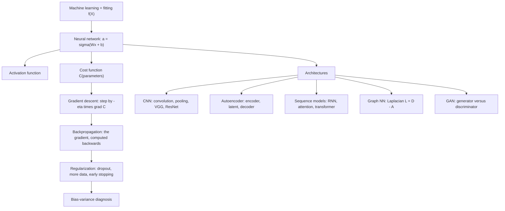

# M2L06 — Deep Learning

## Scope

The lecture builds the whole of supervised deep learning from one idea: **machine
learning is function fitting**. It starts from linear and multiple linear regression,
rewrites a regression as a **neuron**, stacks neurons into a **multilayer perceptron**,
and then derives the three machines that make such a network trainable — a
**cost function** to say how wrong it is, **gradient descent** to reduce that cost, and
**backpropagation** to compute the gradient efficiently. The second half surveys the
architectures built on top: **convolutional networks** for data with spatial structure,
**autoencoders** for unsupervised compression, **sequence models** (RNNs, attention,
transformers), **graph neural networks**, and **generative adversarial networks** — the
last with a frank list of why they are hard to train.

## Key points

- **[[deep-learning]] is curve fitting.** A model is `f(X) = β₀ + β₁X₁ + β₂X₂ + …`; the
  **features** are the `X` and the **labels** are what `f` should output. A deep network
  is the same equation, composed many times with a non-linearity in between.
- **[[neural-network]]** — neurons hold an activation in `[0,1]`; a layer computes
  `a¹ = σ(W a⁰ + b)`; weights are initialised **randomly**. The worked count for a
  `3 → 4 → 4 → 4` network gives **44 weights and 12 biases**.
- **[[activation-function]]** — sigmoid, binary step, softplus, softmax; without one the
  whole network collapses to a single linear map.
- **[[cost-function]]** — the squared-error cost takes the *parameters* as its input and
  one number as its output; its landscape has **local and global minima**. MSE, L1, L2
  and Euclidean variants.
- **[[gradient-descent]]** — compute `∇C`, step by `−η∇C`, repeat; the **learning rate**
  `η` and the **mini-batch** size are the two knobs.
- **[[backpropagation]]** — the three levers on a neuron's output (raise the bias, raise
  the weight in proportion to the incoming activation, change the incoming activation in
  proportion to the weight), applied backwards layer by layer. *Neurons that fire
  together wire together.*
- **[[bias-variance-tradeoff]]** — Andrew Ng's diagnostic: compare human-level error,
  training error and dev error to decide whether to fix **bias** or **variance**;
  [[overfitting]] is the variance failure.
- **[[convolutional-neural-network]]** — motivated by **translational equivariance**;
  kernel, **stride** and **padding**; a convolutional block is convolution → activation →
  [[pooling-layer]]. **VGG** stacks such blocks; **ResNets** add **residual connections**
  so that very deep stacks remain trainable.
- **[[autoencoder]]** — encoder, latent representation, decoder; trained to reconstruct
  its own input, and so a non-linear cousin of
  [[principal-component-analysis]].
- **[[recurrent-neural-network]]** — sequence models, attention and transformers.
- **[[graph-neural-network]]** — node-, edge- and graph-level prediction; the
  **Laplacian `L = D − A`** as the central operator.
- **[[generative-adversarial-network]]** — generator against discriminator; hard because
  of **training instability**, **mode collapse** and **difficult evaluation**.
- **[[dropout]]** — the regularizer introduced in the exercise.

## Diagram

The lecture's logic: one fitting problem, three machines that make it trainable, and five architectures built on top.

## Open questions

- The notes' weight count on p. 4 reads `3·4 + 4·4 + 4·4 = 12 + 16 + 16 = 48`, but that
  sum is **44**. See [[open-questions]].
- "Faster algorithms than gradient descent" are referred to but not named.
- The RNN / attention / transformer equations and the GNN message-passing or spectral
  derivation are not developed in the notes.

## See also

- [[M2L03-machine-learning-and-classification]] — supplies the supervised-learning frame (features, labels, train/test) that deep learning extends.
- [[cross-validation]] — cross-validation is the honest way to pick network hyper-parameters.
- [[interaction-network]] — the input domain for graph neural networks.
- [[machine-learning]] — deep learning is the parametric, high-capacity end of machine learning.
- [[position-weight-matrix]] — a convolution kernel scanning a sequence is a learned PWM — the module-1 motif model, fitted by gradient descent.

## Sources

- `raw/module2/csb_3.pdf`, pp. 1–9 — the full lecture.
  - p. 1 — machine learning as function fitting; linear and multiple linear regression;
    the neuron equation; features and labels.
  - p. 2 — the multilayer perceptron; activations in `[0,1]`; the sigmoid;
    `a¹ = σ(W a⁰ + b)`.
  - p. 3 — random initialisation; the cost function; the gradient descent algorithm;
    local versus global minimum; more hidden layers; binary step, softplus and softmax.
  - p. 4 — counting weights and biases; `z^(l) = W^(l) a^(l−1) + b^(l)`.
  - p. 5 — MSE, L1, L2 and Euclidean costs; the backpropagation levers; mini-batches;
    the learning rate; regularization tips.
  - p. 6 — Andrew Ng's bias/variance tips; CNN motivation; translational equivariance;
    stride and padding; max and average pooling; the convolutional block.
  - p. 7 — VGG and ResNets with residual connections; autoencoders.
  - p. 8 — sequence models; graph neural networks and the Laplacian; GANs.
  - p. 9 — why GANs are hard: training instability, mode collapse, difficult evaluation.

## Appears in

- [[M2E06-deep-learning]] — the accompanying exercise.
