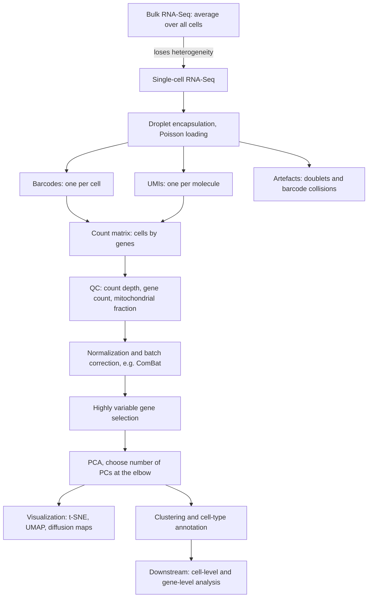

# M2L07 — Single-Cell RNA-Seq

## Scope

The lecture asks what changes when expression is measured **per cell** rather than per
tissue. It begins with the limits of bulk [[rna-seq]] and an eleven-point **wish list**
for what one would want from single-cell data, then works through the wet lab —
**droplet-based** capture, the **Poisson statistics** that govern it, **barcodes**,
**UMIs** and the **doublets** and **collisions** they produce. The second half is the
computational pipeline: quality control on count depth, gene count and mitochondrial
fraction; normalization and **batch correction**; selection of **highly variable genes**;
dimensionality reduction by **PCA**, **[[t-sne]]** and **[[umap]]**; and the split of
downstream analysis into cell-level and gene-level questions.

## Key points

- **[[single-cell-rna-seq]]** — bulk measures an *average over cells*, and therefore
  cannot see cell types, rare populations, or heterogeneity within a tissue; the
  eleven-point wish list is what single-cell resolution buys.
- **[[droplet-based-single-cell-methods]]** — cells and barcoded beads are co-encapsulated
  in droplets. Loading is **Poisson**: with mean `μ` cells per droplet, the
  **capture rate** is `1 − e^(−μ)` and the **duplication rate**
  `(1 − e^(−μ) − μ e^(−μ)) / (1 − e^(−μ))`. Loading density trades capture against
  doublets.
- **[[barcode-collision]]** — two cells receiving the same barcode. With `M` barcodes and
  `N` cells the rate is `1 − ((M−1)/M)^(N−1)`; the practical rule is a barcode pool
  roughly **100×** the number of cells.
- **[[doublet]]** — **technical** (two cells in one droplet), **synthetic** (two barcodes
  on one bead) and **biological** (physically attached cells). A **barnyard plot** —
  human reads against mouse reads — exposes them experimentally.
- **[[unique-molecular-identifier]]** — a random tag per *molecule*, so that PCR
  duplicates can be **collapsed** and counts reflect molecules rather than reads.
- **[[single-cell-analysis-workflow]]** — the seven steps, the preprocessing layers, the
  QC covariates (**count depth**, **number of genes**, **mitochondrial fraction**), and
  the cell-level / gene-level split downstream.
- **[[highly-variable-genes]]** — the feature-selection step; most genes carry no
  between-cell signal and only add noise and compute.
- **[[batch-effect]]** correction with **ComBat** — the same module-1 problem, now at
  the resolution of individual cells.
- **Visualization**: principal components, diffusion components, **force-directed
  graphs**, **[[t-sne]]** and **[[umap]]**; the **elbow** of the variance plot picks the
  number of PCs. All of them are *visualization, not clustering*.
- **[[t-sne]]** — Gaussian neighbour probabilities in high dimensions, **t-distributed**
  ones in low dimensions, minimise `C = KL(P‖Q)` by [[gradient-descent]]. Preserves
  **local** similarities only.
- **[[umap]]** — simplicial complexes as a neighbourhood graph, fuzzy spectral embedding,
  fuzzy set cross entropy. Preserves **global dissimilarities too**, and scales better.

## Diagram

From bulk averages to a per-cell count matrix, and from there through QC and reduction to cell-level and gene-level biology.

## Open questions

- The exact branch placement of "common sensitivity → inDrops" in the platform decision
  tree on p. 15 is uncertain. See [[open-questions]].
- Diffusion components and force-directed graph layouts are named as visualization
  options but not developed.

## See also

- [[autoencoder]] — autoencoders are the non-linear embedding alternative in the single-cell pipeline.
- [[principal-component-analysis]] — PCA is the linear first stage of the single-cell embedding, before t-SNE or UMAP.
- [[next-generation-sequencing]] — single-cell protocols are NGS with a cell barcode added to each read.
- [[data-normalization]] — per-cell library sizes differ wildly, so normalization is mandatory before any embedding.
- [[descriptive-statistics]] — mean and variance per gene are exactly what highly variable gene selection ranks.
- [[rna-seq]] — the **module-1** bulk assay this lecture replaces; single-cell resolves
  the population average that bulk RNA-Seq reports into individual cells.

## Sources

- `raw/module2/csb_3.pdf`, pp. 12–20 — the full lecture.
  - p. 12 — bulk versus single-cell; the eleven-point wish list.
  - p. 13 — droplet methods; the three inDrops steps; Poisson theory; capture and
    duplication rates.
  - p. 14 — barcode collisions; technical, synthetic and biological doublets; the
    barnyard plot.
  - p. 15 — UMIs and collapsing; the platform decision tree; preprocessing layers.
  - p. 16 — quality control: mitochondrial fraction and count depth.
  - p. 17 — batch correction and ComBat; visualization methods; the elbow criterion for
    the number of PCs.
  - p. 18 — t-SNE: the three steps and `C = KL(P‖Q) = ΣΣ p_ij log(p_ij/q_ij)`.
  - p. 19 — UMAP: simplicial complexes, spectral embedding, fuzzy set cross entropy,
    `k`-simplices, the Riemannian metric.
  - p. 20 — UMAP details: `k`-nearest neighbours, local versus global topology, enforcing
    local connectivity.

## Appears in

- [[M2E07-single-cell-rna-seq-and-dimensionality-reduction]] — the accompanying exercise.
