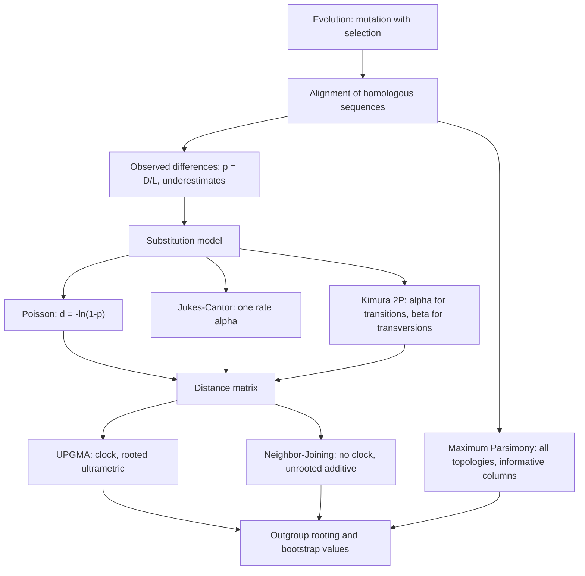

# M2L08 — Molecular Evolution and Phylogeny

## Scope

The lecture reconstructs evolutionary history from sequence data. It defines
**evolution as mutation with selection**, fixes the vocabulary of trees — OTUs and HTUs,
rooted and unrooted, cladograms, additive and ultrametric trees — and counts how
many trees there are, which turns out to be the fact that shapes every algorithm that
follows. It then builds the estimation machinery: why the observed fraction of
differences **underestimates** the true number of substitutions, and how the **Poisson**,
**Jukes–Cantor** and **Kimura two-parameter** models correct for it. Finally it presents
the three reconstruction methods — **UPGMA**, **Neighbor-Joining** and **Maximum
Parsimony** — within a four-step procedure that ends in **outgroup rooting** and
**bootstrap** evaluation.

## Key points

- **[[molecular-evolution]]** — evolution is mutation with selection; mutations are
  **edit operations**; the two principles are the **neutral theory** and the
  **[[molecular-clock]]**. Complications: **gene loss** and **horizontal gene transfer**.
- **[[phylogenetic-tree]]** — external nodes are **OTUs** (sequenced species), internal
  nodes **HTUs** (predicted ancestors), the root is **LUCA**. Rooted trees show a time
  course; unrooted ones show relationships only. **Cladogram** (edge lengths meaningless)
  → **additive tree** (edge length = amount of evolution) → **ultrametric tree**
  (constant rate, all leaves level).
- **Tree counting**: `2n−2` nodes unrooted, `2n−1` rooted; **`2n−3` rooted trees per
  unrooted tree**; `(2n−5)!/(2^(n−3)(n−3)!)` unrooted and `(2n−3)!/(2^(n−2)(n−2)!)`
  rooted topologies. For `n = 3, 4, 5`: **1, 3, 15** unrooted.
- **[[gene-tree-and-species-tree]]** — *a gene may duplicate before or after two species
  diverge*, so the two trees need not agree.
- **[[transition-and-transversion]]** — transitions (`A↔G`, `C↔T`) are **more common**
  despite being outnumbered two to one.
- **[[evolutionary-distance]]** — the true substitution count is unobservable; `p = D/L`
  **underestimates** it; the Poisson correction is `d_P = −ln(1−p)`.
- **[[jukes-cantor-model]]** — one rate `α`, `−3α` on the diagonal. **Row sums = 0 ⟺
  sequence length constant**; **column sums = 0 ⟺ base composition constant**.
- **[[kimura-two-parameter-model]]** — rates `α` for transitions and `β` for
  transversions; `d = −½ln(1−2P−Q) − ¼ln(1−2Q)` with `p = P + Q`.
- **Five shared assumptions** of both models: only substitutions; independent positions;
  probabilities depend only on the current state; one rate for all positions; base
  composition 1:1:1:1. *Note: not always applies to real data.*
- **[[phylogenetic-tree-reconstruction]]** — four steps: data selection, model, method,
  evaluation; and the **distance-based versus alignment-based** comparison.
- **[[upgma]]** — sequential clustering; **assumes a molecular clock**; merges the
  closest pair at height `d_ij/2`; updates by `d_XY = (1/(N_X N_Y)) Σ d_ij`; yields a
  **rooted ultrametric** tree. **MCP ⟺ ultrametric ⟺ `d_ij ≤ d_ik = d_kj`**.
- **[[neighbor-joining]]** — starts star-shaped; joins the pair minimising
  `M_ij = (n−2)d_ij − Σd_ik − Σd_jk`; **unequal** branch lengths `b_iY`, `b_jY`; updates
  by `d_YK = ½(d_iK + d_jK − d_ij)`; **minimum evolution**; **unrooted additive** tree.
- **[[maximum-parsimony]]** — alignment-based, searches **all** topologies, uses
  **character-state changes** with **no explicit model**, returns **multiple unrooted
  trees**. An **informative position** has ≥ 2 nucleotides each occurring ≥ 2 times.
- **[[bootstrap-tree-assessment]]** — root with an **outgroup**; permute or omit
  alignment columns, reconstruct, and report a **bootstrap value per internal branch**.
- **[[maximum-likelihood]]** — named in *both* columns of the method table, as a further
  distance-based and a further alignment-based method, but not developed. It is the same
  criterion module 1 used to train HMMs.

## Diagram

From an alignment to a tree: either summarise into distances and cluster, or score topologies on the columns directly; both routes end in evaluation.

## Open questions

- The internal-node row of the complexity table on p. 25 appears to give `n−1` unrooted
  and `n−2` rooted, which contradicts the node-count row on the same page. See
  [[open-questions]].
- The **Jukes–Cantor distance formula** itself is not written out — only the rate matrix
  and the Poisson correction.
- **Minimal evolution** and **[[maximum-likelihood]]** are named as further methods but
  not developed.

## See also

- [[homology]] — orthology and paralogy are the distinctions phylogeny makes operational.
- [[needleman-wunsch]] — the global alignment that produces the columns a tree is inferred from.
- [[sequence-alignment]] — alignment columns are the raw material of tree inference.
- [[substitution-matrix]] — the module-1 scoring matrix is an empirical substitution model; here the models are written out explicitly as rate matrices.
- [[markov-chain]] — Jukes–Cantor and Kimura are continuous-time Markov chains over the four bases.
- [[dynamic-programming]] — maximum parsimony scores a tree by a Fitch/Sankoff dynamic program over its nodes.
- [[genetic-drift]] — drift is the neutral process that fixes the substitutions a tree counts.
- [[L17-markov-chains-and-hidden-markov-models]] — where the Markov machinery and the [[maximum-likelihood]] principle behind these substitution models were first introduced.

## Sources

- `raw/module2/csb_3.pdf`, pp. 23–34 — the full lecture.
  - p. 23 — evolution, molecular evolution, phylogeny; cladogram; anagenesis;
    cladogenesis; taxon.
  - p. 24 — tree anatomy: HTU, OTU, branch, LUCA, acyclicity, rooted versus unrooted,
    cladogram, additive tree.
  - p. 25 — ultrametric trees; scaling; node counts; `2n−3` rootings; both tree-counting
    formulas.
  - p. 26 — molecular evolution as a distance measure; gene trees versus species trees;
    duplication before or after speciation; neutral drift; the molecular clock.
  - p. 27 — acceptance of mutations; transitions and transversions; gene loss;
    horizontal gene transfer; the modelling programme.
  - p. 28 — `p = D/L` and its bias; `d_P = −ln(1−p)`; `Q^JC`; the row-sum and column-sum
    rules; `Q^K2P` and `d_K2P`.
  - p. 29 — the five shared assumptions and the caveat.
  - p. 30 — the four reconstruction steps and the method comparison table.
  - p. 31 — UPGMA.
  - p. 32 — Neighbor-Joining.
  - p. 33 — Maximum Parsimony and informative positions.
  - p. 34 — outgroup rooting and bootstrap tree assessment.

## Appears in

- [[M2E08-phylogenetics]] — the accompanying exercise.
