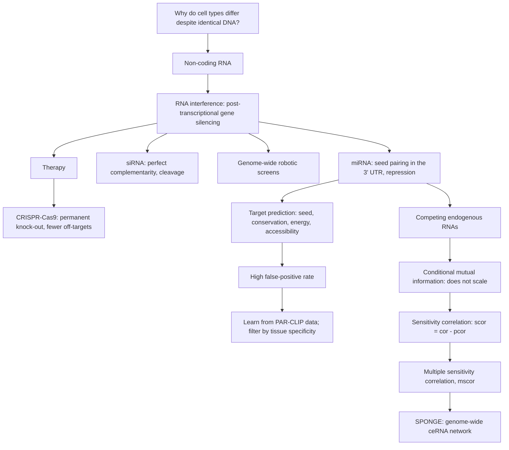

# M2L09 — Non-coding RNAs

## Scope

The lecture opens with the question *how can we explain differences between cell types and
tissues?* — the same puzzle that motivated [[L16-epigenetics]] in module 1 — and answers
it with a second regulatory layer written in RNA rather than in DNA. It classifies RNA
into protein-coding mRNA and [[non-coding-rna|ncRNA]], defines
[[rna-interference|RNA interference]] as sequence-specific post-transcriptional gene
silencing, and develops its two effectors: the endogenous [[microrna|miRNA]], which binds
a 3′ UTR through a short seed and represses translation, and the
[[small-interfering-rna|siRNA]], which pairs perfectly and cleaves. RNAi scaled up with
robotics becomes a genome-wide screening platform; as a therapy it has largely been
displaced by [[crispr-cas9]], which the lecture compares to RNAi point by point.
The second half is computational: because the seed is short,
[[mirna-target-prediction]] drowns in false positives, so experimental binding data is
fed into [[machine-learning]] and expression data is used as a tissue-specificity filter.
Finally, because one miRNA binding site serves many genes, those genes compete — the
[[competing-endogenous-rna|ceRNA]] hypothesis — and inferring that competition genome-wide
motivates [[mutual-information|conditional mutual information]], its failure,
[[sensitivity-correlation]], and the tool [[sponge]].

## Key points

- **The question**: every cell has the same DNA, so cell-type differences need a
  regulatory layer. [[non-coding-rna]] supplies one; [[epigenetics]] supplies the other.
- **[[rna-interference]]** — *a biological process in which RNA molecules are involved in
  sequence-specific suppression of gene expression*; also called post-transcriptional
  gene silencing. Two binding modes: siRNA fully complementary, miRNA seed-paired in the
  3′ UTR.
- **[[microrna]]** — 19–22 nt, key regulators, each potentially regulating hundreds of
  genes. Biogenesis: DNA → pri-miRNA → (Drosha) → pre-miRNA → (Exportin 5) → (Dicer) →
  duplex → miRISC with AGO → seed pairing → repression/decay.
- **[[small-interfering-rna]]** — not explicitly encoded in DNA; shRNA or long dsRNA →
  Dicer → siRNA → RISC → **cleavage**; highly specific.
- **Genome-wide RNAi screening** — robotic high-throughput screens, whose analysis stack
  is [[data-normalization]], [[batch-effect]] correction, [[statistical-testing]] and
  [[enrichment-analysis]].
- **[[crispr-cas9]]** — bacterial adaptive immunity turned into programmed genome
  editing, in four steps; permanent knock-out versus RNAi's reversible knockdown; see
  [[gene-knockout]].
- **[[mirna-target-prediction]]** — four features (seed pairing, conservation,
  hybridization energy, accessibility); CLIP-Seq is specific but insensitive, prediction
  sensitive but unspecific; the resolution is to learn from PAR-CLIP data and to filter
  by tissue-specific expression.
- **[[competing-endogenous-rna]]** — shared miRNA response elements make genes
  cross-regulate; three models, of which only the gene–gene–miRNA triplet expresses
  competition.
- **[[mutual-information]]** — expresses the right dependence but cannot scale: one
  triplet at a time, permutation p-values, Fisher's method losing power, no genome-wide
  inference.
- **[[sensitivity-correlation]]** — `scor = cor − pcor`, generalised to `mscor` over a
  set of miRNAs, with a simulated null model that makes it testable.
- **[[sponge]]** — *Sparse Partial correlation ON Gene Expression*: filter, compute
  `mscor`, test against the null, build the network.

## Diagram

The lecture's arc: a regulatory layer in RNA, its two effectors, the prediction problem it creates, and the statistics that turn competition into a network.

## Open questions

- The final stage label of the PAR-CLIP pipeline on p. 5 is not legible.
- The coefficients `A`, `B`, `C` of the quadratic solved for `r_BZ` (p. 8) are not given.
- See [[open-questions]].

## See also

- [[central-dogma]] — non-coding RNAs are the main qualification of the plain DNA → RNA → protein story.
- [[gene-regulation]] — ncRNAs are a regulatory layer on top of transcription-factor control.
- [[interaction-network]] — ceRNA/sponge relations form their own interaction network.
- [[rna-seq]] — ncRNA expression is measured by the same protocol.
- [[splicing]] — lncRNAs and circRNAs arise from the same splicing machinery as mRNA.
- [[string-matching]] — miRNA target prediction is seed matching — exact string matching on a 7-mer.
- [[suffix-array]] — the index that makes genome-wide miRNA seed search tractable.

## Sources

- `raw/module2/csb_4.pdf`, pp. 1–9 — non-coding RNAs, RNAi, miRNA and siRNA biogenesis,
  CRISPR–Cas9, target prediction, ceRNAs, mutual information, sensitivity correlation and
  SPONGE.
- Exercise: [[M2E09-non-coding-rnas-and-sponge]] (`raw/module2/csb_4.pdf`, p. 10).
