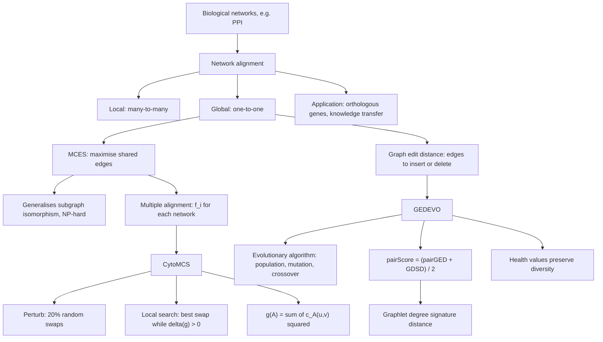

# M2L10 — Network Alignment

## Scope

The closing lecture of module 2 lifts [[sequence-alignment]] one level of abstraction:
instead of comparing two strings, compare two **networks**. The goal of
[[network-alignment]] is the best mapping between the nodes of two or more networks, so
that topologically or functionally similar nodes correspond; applied to PPI networks of
different species, it identifies **orthologous genes** and transfers annotation from
well-studied model organisms. The lecture splits the problem into **local** (many-to-many,
small subnetworks) and **global** (one-to-one, entire networks) alignment, formalises the
global case as the **MCES** problem, and shows that it generalises subgraph isomorphism
and is therefore NP-hard. Two heuristics follow. **[[cytomcs]]** is an iterated local
search for **multiple** network alignment that maximises conserved edges, smoothing the
flat objective by squaring per-edge conservation counts so that fewer well-conserved
edges beat many poorly conserved ones. **[[gedevo]]** attacks the pairwise case from the
dual direction, minimising the **[[graph-edit-distance]]** with an
[[evolutionary-algorithm]] whose offspring are guided by a `pairScore` combining local
edit cost with the **[[graphlet-degree-signature-distance]]**, and whose selection uses
health values to preserve diversity.

## Key points

- **Biological networks** model entities and their relationships, e.g. protein–protein
  interactions; see [[interaction-network]].
- **[[network-alignment]]** — best mapping between nodes of two or more networks;
  **local** = many-to-many on small subnetworks, **global** = one-to-one on entire
  networks. Application: orthologous genes across species ([[homology]]).
- **MCES** — maximum common edge subgraph: find `f : V₁ → V₂` maximising
  `F(f) = Σ_{(u,v)∈E₁} [ (f(u),f(v)) ∈ E₂ ]`. **NP-hard.**
- **Isomorphism** — `G₁ ≅ G₂` iff a mapping preserving all edges exists, i.e.
  `F(f) = |E₁| = |E₂|`; MCES generalises subgraph isomorphism, which is where the
  hardness comes from ([[algorithmic-complexity]]).
- **Multiple alignment** — `A = { f_i : V₁ → V_i }`, with `f(A)` counting only edges
  conserved in **every** network.
- **[[cytomcs]]** — iterated local search: perturb (20 % random swaps), local search
  (best swap while the gain is positive), keep the best. Optimises
  `g(A) = Σ c_A(u,v)²` to prioritise **fewer well-conserved edges over many poorly
  conserved ones**.
- **[[graph-edit-distance]]** — the dual objective: edges to insert or delete to make
  `G₁` isomorphic to `G₂`, counted in both directions.
- **[[gedevo]]** — evolutionary search on GED. Initial population from random
  permutations, optionally pre-aligned by [[blast]] similarity or local topology;
  `pairScore = (pairGED + GDSD)/2`; four offspring strategies; health-based selection;
  three termination criteria.
- **[[graphlet-degree-signature-distance]]** — graphlets are small, connected,
  non-isomorphic induced subgraphs; the graphlet degree `dᵢ^v` counts how often `v`
  touches a graphlet at orbit `i`; weights correct for orbit redundancy.
- **[[evolutionary-algorithm]]** — population, mutation, crossover, survival of the
  fittest; the population-based sibling of [[ant-colony-optimization]].

## Diagram

The lecture's structure: one problem, two objectives that are duals of each other, and two metaheuristics.

## Open questions

- The internal structure of the graphlet-orbit table on p. 19 is overwritten and only
  partly legible.
- The `α` factor in GEDEVO's health-decay formula (p. 17) is never defined.
- The third termination criterion (p. 17) runs off the edge of the page.
- See [[open-questions]].

## See also

- [[keypathwayminer]] — both extract biologically meaningful subgraphs, one within a network, one across networks.
- [[smith-waterman]] — local sequence alignment is the one-dimensional ancestor of local network alignment.
- [[sequence-alignment]] — the **module-1** problem one abstraction level down: the
  global/local split carries over, the dynamic-programming solution does not.
- [[interaction-network]] — the module-1 concept supplying the graphs that are aligned here.

## Sources

- `raw/module2/csb_4.pdf`, pp. 11–17 — network alignment, MCES, complexity and
  isomorphism, CytoMCS with its local search and perturbation, GEDEVO with graph edit
  distance, graphlets, offspring generation and health-based selection.
- Exercise: [[M2E10-network-alignment]] (`raw/module2/csb_4.pdf`, pp. 18–19).
