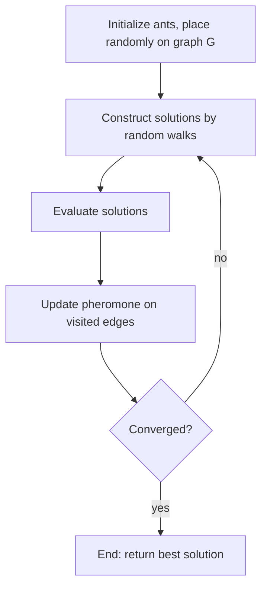

# Ant Colony Optimization

## Problem

**Input**: a graph `G` representing the working space of a combinatorial optimisation
problem, a predicate deciding whether a walk is a **valid solution**, and a quality
function to maximise.
**Output**: a good — not provably optimal — solution, found by repeated randomised
construction biased by accumulated experience.

## Idea

The summary given in the notes:

- A set `S` of **ants** is randomly placed on the working space in graph `G`.
- Each ant tries to **construct a valid solution** to the problem by a **random walk**.
- The movement is governed by **the probability that an ant `s` at vertex `u` moves to
  vertex `v`** — a probability that depends on the pheromone deposited on the edge
  `(u, v)`.
- Once an ant has **successfully constructed a valid solution**, it may **update the
  pheromone value of the edges it visited**.

So the colony's memory lives in the edges, not in the ants. Edges that have participated
in good solutions become more attractive, and over iterations the random walks
concentrate on the promising part of the search space. Pheromone **evaporation** keeps
the colony from locking onto the first decent solution it finds — the same
local-maximum problem that haunts [[expectation-maximization]] and is attacked
stochastically in [[gibbs-sampling]].

## Pseudocode

```text
ANT-COLONY-OPTIMIZATION(G, S, valid, quality, rho, max_iter):
  // S = number of ants, rho = evaporation rate in (0,1)
  INITIALIZE-ANTS:
    for each edge (u,v) in E(G): tau[u,v] ← tau_0      // initial pheromone
    best ← NIL

  for it ← 1 to max_iter:

    // --- construct solutions ---
    for each ant s ← 1 to S:
      u ← RANDOM-VERTEX(G)                             // ants are placed randomly
      H_s ← { u }
      while H_s can still be extended:
        choose v among the neighbours of H_s with
            P(u → v) ← tau[u,v]^alpha · eta[u,v]^beta
                       / Σ_{w neighbour} tau[u,w]^alpha · eta[u,w]^beta
        H_s ← H_s ∪ { v }                              // eta = heuristic desirability
        u ← v

    // --- evaluate solutions ---
    for each ant s:
      if valid(H_s) and quality(H_s) > quality(best): best ← H_s

    // --- update pheromone ---
    for each edge (u,v) in E(G):
      tau[u,v] ← (1 - rho) · tau[u,v]                  // evaporation
    for each ant s with valid(H_s):
      for each edge (u,v) visited by ant s:
        tau[u,v] ← tau[u,v] + quality(H_s)             // reinforcement

    // --- convergence? ---
    if CONVERGED(): break                              // yes → End; no → loop back

  return best
```

The four boxes of the flowchart in the notes — **Initialize Ants → Construct Solutions →
Evaluate Solutions → Update Pheromone → Convergence?** — are the four blocks above, with
the "no" branch looping back to *Construct Solutions* and the "yes" branch ending the
run.

## Worked example

On the [[travelling-salesman-problem]] with four cities, `eta[u,v] = 1/d(u,v)` (prefer
short edges) and `tau` initially uniform:

1. Iteration 1 — all `tau` equal, so the ants' choices are driven purely by `eta`; they
   produce a spread of tours, say of lengths 42, 47, 51 and 44.
2. Pheromone update — every edge loses a fraction `rho`, then the edges of the length-42
   tour receive the largest reinforcement.
3. Iteration 2 — those edges are now more likely to be chosen, so more ants rediscover
   the short tour and refine it.
4. Convergence — when all ants build (nearly) the same tour, the run stops.

In this course the "working space" is not a map of cities but an
[[interaction-network]], and the "valid solution" predicate is the `K`/`L` constraint of
[[keypathwayminer]].

## Complexity

- Per iteration: `O(S · n · deg)` to construct `S` walks of length `n`, plus `O(|E|)`
  for evaporation.
- Total: `O(max_iter · (S · n · deg + |E|))` — polynomial per run, but with **no
  guarantee of optimality**. That is the whole point: ACO trades the exponential
  certainty of exhaustive search for a polynomial, approximate answer, which is the only
  option on NP-hard problems (see [[algorithmic-complexity]]).

## Variants & pitfalls

- **Premature convergence.** Too much reinforcement or too little evaporation and the
  colony locks onto one mediocre solution. `rho` is the main dial.
- **`alpha` versus `beta`.** `alpha` weights accumulated experience, `beta` weights the
  problem-specific heuristic. `alpha = 0` gives a greedy heuristic search, `beta = 0`
  a pure reinforcement search.
- **Stochastic output.** Two runs give two answers. Results must be reported over
  repeated runs, exactly as for [[gibbs-sampling]].
- **Validity versus quality.** In KeyPathwayMiner an ant's walk must satisfy a *hard*
  constraint (`K`, `L`) before its quality (the subnetwork size) is even considered.

## Diagram


The ant-colony loop exactly as drawn in the notes, with the convergence test closing the cycle.

## Relations

- [[travelling-salesman-problem]] — the standard example application.
- [[keypathwayminer]] — the biological problem ACO solves in this course.
- [[hamiltonian-and-eulerian-paths]] — the graph-traversal vocabulary behind the TSP.
- [[algorithmic-complexity]] — why an approximate polynomial method is used at all.
- [[expectation-maximization]] and [[gibbs-sampling]] — the other two iterative
  "improve until convergence" schemes in this module, and the same local-maximum trap.
- [[greedy-assembly]] — a non-randomised heuristic for a similarly intractable problem.
- [[bicon]] — module 2 runs this colony over a joint expression/interaction network to find a network-constrained bi-clustering.
- [[transclust]] — another NP-hard clustering objective attacked by a cascade of heuristics rather than by exact search.
- [[neighbor-joining]] — the same response to an intractable search space: a greedy heuristic driven by a cheap local criterion rather than enumeration.
- [[evolutionary-algorithm]] — the other nature-inspired metaheuristic of module 2: a population of solutions rather than a pheromone trail.
- [[cytomcs]] — iterated local search, a third point on the same spectrum.
- [[gedevo]] — an evolutionary algorithm applied to network alignment.

## Appears in

- [[M2L01-enrichment-analysis]]
- [[M2E01-enrichment-analysis-and-keypathwayminer]]
- [[M2L05-network-based-disease-modules]]
- [[M2E05-grandforest-and-bicon]]
- [[M2L10-network-alignment]]

## Sources

- `raw/module2/csb_1.pdf`, p. 9 — the four-point summary, the pheromone update rule and
  the Initialize/Construct/Evaluate/Update/Converge flowchart, with the travelling
  salesman problem named as the example.
- `raw/module2/csb_1.pdf`, p. 11 — exercise.

- `raw/module2/csb_4.pdf`, pp. 13–17 — iterated local search and evolutionary search as alternative metaheuristics.
