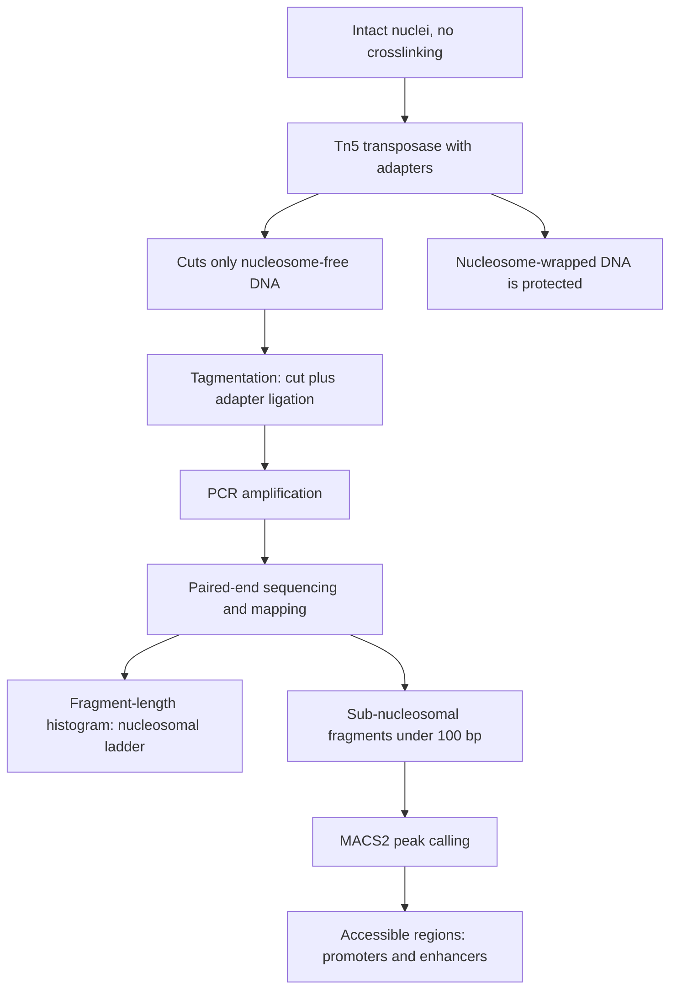

# ATAC-Seq

> [!note] Added beyond lecture notes
> Source: general domain knowledge (Buenrostro et al. 2013; standard epigenomics
> textbook material). Not from the UHH handwritten notes.
>
> **Scope of this callout: the whole page except the two statements below.** The
> handwritten notes name ATAC-Seq only twice — as one of the input data types
> [[peak-calling|MACS2]] can call peaks on (`gsb_part4.pdf` p. 9) — and never describe
> the assay itself. `wiki/gaps/open-questions.md` recorded that as a gap. Per
> `CLAUDE.md` §1 the epigenetics gap is filled here with established domain knowledge;
> everything in the sections below is such an addition and is **not** examinable
> lecture content unless the lecture slides confirm it.

**From the notes:** ATAC-Seq is listed as a data type that MACS2 accepts, alongside
TF ChIP data; ATAC-Seq peaks correspond to open-chromatin regions ([[chromatin]]).

## Problem

**Input**: a small number of intact, non-fixed nuclei (typically 500–50 000 cells).
**Output**: a genome-wide map of **chromatin accessibility** — which stretches of DNA are
free of nucleosomes and therefore available to the transcription machinery — delivered as
mapped reads whose enriched regions are found by [[peak-calling]].

ATAC-Seq answers the question [[chip-seq]] cannot: not *which protein sits here*, but
*is this region reachable at all*. It is the assay-level readout of the euchromatin /
heterochromatin distinction described in [[chromatin]].

## Idea

**ATAC** = *Assay for Transposase-Accessible Chromatin*. A hyperactive **Tn5
transposase** is loaded with sequencing adapters. Tn5 performs **tagmentation**: it cuts
double-stranded DNA and ligates its adapters to the cut ends in a single step. Crucially,
Tn5 can only reach DNA that is **not wrapped around a nucleosome** — so the cut density
is a direct measurement of accessibility.

Because cutting and library preparation are the same reaction, the protocol is short
(hours, not days) and needs no antibody, no crosslinking and no immunoprecipitation.

| | [[chip-seq]] | ATAC-Seq | [[bisulfite-sequencing]] |
|---|---|---|---|
| Measures | protein–DNA binding / [[histone-modification]] | nucleosome-free, accessible DNA | [[dna-methylation]] per cytosine |
| Needs an antibody | yes | **no** | no |
| Input material | millions of cells | hundreds to tens of thousands | variable |
| Signal | read pile-up at binding sites | read pile-up at open regions | C-versus-T base ratio |
| Downstream | [[peak-calling]] | [[peak-calling]] | DMR scan |

### Fragment-size structure

The fragment-length histogram is the assay's built-in quality control and carries real
signal:

- **< ~100 bp** — *sub-nucleosomal*: both Tn5 insertions fell inside one open region.
  This is the accessibility signal proper, and the fraction used for footprinting.
- **~180–250 bp** — *mono-nucleosomal*: the two insertions straddled a single
  nucleosome, so the wrapped ~147 bp plus linker sits between them (see [[chromatin]]).
- **~350–450, ~550–650 bp** — di- and tri-nucleosomal, decaying in a characteristic
  ladder.

A library without this periodic ladder is a failed library.

## Pseudocode

```text
ATAC-SEQ(nuclei, reference):
  N ← ISOLATE-NUCLEI(nuclei)                 // gentle lysis, no crosslinking
  F ← TAGMENT(N, Tn5_with_adapters)          // cut + adapter ligation in one step;
                                             // Tn5 reaches only nucleosome-free DNA
  L ← PCR-AMPLIFY(F)
  R ← SEQUENCE(L)                            // paired-end: both ends give the fragment length
  M ← MAP(R, reference)

  M ← REMOVE-DUPLICATES(M)
  M ← REMOVE-MITOCHONDRIAL(M)                // chrM is adapter-accessible and dominates the library

  for each mapped fragment f in M:
    shift f.start by +4 on the plus strand   // correct for the 9 bp staggered Tn5 cut
    shift f.end   by -5 on the minus strand

  H ← FRAGMENT-LENGTH-HISTOGRAM(M)           // QC: expect the nucleosomal ladder
  sub ← { f in M : length(f) < 100 }         // sub-nucleosomal = accessibility signal

  peaks ← CALL-PEAKS(sub)                    // MACS2, see [[peak-calling]]
  return peaks, H
```

Because there is no immunoprecipitated-versus-input pair, the background is taken from
the **local read density** rather than from a control library — exactly the dynamic local
Poisson λ that [[peak-calling]] already describes.

## Worked example

A 50 000-nucleus experiment yields 60 M paired-end reads. After removing duplicates and
the 25 % of reads mapping to the mitochondrial genome, 40 M remain. The fragment-length
histogram shows a sharp peak below 100 bp and clear bumps near 200 bp and 400 bp — the
library is good. Restricting to the sub-nucleosomal fraction and running MACS2 gives
~70 000 peaks, of which the strongest sit over [[promoter|promoters]] and over distal
elements that overlap known [[transcription-factor-binding-site|binding sites]].

## Complexity

The computational cost is that of any short-read pipeline: mapping dominates
(see [[next-generation-sequencing]]), then one linear pass for shifting and the
histogram, then [[peak-calling]] itself.

## Variants & pitfalls

- **Mitochondrial contamination** — naked mitochondrial DNA is perfectly accessible and
  can swallow 20–50 % of reads. Omni-ATAC and CUT-and-Tag-style protocols reduce it.
- **Over- or under-tagmentation** — too much Tn5 cuts even closed chromatin and
  flattens the signal; too little gives only long fragments.
- **No antibody means no specificity**: a peak says *open*, not *bound by X*. Pairing
  ATAC-Seq with [[chip-seq]] or with a [[position-weight-matrix]] scan of the peak
  sequences is what assigns a factor to an open region.
- **scATAC-Seq** applies the same chemistry per single cell, at the cost of extreme
  sparsity (a few thousand fragments per cell).
- **Footprinting** — within a broad open region, the base-resolution dip where a factor
  physically protects the DNA from Tn5 can reveal the bound motif, but it requires very
  deep coverage.

## Diagram


Tn5 tagmentation converts chromatin accessibility into sequenceable fragments, whose enriched regions are then called as peaks.

## Relations

- [[chromatin]] — accessibility is the operational definition of euchromatin; ATAC-Seq
  measures it directly.
- [[peak-calling]] — the step that turns ATAC-Seq read pile-ups into regions; the notes
  name ATAC-Seq precisely as a MACS2 input.
- [[chip-seq]] — the complementary assay: ChIP asks *who binds*, ATAC asks *what is
  reachable*.
- [[bisulfite-sequencing]] — the third epigenomic readout, measuring the DNA-level mark
  instead of the packaging.
- [[epigenetics]] — ATAC-Seq is one of the standard assays of the field.
- [[histone-modification]] — nucleosome positioning determines what Tn5 can reach.
- [[transcription-factor-binding-site]] — open regions are where binding sites are
  actually usable; motif scanning of peaks assigns factors to them.
- [[next-generation-sequencing]] — the readout platform and the source of its biases.
- [[promoter]] — the strongest and most reproducible class of ATAC-Seq peaks.

## Appears in

- [[L16-epigenetics]]
- [[E12-epigenetics-and-peak-calling]]

## Sources

- `raw/module1/gsb_part4.pdf`, p. 9 — ATAC-Seq named as a MACS2 input data type (the
  only mention in the notes).
- Everything else on this page: general domain knowledge added under `CLAUDE.md` §1, as
  marked by the callout at the top.
