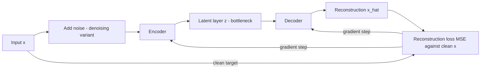

# Autoencoder

## Problem

**Input**: unlabelled high-dimensional data.
**Output**: a low-dimensional **latent representation** of each data point, plus a
decoder able to reconstruct the original from it.

Autoencoders are explicitly marked **unsupervised** in the notes — the only
[[deep-learning]] architecture there that needs no labels.

## Idea

Squeeze the data through a bottleneck and ask the network to put it back together:

```text
In  →  [ encoder ]  →  latent layer  →  [ decoder ]  →  Out
```

If the output matches the input despite the bottleneck, the latent layer must contain
everything that mattered. Training minimises the **reconstruction loss**:

```text
reconstruction loss = MSE( input , output )
```

The notes add the observation that makes it biologically interesting:

> Sometimes the **latent representation of data points can show identity properties**.

That is, the compressed coordinates can separate cell types, patients or conditions even
though no label was ever supplied — the same promise as
[[principal-component-analysis]], but with a non-linear encoder.

**Denoising autoencoder.** *For denoising autoencoders we add noise to the data before
feeding it into the encoder* — the target stays the clean input, so the network is
forced to learn the structure rather than copy its input.

**Assumptions for autoencoders to work**

- higher-dimensional data **needs a representation in lower dimension**;
- the data should have **irrelevant dimensions**, which are the ones discarded by the
  encoder.

If neither holds — if every dimension carries independent signal — the bottleneck simply
destroys information.

## Pseudocode

```text
TRAIN-AUTOENCODER(X, d_latent, η, epochs, noiseLevel):
  // encoder E: ℝ^n → ℝ^d_latent ,  decoder D: ℝ^d_latent → ℝ^n
  initialise E, D randomly
  for e ← 1 to epochs:
    for each mini-batch B ⊆ X:
      L ← 0
      for each x ∈ B:
        x̃ ← x + NOISE(noiseLevel)        // denoising variant; x̃ ← x otherwise
        z  ← E(x̃)                        // latent representation
        x̂  ← D(z)
        L  ← L + MSE(x, x̂)               // target is always the CLEAN x
      L ← L / |B|
      (E, D) ← GRADIENT-STEP(E, D, ∇L, η)   // gradients from backpropagation
  return E, D

ENCODE(x):  return E(x)                    // the useful output: the latent code
```

## Worked example

The notes give no numeric example. The structural example they draw is the classic
hourglass: a wide input layer, narrowing to a thin **latent layer**, widening again to an
output layer of the input's width. Taking a `20 000`-gene expression profile down to a
latent layer of, say, 10 units and back is the direct analogue of taking the first ten
principal components — except that the encoder may use non-linear boundaries, so it can
represent structure a linear projection cannot.

## Diagram



The data are squeezed through the bottleneck and rebuilt, and the reconstruction loss against the clean input drives both encoder and decoder.

## Complexity

Same as the underlying [[neural-network]]: `O(#weights)` per sample per pass, and the
weight count is dominated by the two layers adjacent to the input. The latent dimension
`d_latent` is the one hyper-parameter that controls both capacity and compression.

## Variants & pitfalls

- **Denoising autoencoder** — add noise before the encoder, as above.
- **The bottleneck must actually bind.** If the latent layer is as wide as the input, the
  network can learn the identity function and the reconstruction loss goes to zero while
  nothing has been learned.
- **No clustering is performed.** Like [[t-sne]] and [[umap]], an autoencoder produces a
  representation; grouping the points is a separate step ([[k-means]],
  [[cluster-analysis]]).
- **The latent axes have no meaning** individually, unlike principal components, which
  are ordered by explained variance.

## Relations

- [[deep-learning]], [[neural-network]] — the architecture family and the building block.
- [[generative-adversarial-network]] — the other generative architecture in the notes;
  both learn the data distribution, the GAN by an adversarial game rather than by
  reconstruction.
- [[principal-component-analysis]] — the linear ancestor: both compress to a few
  coordinates and both are unsupervised, but PCA's projection is a fixed orthogonal
  rotation.
- [[t-sne]], [[umap]] — the non-linear dimensionality reductions used in
  [[M2L07-single-cell-rna-seq]]; those two are for **visualization only**, while an
  autoencoder gives a reusable encoder.
- [[cost-function]] — the reconstruction loss is an MSE.
- [[machine-learning]] — autoencoders sit on the unsupervised side.
- [[cluster-analysis]] — the natural consumer of a latent representation.

## Appears in

- [[M2L06-deep-learning]]

## Sources

- `raw/module2/csb_3.pdf`, p. 7 — the encoder/latent/decoder diagram, "unsupervised",
  reconstruction loss as MSE(input, output), latent representations showing identity
  properties, denoising autoencoders, and the two assumptions for autoencoders to work.
