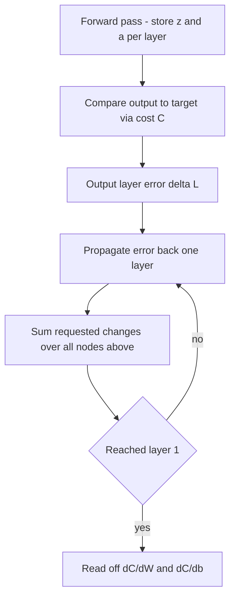

# Backpropagation

## Problem

**Input**: a [[neural-network]] with weights `W` and biases `b`, a training example
`(x, y)` and a [[cost-function]] `C`.
**Output**: the gradient `∇C` with respect to **every** weight and bias in the network,
so that [[gradient-descent]] can take a step.

## Idea

The exercise definition from the notes:

> Backpropagation **performs a backward pass to adjust the model's parameters**, aiming
> to minimise the mean squared error. Predicted results are compared to the correct
> result and the error is computed; this is used to update the neuron parameters.
> **Updates are propagated backwards through the network.**

The intuition for *what* the update wants, read off the last layer: for a given output
neuron whose activation should be larger,

- **increase `b`**,
- **increase `w_i` in proportion to `a_i`** — a loud input deserves a bigger weight,
- **change `a_i` in proportion to `w_i`** — which is a *request* to the previous layer,
  not something this layer can do.

That last line is the recursion: each layer passes a desired change in activations back
to the layer below it. The notes summarise it with Hebb's slogan:

> **Neurons that fire together wire together.**

Because every output neuron makes its own request, the changes demanded of layer `l−1`
are **summed over all output nodes** of layer `l` before being passed further back.

## Pseudocode

```text
BACKPROPAGATION(x, y, W, b, g, L):
  // ---- forward pass: remember every intermediate value ----
  a[0] ← x
  for l ← 1 to L:
    z[l] ← W[l] · a[l-1] + b[l]
    a[l] ← g[l]( z[l] )

  // ---- output layer error ----
  δ[L] ← ∇_a C( a[L], y ) ⊙ g'[L]( z[L] )      // ⊙ = elementwise product
                                               // for C = Σ(out − real)²:
                                               //   ∇_a C = 2 · (a[L] − y)

  // ---- backward pass: propagate the error ----
  for l ← L−1 down to 1:
    δ[l] ← ( W[l+1]ᵀ · δ[l+1] ) ⊙ g'[l]( z[l] )   // sum over all nodes of layer l+1

  // ---- read off the gradients ----
  for l ← 1 to L:
    ∂C/∂b[l] ← δ[l]
    ∂C/∂W[l] ← δ[l] · a[l-1]ᵀ                  // change w_i in proportion to a_i

  return ∂C/∂W, ∂C/∂b
```

Averaged over a mini-batch, as the notes write it:

```text
∂C/∂w^l  =  (1/n) · Σ_{k=0}^{n−1}  ∂C_k/∂w^l
```

## Worked example

The notes trace one output neuron `O_2` of the last layer:

```text
O_2 = σ( w_0 a_0 + … + w_{n−1} a_{n−1} + b )
```

Suppose the target for `O_2` is higher than the value produced. Three levers exist, and
backpropagation uses all three at once:

| Lever | Direction | Owned by |
|---|---|---|
| `b` | increase | this layer |
| `w_i` | increase **in proportion to `a_i`** | this layer |
| `a_i` | change **in proportion to `w_i`** | the previous layer — becomes `δ[l−1]` |

Doing this for *every* output node and summing the requested `a_i` changes is exactly the
`W[l+1]ᵀ · δ[l+1]` line of the pseudocode.

## Diagram



The forward pass stores every intermediate value, then the error is pushed backwards layer by layer until every weight and bias has a gradient.

## Complexity

```text
time  O(#weights)   per training example — the same order as one forward pass
space O(#weights + Σ_l n_l)  — W, b and every stored z[l], a[l]
```

The storage of all intermediate activations is why memory, not arithmetic, limits the
batch size: *big batches won't fit in the GPU*.

## Variants & pitfalls

- **Vanishing / exploding gradients.** Every backward step multiplies by `g'(z)` and by
  `W`. With a saturating [[activation-function]] such as the sigmoid, `g'(z) ≈ 0` over
  most of its range, so `δ` shrinks towards the input layer and early layers stop
  learning. The notes' fixes: **residual / shortcut connections** (VGG, ResNets) and
  **batch normalization**; against the opposite failure, **gradient clipping**.
- **Mini-batches** — the gradient is averaged over a batch before the update, trading
  estimate noise against memory.
- **It needs differentiability**, which rules out the binary-step activation.

## Relations

- [[gradient-descent]] — consumes the gradient this method produces.
- [[cost-function]] — differentiated at the output layer to start the recursion.
- [[neural-network]] — the forward pass whose intermediate values are reused.
- [[activation-function]] — `g'(z)` appears in every backward step; its shape decides
  whether the gradient survives.
- [[deep-learning]] — backpropagation is what makes deep stacks trainable at all.
- [[dynamic-programming]] — the backward pass is a classic reuse of stored subresults,
  exactly like the traceback phase of [[needleman-wunsch]] or [[viterbi-algorithm]].
- [[baum-welch-algorithm]] — the other "run forwards, then run backwards to re-estimate
  parameters" algorithm in the wiki.
- [[convolutional-neural-network]] — shared kernel weights are trained by the same backward pass.
- [[generative-adversarial-network]] — gradients flow back through the discriminator into the generator.
- [[recurrent-neural-network]] — backpropagation through time is the recurrent form of the same rule.

## Appears in

- [[M2L06-deep-learning]]
- [[M2E06-deep-learning]]
- [[M2L03-machine-learning-and-classification]] — named as the training rule that makes multi-layer classifiers learnable.

## Sources

- `raw/module2/csb_3.pdf`, p. 5 — the `O_2` trace, the three levers, "neurons that fire
  together wire together", `−η∇C(w)`, the mini-batch averaging formula.
- `raw/module2/csb_3.pdf`, p. 7 — residual/shortcut connections against the
  vanishing/exploding gradient problem.
- `raw/module2/csb_3.pdf`, p. 10 — the exercise definition of backpropagation.
- `raw/module2/csb_3.pdf`, p. 11 — the epoch loop: forward pass, loss calculation,
  backward pass, parameter update.
