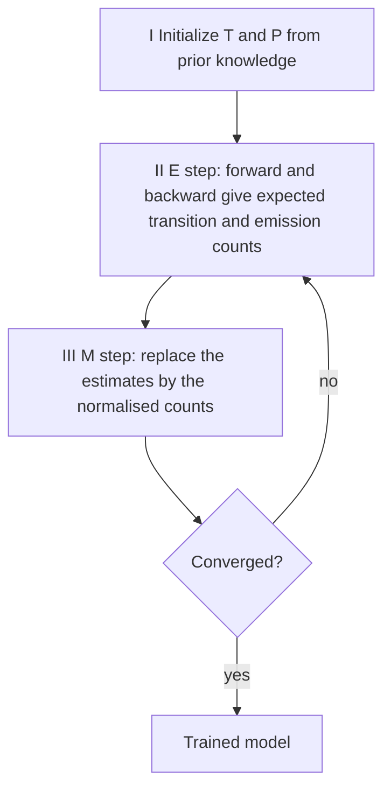

# Baum–Welch algorithm

## Problem

The **learning problem** of a [[hidden-markov-model]]:

> Given a model and a set of observed sequences, how do we set the model's parameters so
> that it has a high probability of generating those sequences?

**Input**: the **topology** of the HMM (which states exist and which transitions are
allowed) and a set of training sequences `s(1), …, s(n)`.
**Output**: all transition probabilities `T(r | q)` and emission probabilities `P(x | q)`.

The notes put it plainly: the algorithm *allows us to determine all the probabilities in
an HMM by using an ensemble of training data.*

## Idea

The algorithm is the **EM (expectation–maximization) algorithm**, in the HMM setting also
called the **forward–backward algorithm** after the [[forward-algorithm]] it calls
internally. The chicken-and-egg problem is that the parameters would be easy to count if
the state paths were known, and the state paths would be easy to infer if the parameters
were known. EM breaks the circle by **iterative adaptation of the model to fit the data**:
guess parameters, use them to compute expected counts, re-estimate from those counts,
repeat.

### What is being maximised

- **Maximum likelihood (ML)** of the model — given `s(1), …, s(n)`, find

  ```
  P(seq's | model) = ∏_{j=1}^{n} P(s(j) | model)  →  max
  ```

  usually reported as the **negative log likelihood**,
  `NLL-score = −log P(seq's | model)` (smaller is better).

- **Maximum a posteriori (MAP)** of the model — Bayes' rule turns the question around:

  ```
  P(model | seq's) = P(seq's | model) · P(model) / P(seq's)
  ```

  Since `P(seq's)` does not depend on the model, the best model maximises

  ```
  P(seq's | model) · P(model)  →  max
  ```

  i.e. ML weighted by a **prior** on the model.

## Pseudocode

```text
BAUM-WELCH(S, Q, topology):
  // S ← training sequences s(1) … s(n); Q ← states
  // I) Initialize
  for each q, r in Q, each symbol x:
    T(r | q) ← prior knowledge                 // initial transition estimates
    P(x | q) ← prior knowledge                 // initial emission estimates

  repeat
    // II) Get new estimates, by expected counts over all training sequences
    for each q, r in Q: A[q, r] ← 0
    for each q in Q, each symbol x: E[q, x] ← 0

    for each sequence s in S:
      f ← FORWARD(s, Q, T, P)                  // see the forward algorithm
      b ← BACKWARD(s, Q, T, P)
      Ps ← P(s | model)
      for i ← 1 to |s|:
        for each q in Q:
          for each r in Q:
            // expected number of times a transition is made from state q to r
            A[q, r] ← A[q, r] + f[q, i] · T(r | q) · P(s[i+1] | r) · b[r, i+1] / Ps
          // expected number of times symbol s[i] is aligned to state q
          E[q, s[i]] ← E[q, s[i]] + f[q, i] · b[q, i] / Ps

    // III) Replace estimations
    for each q in Q:
      for each r in Q:       T(r | q) ← A[q, r] / Σ_{r' in Q} A[q, r']
      for each symbol x:     P(x | q) ← E[q, x] / Σ_{x'} E[q, x']

    score ← −log ∏_{s in S} P(s | model)       // NLL of the whole training set
  // IV) Repeat II and III until convergence
  until score changes by less than ε

  return T, P
```

The counting step is exactly what the notes write out: `T(r|q)` is the **count of the
number of times a transition is made from state `q` to `r`**, and `P(x|q)` the **count of
the number of times the amino acid `x` is aligned to the state `q`** — with the
qualification that for a hidden model these are *expected* counts, weighted by the
posterior probability of each path rather than hard counts.

## Worked example

Train a profile HMM on a protein family. Initialise with a flat prior: every match state
emits all 20 amino acids equally, transitions along the backbone are likely and
insert/delete transitions are rare.

After one E-step over the training sequences, match state `m₂` collects an expected count
of 18.4 for leucine and 0.3 for tryptophan; the M-step turns these into emission
probabilities of roughly 0.73 and 0.01. The NLL drops. A second iteration sharpens the
estimates further; after a handful of iterations the NLL stops improving and training
stops. The resulting model is then used with the [[viterbi-algorithm]] to align new
sequences to the family.

## Complexity

- One iteration costs one forward and one backward pass per training sequence:
  `O(n · L · |Q|²)` time for `n` sequences of length `L`.
- Space `O(L · |Q|)` for the trellis of the current sequence, plus `O(|Q|² + |Q|·|Σ|)`
  for the count matrices.
- The number of iterations is data-dependent and not bounded a priori.

## Variants & pitfalls

- **Local maxima** — EM increases the likelihood monotonically but converges to a *local*
  optimum; the result depends on the initialisation, which is why **prior knowledge** is
  listed as an advantage of HMMs.
- **Over-fitting** — with many states and few sequences the model memorises the training
  set; pseudo-counts (the same device as in a [[position-weight-matrix]]) or a MAP prior
  regularise it.
- **Zero probabilities** are absorbing: a transition initialised at 0 can never be
  recovered, so the topology must be chosen deliberately.
- **Viterbi training** is the cheaper alternative: instead of expected counts over all
  paths, count along the single best path from the [[viterbi-algorithm]]. Faster, but it
  optimises a different objective.
- Convergence is in likelihood, not in parameters — the stopping criterion must be on the
  NLL score.

## Diagram


The EM loop: expected counts in, re-estimated parameters out, repeated until the likelihood stops improving.

## Relations

- [[hidden-markov-model]] — the model being trained; learning is its second problem.
- [[forward-algorithm]] — supplies the forward and backward variables of the E-step.
- [[viterbi-algorithm]] — the decoding step that uses the trained parameters, and the
  basis of the cheaper Viterbi-training variant.
- [[markov-chain]] — the transition matrix being estimated.
- [[statistical-testing]] — likelihood and the NLL score are the same machinery that
  underlies likelihood-based tests.
- [[position-weight-matrix]] — the gapless analogue whose counts are estimated directly,
  without EM, because its "paths" are not hidden.
- [[expectation-maximization]] — the general framework of which Baum–Welch is the HMM
  instance: use probabilities to complete the data, then apply MLE. Here the missing data
  is the hidden state path; in [[em-motif-discovery]] it is the motif position; in the
  coin example it is which coin was flipped. The full treatment of the general scheme,
  its monotone likelihood increase and its local-maximum caveat is on
  [[expectation-maximization]].
- [[em-motif-discovery]] — the sibling instance, on a gapless motif model.
- [[gibbs-sampling]] — the stochastic alternative that escapes local maxima by sampling
  rather than averaging.
- [[cpg-island]] — the application in which the hidden state is "island" versus
  "non-island".
- [[backpropagation]] — the deep-learning counterpart: both are iterative parameter-fitting procedures that climb a likelihood or descend a cost rather than solving in closed form.
- [[recurrent-neural-network]] — the neural replacement for HMMs on sequence data.
- [[maximum-likelihood]] — the objective this algorithm maximises; the NLL score is its negative logarithm.

## Appears in

- [[L17-markov-chains-and-hidden-markov-models]]
- [[M2E02-motif-discovery-and-expectation-maximization]]

## Sources

- `raw/module1/gsb_part4.pdf`, p. 16 (learning problem, EM / forward–backward, ML, NLL,
  MAP, the four iteration steps), p. 18 (summary and the over-fitting / local-maxima
  caveats).
- `raw/module2/csb_1.pdf`, p. 18 — the general statement of expectation maximization of
  which this algorithm is an instance.
