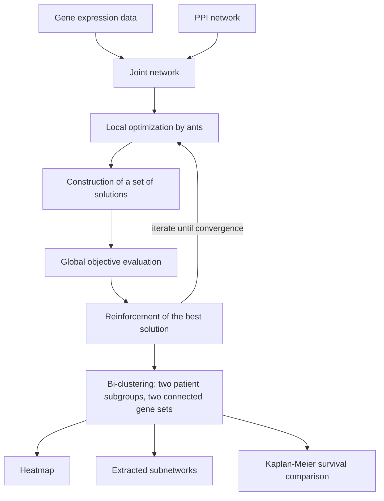

# BiCoN

## Problem

**Input**: **expression data** and an **interaction network** (a PPI network).
**Output**: a **bi-clustering with `k` genes inside the bi-clusters that induce a
connected subnetwork** — i.e. two patient subgroups together with the two gene sets that
separate them.

BiCoN (earlier **BiGAnts**) is **network-constrained bi-clustering for de novo
[[endophenotype|endophenotypes]]**.

## Idea

**Motivation**

- **Supervised methods are biased to current disease definitions.**
- **Disease subtypes may exist.**
- **Different mechanotypes require different treatments.**
- **Shelved drugs might be effective and/or repurposable.**

**Canonical approaches are not integrative enough**: clustering (rows *or* columns),
bi-clustering, community detection — each uses either the expression matrix or the
network, never both.

**The BiCoN idea**: bi-cluster patients and genes **simultaneously**, under two
constraints:

- **restriction of the genes in the bi-clusters to be functionally related** — i.e.
  **connected in the network**;
- **maximize the expression differences of these two gene sets between the two subgroups
  of patients**.

The search is combinatorial and is run with **ants**
([[ant-colony-optimization]]), the same metaheuristic [[keypathwayminer]] uses.

## Pseudocode

```text
BICON(E, PPI, k_min, k_max, n_ants, ρ, max_iter):
  // E   : gene expression matrix (genes × patients)
  // PPI : protein-protein interaction network
  // k_min, k_max : minimal and maximal number of genes per subnetwork
  // ρ   : evaporation rate
  J ← JOINT-NETWORK(E, PPI)                      // expression + topology in one graph
  τ ← initial pheromone on every edge of J
  best ← none
  for it ← 1 to max_iter:
    solutions ← ∅
    for a ← 1 to n_ants:                         // local optimization, one ant each
      (G1, G2) ← ∅, ∅
      while |G1| < k_max:
        g ← choose a neighbour in J with probability ∝ τ(edge) · heuristic(edge)
        G1 ← G1 ∪ { g }                          // keeps G1 connected by construction
      repeat for G2
      (P1, P2) ← split the patients by the expression of G1 versus G2
      solutions ← solutions ∪ { (G1, G2, P1, P2) }

    // construction of a set of solutions → global objective evaluation
    for each s ∈ solutions:
      score(s) ← expression difference of the two gene sets between P1 and P2
                 provided G1 and G2 each induce a connected subnetwork
                 and k_min ≤ |G_i| ≤ k_max
    best ← argmax score over solutions ∪ { best }

    // reinforcement of the best solution
    τ ← (1 − ρ) · τ                              // evaporation
    for each edge e used by best:
      τ(e) ← τ(e) + Δ(score(best))               // reinforcement
    if all ants converged to a single solution: break
  return best                                    // (G1, G2, P1, P2)
```

## Worked example

The pipeline exactly as drawn in the notes:

```text
Gene Expression Data  ─┐
                       ├→ Joint Network → Local Optimization (Ant)
PPI Network           ─┘                         │
                                                 ▼
                    Construction of a set of solutions
                                                 │
                                                 ▼
                         Global objective evaluation
                                                 │
                                                 ▼
                      Reinforcement of the best solution
                                                 │
                     iterations until convergence to a single solution
```

**Reading the output** (from the exercise):

| Output | What it shows |
|---|---|
| **Extracted subnetworks** | a **connected subnetwork with `k` genes** inside the bi-cluster |
| **Heatmap** | the **bi-clustering** itself — patients on one axis, genes on the other |
| **Survival analysis** | a **[[kaplan-meier-plot]]** showing the **difference in survival rate between the bi-clusters** |

**Parameters used by BiCoN**:

- **minimal and maximal number of genes** wanted in each subnetwork
- **gene set size / input size**
- **maximum number of iterations**
- **number of ants** — more ants can **explore a larger search space**, so increase it
  with the search space
- **evaporation rate** — **decrease it until convergence**

## Diagram


The BiCoN loop: ants build connected candidate gene sets on a joint network, the best solution is reinforced, and the result is read as a bi-clustering.

## Complexity

Each iteration costs `O(n_ants · k_max · deg)` network steps plus one objective
evaluation per solution over the expression matrix. The underlying problem — find two
connected subnetworks maximising an expression contrast — is combinatorial and
intractable to solve exactly, which is why a metaheuristic with **no optimality
guarantee** is used; the run time is controlled by `max_iter` and `n_ants`.

## Variants & pitfalls

- **Robustness to noise**: BiCoN **considers only connected subnetworks**, so isolated
  noisy genes cannot enter a solution.
- As with any [[ant-colony-optimization]] run, the answer is **good, not provably
  optimal**, and depends on the evaporation rate and the number of ants.
- The output is **two** patient subgroups by construction; finer stratification needs
  repeated runs.
- The network prior inherits the biases of the PPI database.
- **Used to**: identify patient subgroups and biomarkers and/or disease-correlated genes.

## Relations

- [[ant-colony-optimization]] — the search engine; BiCoN's parameters (ants, evaporation
  rate) are its parameters.
- [[interaction-network]] — the PPI network supplying the connectivity constraint.
- [[endophenotype]] — the goal: de novo mechanotypes rather than existing diagnoses.
- [[kaplan-meier-plot]] — how the two bi-clusters are compared clinically.
- [[cluster-analysis]] — bi-clustering is clustering on rows and columns at once.
- [[grandforest]] — the other network-constrained de novo method in the same lecture;
  forest-based rather than ant-based.
- [[keypathwayminer]] — the module-2 part-1 ancestor: ants on a network, but extracting
  one module rather than a bi-clustering.
- [[rna-seq]], [[microarray-expression-analysis]] — the assays producing the expression
  matrix.
- [[machine-learning]] — unsupervised learning, since the patients are unlabelled.
- [[graph-neural-network]] — the deep-learning route to the same problem: learning on a network instead of searching it combinatorially.
- [[evolutionary-algorithm]] — the metaheuristic family BiCoN's genetic search belongs to.

## Appears in

- [[M2L05-network-based-disease-modules]]
- [[M2E05-grandforest-and-bicon]]
- [[M2E01-enrichment-analysis-and-keypathwayminer]] — run alongside KeyPathwayMiner as a network-enrichment tool.
- [[M2L01-enrichment-analysis]] — introduced as a network-constrained alternative to set-based enrichment.

## Sources

- `raw/module2/csb_part2.pdf`, p. 23 — motivation, the inadequacy of canonical
  approaches, the idea, input/output, the two constraints, the ant pipeline, the use
  cases and the robustness argument.
- `raw/module2/csb_part2.pdf`, p. 25 — the exercise: extracted subnetworks, heatmap,
  survival analysis and the five parameters.

- `raw/module2/csb_4.pdf`, p. 15 — the generic evolutionary algorithm loop.
