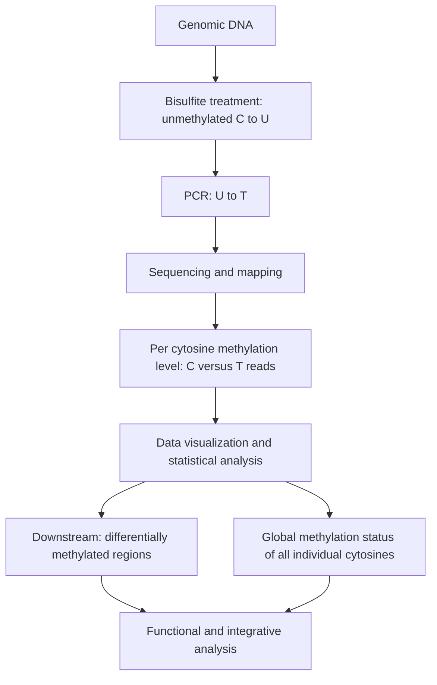

# Bisulfite sequencing

## Problem

**Input**: genomic DNA from one or more samples.
**Output**: the **methylation status of every individual cytosine** in the genome, and —
by comparing groups — the **differentially methylated regions (DMRs)** between them.

Sequencing alone cannot see [[dna-methylation]]: a methyl group does not change base
pairing, so a methylated C is read as a plain C. Bisulfite treatment converts the
chemical mark into a **sequence difference** that an ordinary sequencer can read.

## Idea

Sodium bisulfite deaminates **unmethylated** cytosine to **uracil** while leaving
**methylated** cytosine untouched. The subsequent PCR replaces every U by **T**. After
mapping against the untreated reference:

| In the sample | After bisulfite | After PCR | Read as |
|---|---|---|---|
| unmethylated C | U | T | **T** |
| methylated C | C | C | **C** |

So a `C` in the read at a reference `C` position means **methylated**, a `T` means
**unmethylated** — the two are discriminated base by base. The methylation level of a
site is the fraction of reads still showing `C`.

Downstream, the per-cytosine levels are aggregated into **regions**: the task set in the
notes is *find the maximal DMR with at most `k` exceptions*, with the concrete parameters
`ex ≤ 2`, `p ≤ 0.05` and window size `S`.

## Pseudocode

```text
BISULFITE-SEQ(sample, reference):
  D ← EXTRACT-DNA(sample)
  D ← BISULFITE-TREAT(D)                  // unmethylated C → U, methylated C stays C
  L ← PCR-AMPLIFY(D)                      // U → T
  R ← SEQUENCE(L)
  M ← MAP(R, reference)                   // allow C/T mismatches during mapping

  for each cytosine position i of the reference:
    c ← #reads of M covering i that show 'C'
    t ← #reads of M covering i that show 'T'
    if c + t ≥ MIN-COVERAGE:
      level[i] ← c / (c + t)              // methylation level in [0,1]
  return level

FIND-MAX-DMR(level_A, level_B, S, k, α):
  // level_A, level_B ← per-cytosine methylation levels of the two groups
  // S ← minimum window size, k ← number of tolerated exceptions, α ← significance level
  best ← ∅
  for each start position i over the cytosine positions:
    j ← i; exceptions ← 0
    while j ≤ last position:
      p ← TEST-DIFFERENCE(level_A[j], level_B[j])     // per-site statistical test
      if p > α:
        exceptions ← exceptions + 1                   // a site that is NOT differential
        if exceptions > k: break                      // at most k exceptions allowed
      j ← j + 1
    if LENGTH(i, j) ≥ S and LENGTH(i, j) > LENGTH(best):
      best ← region(i, j)                             // keep the maximal region
  return best
```

The second procedure is the "maximal region with at most `k` exceptions" formulation
given on p. 8; with the parameters from the notes, `k = 2` and `α = 0.05`.

## Worked example

At one CpG site, 40 reads cover the position: 34 read `C`, 6 read `T`. The methylation
level is `34/40 = 0.85` — the site is highly methylated. In the control group the same
site reads 5 `C` and 35 `T`, i.e. `0.125`. The per-site test is significant, so the site
is differential.

Scanning outward, the next four sites are also differential, site 6 is not
(`exceptions = 1`), sites 7–9 are, site 10 is not (`exceptions = 2`), site 11 is, site 12
is not — with `k = 2` the region stops there. The 11-site region is reported as a DMR if
it spans at least `S` bases.

## Complexity

- Sequencing and mapping dominate; see [[next-generation-sequencing]]. Mapping is harder
  than usual because the converted library has a reduced alphabet (almost no unmethylated
  C), which lowers mapping specificity.
- Per-site level computation: one pass over the mapped reads, `O(|M|)`.
- The naive maximal-DMR scan above is `O(n²)` in the number of cytosine positions; it
  becomes `O(n·k)` with a sliding window that keeps the exception count incrementally.

## Variants & pitfalls

- **Incomplete conversion** makes unmethylated cytosines look methylated; a spiked-in
  unmethylated control sequence is used to measure the conversion rate.
- **Reduced alphabet** — the converted genome has far lower complexity, so reads map
  ambiguously more often.
- **Coverage** — a methylation level is a ratio of small counts; low-coverage sites carry
  huge sampling noise and are normally discarded below a minimum coverage.
- Bisulfite treatment **cannot distinguish 5-methylcytosine from 5-hydroxymethyl-
  cytosine**; both survive the treatment.
- Long-read platforms ([[next-generation-sequencing]]) read base modifications directly
  and need no conversion at all.

> [!note] Added beyond lecture notes
> Source: general domain knowledge (Booth et al., *Science* 336:934, 2012 on oxBS-Seq;
> Yu et al., *Cell* 149:1368, 2012 on TAB-Seq; Meissner et al., *NAR* 33:5868, 2005 on
> RRBS; Vaisvila et al., *Genome Res.* 31:1280, 2021 on enzymatic methyl-seq). Not from
> the UHH handwritten notes.
>
> **Resolving the 5mC / 5hmC ambiguity.** The pitfall above has two standard fixes, both
> of which work by running a *second* library and subtracting:
>
> - **oxBS-Seq** — chemically oxidise 5hmC to 5fC before the bisulfite step, so 5hmC now
>   converts to T as well. The oxidised library reports **5mC only**; the difference
>   `BS − oxBS` is the 5hmC level per site.
> - **TAB-Seq** — protect 5hmC by glucosylation, then use TET to oxidise 5mC so that it
>   *does* convert. This library reports **5hmC only**, directly.
>
> **Avoiding bisulfite altogether.** Bisulfite is harsh and degrades most of the input
> DNA, which is why low-input libraries are noisy. **EM-seq** replaces the chemistry with
> two enzymes (TET2 plus APOBEC3A) and gives the same C/T readout with far less
> fragmentation; nanopore and PacBio read the modification from the raw signal with no
> conversion step at all, and additionally phase the mark to an allele.
>
> **Which fraction of the genome to sequence.** Three designs trade coverage against cost,
> and the choice determines what the DMR scan above can even see:
>
> | Design | Covers | Typical use |
> |---|---|---|
> | **WGBS** | every cytosine | reference epigenomes, discovery of unexpected DMRs |
> | **RRBS** | MspI fragments, i.e. CpG-rich regions | cheap screening, biased towards [[cpg-island|islands]] |
> | **Arrays** (450k, EPIC) | a fixed panel of ~450 000 / ~900 000 CpGs | large cohorts, the usual input to an [[epigenome-wide-association-study]] |
>
> RRBS and arrays both under-sample the **island shores** where much of the differential
> signal actually sits ([[cpg-island]]).


> [!note] Added beyond lecture notes
> Source: general domain knowledge (standard epigenomics / statistics material). Not
> from the UHH handwritten notes.
>
> **Which test goes in `TEST-DIFFERENCE`.** The notes specify only `p ≤ 0.05` and never
> name a test, which `wiki/gaps/open-questions.md` records as a gap. The standard choices
> are:
>
> - **Fisher's exact test** on the 2×2 table of (methylated, unmethylated) read counts
>   in group A versus group B at that cytosine. This is the natural test because the data
>   really are counts, and it is the same test already used for case/control genotype
>   tables in [[genome-wide-association-study]].
> - **Beta-binomial regression** (the basis of DSS, MethylKit, BiSeq) when there are
>   biological replicates: the methylation level is a proportion, and the
>   beta-binomial adds the between-replicate overdispersion that a plain binomial
>   underestimates. Plain `t`-tests on the levels are common but ignore coverage, so a
>   site with 4 reads is weighted like a site with 400.
> - **Smoothing before testing** (BSmooth) — methylation varies slowly along the genome,
>   so levels are smoothed over a local window first, which stabilises low-coverage
>   sites.
>
> Whichever is used, the per-site p-values are many millions, so they need a
> [[multiple-testing-correction]] — in practice Benjamini–Hochberg FDR — before the
> `p ≤ α` rule in the scan above is applied. The `k`-exceptions formulation of the notes
> is itself a crude way of tolerating the resulting per-site noise.

## Workflow


The bisulfite workflow from DNA to differentially methylated regions, as laid out on p. 8 of the notes.

## Relations

- [[dna-methylation]] — the mark this method measures.
- [[cpg-island]] — the context in which almost all of the signal sits.
- [[next-generation-sequencing]] — the readout platform.
- [[epigenome-wide-association-study]] — consumes per-site methylation levels as the
  quantifiable marks it associates with a phenotype.
- [[statistical-testing]] — the per-site difference test inside the DMR scan.
- [[peak-calling]] — the analogous "find the enriched region" problem for ChIP-Seq.
- [[epigenetics]] — one of the two central assays of the field, next to [[chip-seq]].
- [[atac-seq]] — the third epigenomic readout: it measures the accessibility of the
  packaging, where this method measures the mark on the DNA itself.

- [[fishers-exact-test]] — the 2×2 exact test applied to its methylated/unmethylated counts, written out in full on its own page.

## Appears in

- [[L16-epigenetics]]

## Sources

- `raw/module1/gsb_part4.pdf`, p. 8 (bisulfite workflow, DMR definition and parameters),
  p. 7 (what methylation is and why it is measurable).
