# BLAST

## Problem

**Input**: a query sequence and a sequence database.
**Output**: the database entries that contain regions locally similar to the query, each
with an alignment, a score and a statistical significance value.

Exact [[sequence-alignment]] against every database entry costs `O(n · m)` per entry,
which is impossible at database scale. BLAST trades guaranteed optimality for speed.

## Idea

**BLAST** = *Basic Local Alignment Search Tool*. Biologically meaningful similarity
almost always contains at least one short stretch of near-identity. So: index the
database by short words, find exact (or near-exact) word hits, and only extend an
alignment around those seeds. Everything else is never examined.

## Pseudocode

```text
BLAST(q, DB, w, T, X, S_min):
  // q = query, w = word length, T = word score threshold,
  // X = drop-off, S_min = reporting threshold
  W ← ∅
  for i ← 1 to |q| - w + 1:
    word ← q[i .. i+w-1]
    W ← W ∪ NEIGHBOURHOOD(word, T)          // words scoring at least T against word

  H ← ∅
  for each sequence d in DB:
    for each position p where d contains a word from W:
      hsp ← EXTEND(q, d, p, X)              // extend both ways until score drops by X
      if SCORE(hsp) ≥ S_min:
        H ← H ∪ {hsp}

  for each hsp in H:
    E[hsp] ← E-VALUE(SCORE(hsp), |q|, SIZE(DB))
  return SORT-ASCENDING-BY-E-VALUE(H)
```

## Worked example

Query a 300 bp fragment of a human gene against a nucleotide database. With `w = 11`, the
query contributes 290 seed words. Only database entries sharing one of those words are
touched; one hit extends to a 280 bp alignment at 97 % identity with
`E = 3 · 10⁻¹⁴⁰`, and a second extends to 40 bp at 70 % identity with `E = 2.1`. The
first is a genuine match; the second is the kind of hit a database of that size is
expected to produce roughly twice by chance alone, so it is discarded.

## Complexity

- Roughly linear in the database size for the scan, because only seeded regions are
  extended: `O(|DB|)` word lookups plus `O(h · L²)` for `h` extensions of length `L`.
- Dramatically faster than exhaustive dynamic programming, which would be
  `O(|q| · |DB|)`.

## Variants & pitfalls

**The program family** — the query and the database need not be of the same type,
because nucleotide sequences can be translated on the fly:

| Program | Query | Database |
|---|---|---|
| `blastn` | nucleotide | nucleotide |
| `blastp` | protein | protein |
| `blastx` | translated nucleotide | protein |
| `tblastn` | protein | translated nucleotide |
| `tblastx` | translated nucleotide | translated nucleotide |

The `G` parameter controls gapping: `G = 0` means ungapped alignments only, `G > 0`
allows gaps.

**Scoring** — the extension step maximises a score built from a
[[substitution-matrix]] (BLOSUM62 by default for proteins) and a gap-penalty scheme;
**PAM** matrices derive from global alignments, **BLOSUM** matrices from local ones.

- **E-value** — the number of different alignments with a score equal to or higher than
  the observed score `S` that one can expect to occur **by chance** in a database search.
  Lower is better; `E` grows linearly with database size, so the same alignment becomes
  less significant as databases grow.
- A good E-value means *statistically unexpected*, not *biologically homologous* — the
  distinction made precise in [[homology]].
- Being a heuristic, BLAST can **miss** the optimal local alignment if no seed word is
  present — low-complexity or highly diverged matches are the typical misses.
- Word length `w` controls the sensitivity/speed trade-off: shorter words are more
  sensitive but much slower.

## Diagram

```mermaid
flowchart LR
    Q["Query sequence"] --> W["All words of length w"]
    W --> NB["Neighbourhood words scoring at least T"]
    NB --> HIT["Exact word hits in the database"]
    HIT --> EXT["Extend both ways until the score drops by X"]
    EXT --> SC["Score the extension with a substitution matrix"]
    SC --> EV["E-value from score, query length and database size"]
    EV --> OUT["Hits sorted by increasing E-value"]
```


The seed-and-extend pipeline: only regions carrying a word hit are ever aligned, and every surviving alignment is finally judged by its E-value.

## Relations

- [[sequence-alignment]] — the exact method BLAST approximates locally.
- [[needleman-wunsch]] — the exhaustive dynamic program whose `O(n · m)` cost per
  database entry BLAST avoids by starting from word hits.
- [[dynamic-programming]] — the design pattern BLAST gives up: even a quadratic table is
  too expensive at database scale.
- [[smith-waterman]] — the guaranteed-optimal local alignment BLAST trades away for
  speed.
- [[substitution-matrix]] — the PAM/BLOSUM scoring BLAST relies on.
- [[homology]] — the inference a significant hit supports.
- [[statistical-testing]] — the E-value is a significance statement of the same kind as a
  p-value.
- [[next-generation-sequencing]] — read mapping faces the same seed-and-extend problem at
  larger scale.
- [[genome-organization]] — paralogous and repetitive sequence produces spurious hits.
- [[hidden-markov-model]] — the probabilistic alternative for database search: HMMER
  queries with a profile of a whole family instead of a single sequence.
- Appears in [[L05-sequence-comparison-and-networks]],
  [[L09-sequence-alignment-and-homology]] and [[L01-bioinformatics-and-the-cell]].
- [[gene-tree-and-species-tree]], [[phylogenetic-tree-reconstruction]] — in practice BLAST is how the homologous, single-copy sequence set for a phylogeny is assembled.
- [[crispr-cas9]] — guide RNA design is a genome-wide search for matching sequence, off-targets included.
- [[gedevo]] — uses BLAST similarity to pre-align networks and speed up convergence.
- [[cytomcs]] — the purely topological alternative, which uses no sequence information at all.
- [[evolutionary-algorithm]] — heuristic search, as BLAST itself is relative to Smith–Waterman.

- Covered further in [[M2L10-network-alignment]], which lifts alignment from strings to graphs.

## Sources

- `raw/module1/gsb_part1.pdf`, p. 8.
- `raw/module1/gsb_part2.pdf`, pp. 16–17.
- `raw/module1/gsb_part4.pdf`, pp. 15, 17–18 — profile HMMs and HMMER as the alternative
  search paradigm.

- `raw/module2/csb_4.pdf`, pp. 3, 16 — guide RNA matching and BLAST-based pre-alignment in GEDEVO.
