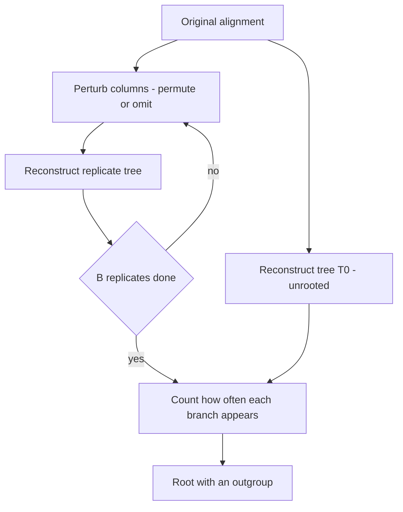

# Bootstrap Tree Assessment

## Problem

**Input**: the alignment a tree was built from, plus the reconstruction procedure used.
**Output**: a **bootstrap value for every internal branch** — the share of resampled data
sets that recover that branch — and, separately, a **root** located by an outgroup.

This is step 4, *evaluation*, of [[phylogenetic-tree-reconstruction]].

## Idea

### Locating the root

A tree from [[neighbor-joining]] or [[maximum-parsimony]] is **unrooted**: it shows
relationships but **no clear evolutionary direction**. The root is supplied from outside
the group of interest:

> **Use an outgroup** — a taxon known to have branched off before all the others. The
> branch connecting the outgroup to the rest carries the root.

The notes' picture: the ingroup taxa form a subtree, the outgroup hangs off it, and the
root is placed on the connecting edge.

### Assessing the branches

The topology is a point estimate from one finite alignment. [[bootstrapping]] asks how
much of it survives when the data are perturbed. The two perturbations the notes list:

- **permutation of the columns of the alignment**, or
- **omitting columns of the alignment**

Then **reconstruct the tree** from the perturbed data, and repeat. The
**bootstrap value** of an internal branch is **how often that branch appears** across
the replicates. High values mean the branch is supported by many independent columns;
low values mean it rests on a handful and would vanish under slightly different data.

## Pseudocode

```text
BOOTSTRAP-TREE(MSA, RECONSTRUCT, B):
  T₀ ← RECONSTRUCT(MSA)                       // the tree being assessed
  L  ← number of columns in MSA

  for b ← 1 to B:                             // B replicates, e.g. 100 or 1000
    MSA_b ← empty alignment
    for k ← 1 to L:
      c ← a column of MSA drawn at random WITH replacement
      append c to MSA_b                       // columns permuted / omitted / duplicated
    T_b ← RECONSTRUCT(MSA_b)
    record the set of SPLITS (bipartitions) induced by the internal branches of T_b

  for each internal branch e of T₀:
    support[e] ← ( number of replicates whose splits contain split(e) ) / B
  return T₀, support

ROOT-WITH-OUTGROUP(T, outgroup):
  // T is unrooted; outgroup diverged before every taxon of interest
  e ← the branch connecting outgroup to the rest of T
  insert a new node on e and declare it the root
  return T
```

Resampling **columns**, never rows, is the point: positions are the independent units
under the models' *"positions evolve independently"* assumption
([[jukes-cantor-model]]).

## Worked example

The notes give no numbers; the standard reading is:

| Bootstrap value | Interpretation |
|---|---|
| ≥ 95 % | the branch is essentially certain given the data |
| 70–95 % | reasonably supported |
| < 70 % | the branch should be treated as unresolved |

A tree in which the deep branches carry 50 % and the tips carry 99 % is the common real
outcome: recent relationships are easy, deep ones are where the signal has saturated —
the saturation problem of [[evolutionary-distance]].

## Diagram



Each replicate reconstructs a tree from resampled alignment columns, and the share of replicates recovering a branch becomes its bootstrap value before the outgroup supplies the root.

## Complexity

```text
B × (cost of one reconstruction)
  = O(B · n³)                        for UPGMA or Neighbor-Joining
  = B × super-exponential            for exhaustive maximum parsimony
```

Which is why bootstrapping is routine with distance methods and expensive with
parsimony.

## Variants & pitfalls

- **The bootstrap measures stability, not truth.** If the substitution model is wrong,
  every replicate is wrong in the same way and the branch gets 100 % support. Systematic
  error is invisible to resampling — the same caveat as in [[bootstrapping]] and
  [[cross-validation]].
- **Support attaches to branches, not to the whole tree.** A tree is typically part
  well-supported and part guesswork.
- **The outgroup must be right.** Choosing an outgroup that is too distant makes its
  attachment point arbitrary (long-branch attraction); choosing one inside the ingroup
  roots the tree in the wrong place entirely.
- **Column permutation versus omission** give slightly different null behaviour; the
  notes list both as acceptable.

## Relations

- [[bootstrapping]] — the general resampling principle from
  [[M2L03-machine-learning-and-classification]], applied here to alignment columns.
- [[cross-validation]] — the other resampling scheme of module 2; both answer "how much
  of this result is the data and how much is luck".
- [[phylogenetic-tree-reconstruction]] — this is its fourth step.
- [[upgma]], [[neighbor-joining]], [[maximum-parsimony]] — the procedures being
  resampled; the latter two produce unrooted trees needing an outgroup.
- [[phylogenetic-tree]] — rooted versus unrooted.
- [[random-forest]] — bootstrap aggregation over trees of a different kind; the same
  statistical idea, a different object.
- [[statistical-testing]], [[multiple-testing-correction]] — the module-1 framework for
  interpreting a support value as evidence.

## Appears in

- [[M2L08-molecular-evolution-and-phylogeny]]
- [[M2E08-phylogenetics]]

## Sources

- `raw/module2/csb_3.pdf`, p. 34 — locating the root with an outgroup, the bootstrap
  procedure by permuting or omitting alignment columns, reconstruction of the perturbed
  trees, and bootstrap values on internal branches.
