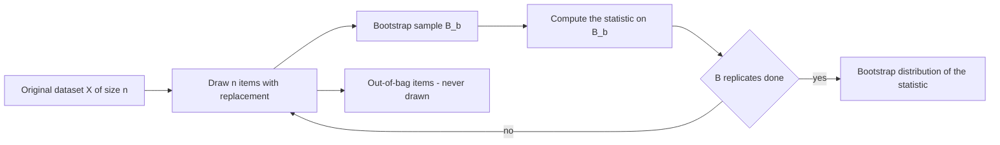

# Bootstrapping

## Problem

**Input**: an original dataset `X` of size `n`.
**Output**: many datasets `B₁, B₂, B₃, …`, each of size `n`, from which the **sampling
distribution of a statistic** can be estimated or **inferences about a population** can
be made.

## Idea

**Draw bootstrap samples of size `n` repeatedly from the original data `X` by simple
random sampling with replacement.** Because the sampling is *with replacement*, some
original samples appear several times in a bootstrap sample and others not at all; the
ones left out are the **out-of-bag** samples, which [[random-forest]] turns into a free
generalization-error estimate.

Compared with [[cross-validation]], bootstrapping **leads to lower variance but has a
larger bias**.

## Pseudocode

```text
BOOTSTRAP(X, B, statistic):
  n ← |X|
  for b ← 1 to B:
    S[b] ← empty multiset
    for i ← 1 to n:
      j ← UNIFORM-RANDOM(1, n)                 // simple random sampling …
      S[b] ← S[b] ∪ { X[j] }                   // … with replacement
    OOB[b] ← X \ S[b]                          // out-of-bag: never drawn
    θ[b] ← statistic(S[b])
  return θ[1..B], S[1..B], OOB[1..B]           // the bootstrap distribution of θ
```

## Worked example

The notes draw one dataset `X` fanning out into three bootstrap samples `B₁`, `B₂`, `B₃`
with crossing arrows — the crossings are the point: the same original observation feeds
several bootstrap samples.

For a toy `X = {a, b, c}` with `n = 3`:

| Bootstrap sample | Drawn | Out-of-bag |
|---|---|---|
| `B₁` | `a, a, c` | `b` |
| `B₂` | `b, c, c` | `a` |
| `B₃` | `a, b, b` | `c` |

Each `B_i` has the original size 3; each leaves something out, and that leftover is a
ready-made test set.

The notes' random-forest illustration uses the same mechanics on a tabular example:

```text
Data:       (Loud, Drunk)      → Victory
Resample:   (Loud, Drunk)      → Victory
Out of bag: (Quiet, Not-Drunk) → Loss,  model predicted Victory  ✗

Correct OOB  = #false predicted / #out of bag
Tree OOB     = the average error for each case, calculated using predictions
               from the trees that do not contain that case in their
               respective bootstrap sample
```

## Diagram



Repeated sampling with replacement produces both a bootstrap distribution of the statistic and an out-of-bag remainder usable as a free test set.

## Complexity

`B` resamples of `n` draws each: `O(B·n)` plus `B` evaluations of the statistic. Memory
is `O(n)` if the samples are processed one at a time.

## Variants & pitfalls

- **Bootstrapping versus [[cross-validation]]**:

  | Bootstrapping | Cross-validation |
  |---|---|
  | Random sampling **with replacement** | **Partitioning** into folds |
  | Estimating the **sampling distribution of a statistic**, inference about a population | **Evaluating the performance** of a predictive model |

- Lower variance, **larger bias** — a bootstrap sample contains on average only about
  two-thirds of the distinct original observations, so the "training set" is effectively
  smaller than it looks.
- The out-of-bag set is a *by-product*, not a designed test set; its size fluctuates.

## Relations

- [[cross-validation]] — the partitioning alternative; the notes compare the two
  directly.
- [[random-forest]] — builds every tree on a bootstrap sample and scores it on the
  out-of-bag remainder.
- [[overfitting]] — both resampling schemes exist to detect it.
- [[machine-learning]] — resampling is the evaluation infrastructure of the whole
  supervised toolkit.
- [[gene-set-enrichment-analysis]] — permutation of the labels there plays the same role
  as resampling here: an empirical null built by shuffling the data.
- [[probability-distribution]] — the bootstrap distribution of `θ` is an empirical
  sampling distribution.
- [[bootstrap-tree-assessment]] — the same resampling idea applied to the columns of an alignment, giving a support value per internal branch of a [[phylogenetic-tree]].
- [[dropout]] — regularization by random omission; conceptually an ensemble over subnetworks, as bagging is an ensemble over resamples.
- [[bias-variance-tradeoff]], [[generative-adversarial-network]] — further resampling and ensembling in the deep-learning lecture.

## Appears in

- [[M2L03-machine-learning-and-classification]]
- [[M2E03-machine-learning-and-classification]]

## Sources

- `raw/module2/csb_part2.pdf`, p. 3 — bootstrap sampling with replacement, lower variance
  and larger bias than CV.
- `raw/module2/csb_part2.pdf`, p. 7 — the out-of-bag example and the OOB error
  definitions.
- `raw/module2/csb_part2.pdf`, p. 9 — bootstrapping versus cross-validation.
