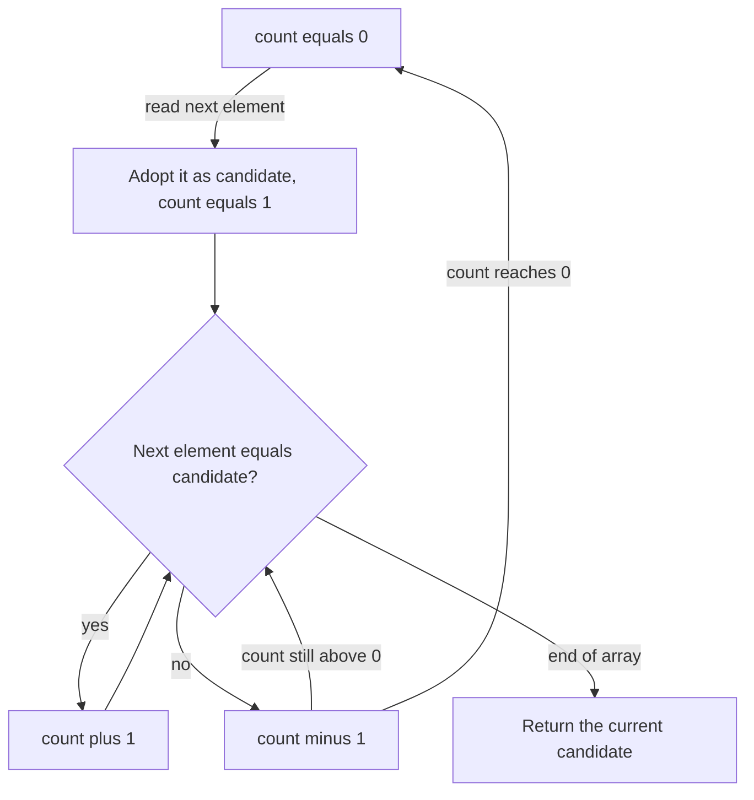

# Boyer–Moore Majority Vote

> Not to be confused with [[boyer-moore-string-search]], the exact string-search
> algorithm by the same authors. This page is about the **majority element** of an
> array; the two share nothing but their names.

## Problem

**Input**: an array of `l` elements.
**Output**: the **majority element** — the value occurring in strictly more than half the
positions — if one exists.

Counting every value costs extra memory; sorting costs `O(n log n)`. The question of the
exercise sheet is whether it can be done faster and with less memory.

## Idea

Two approaches appear in the notes.

1. **Divide and conquer**: the majority element of the whole array must also be the
   majority element of at least one half. Recursively find the majority candidate of each
   half; if they agree, that is the answer; if not, count both over the current range and
   keep the more frequent one.
2. **Boyer–Moore voting**: sweep once, keeping a `candidate` and a `count`. Every element
   equal to the candidate votes `+1`, every other element votes `−1`. When the count
   drops to zero the candidate is replaced by the current element. A true majority
   element survives all cancellations, because it outnumbers everything else combined.

## Pseudocode

```text
MAJORITY-DIVIDE-AND-CONQUER(array):
  if LENGTH(array) = 1:
    return array[0]
  mid ← LENGTH(array) / 2                    // integer division
  L ← array[0 .. mid-1]
  R ← array[mid .. end]
  left_m  ← MAJORITY-DIVIDE-AND-CONQUER(L)
  right_m ← MAJORITY-DIVIDE-AND-CONQUER(R)
  if left_m = right_m:
    return left_m
  l_count ← 0; r_count ← 0
  for i ← 0 to LENGTH(L)-1:
    if L[i] = left_m:  l_count ← l_count + 1
  for i ← 0 to LENGTH(R)-1:
    if R[i] = right_m: r_count ← r_count + 1
  if l_count > r_count:
    return left_m
  else:
    return right_m

BOYER-MOORE-MAJORITY(array, l):
  count ← 0
  candidate ← 0
  for i ← 0 to l-1:
    if count = 0:
      candidate ← array[i]                   // adopt a new candidate
    if array[i] = candidate:
      count ← count + 1                      // vote for
    else:
      count ← count - 1                      // vote against, cancelling out
  return candidate                           // valid only if a majority exists
```

Note: this block uses **0-based** indices because the lecture notes wrote the algorithm in
C/Python style with `array[0]`.

## Worked example

Array `[A, A, B, A, C, A, A]`, `l = 7`:

| i | element | candidate before | count before | candidate after | count after |
|---|---|---|---|---|---|
| 0 | A | – | 0 | A | 1 |
| 1 | A | A | 1 | A | 2 |
| 2 | B | A | 2 | A | 1 |
| 3 | A | A | 1 | A | 2 |
| 4 | C | A | 2 | A | 1 |
| 5 | A | A | 1 | A | 2 |
| 6 | A | A | 2 | A | 3 |

Returns `A`, which occurs 5 of 7 times — a true majority.

## Complexity

- **Boyer–Moore**: time `O(n)`, space `O(1)` — a single pass with two variables.
- **Divide and conquer**: the recursion splits in half and does `O(n)` counting work per
  level, giving `O(n log n)` time and `O(log n)` stack space
  (see [[algorithmic-complexity]]).

## Variants & pitfalls

- **If there is no majority element**, the algorithm still returns something: the last
  object that was set as candidate. The result is therefore meaningless unless verified.
- The fix is a **second pass** that counts occurrences of the returned candidate and
  checks that it exceeds `l / 2`. The notes stop at the observation; the verification pass
  is the standard remedy.
- The method generalises to "elements occurring more than `n/k` times" by keeping `k−1`
  candidates and counters.

## Diagram


The voting sweep as a state machine: the counter cancels non-candidates against candidates, and only a true majority element survives every cancellation.

## Relations

- [[algorithmic-complexity]] — the `O(n)` vs `O(n log n)` comparison and the
  divide-and-conquer pattern.
- [[string-matching]] — the paradigm of the same authors' exact-search algorithm, from
  which this majority-element method is explicitly distinguished.
- [[boyer-moore-string-search]] — the unrelated exact string-matching algorithm by the
  same authors, covered in [[L08-exact-string-matching]].
- Appears in [[L07-algorithms-and-complexity]] and
  [[E04-complexity-and-majority-element]].

## Sources

- `raw/module1/gsb_part1.pdf`, pp. 30–31.
- `raw/module1/gsb_part2.pdf`, pp. 7–10 — disambiguation against the string-search
  algorithm of the same name.
