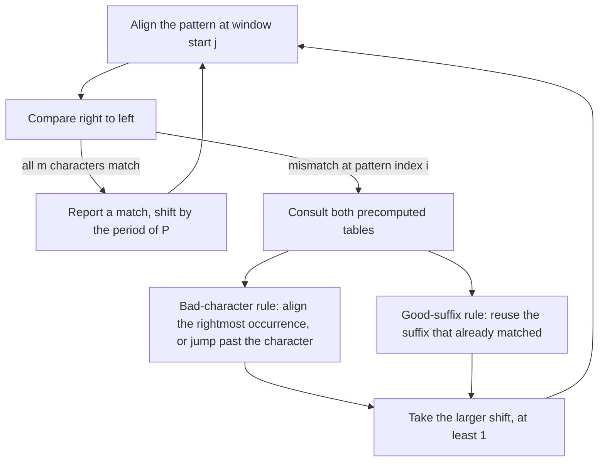

# Boyer–Moore String Search

> Not to be confused with [[boyer-moore-majority-vote]], a different algorithm by the
> same authors that finds the majority element of an array. This page is about **exact
> string search**.

## Problem

**Input**: a text `T` of length `n` and a pattern `P` of length `m`.
**Output**: every position at which `P` occurs exactly in `T`.

## Idea

Compare the pattern against the text window **right to left**. A mismatch near the right
end of the window carries a lot of information, because it says something about a
character that the pattern may not contain at all — and then the whole window can be
skipped. This is suffix searching in the sense of [[string-matching]], and it makes the
algorithm **sub-linear on average**: many text characters are never read.

Formally, the shift `d` is the smallest integer such that

`T[k+m−1] = P[m−1−d]`, `T[k+m−2] = P[m−2−d]`, …, `T[k+i] = P[i−d]`

where `k` is the start index of the window in the target, `m` the pattern length and `i`
the mismatch index in the pattern.

Two independent rules propose a shift; the algorithm takes the **larger** of the two.

**Bad character rule.** Look at the text character `T[i+j]` that caused the mismatch.
Shift the pattern so that its rightmost occurrence of that character lines up. If the
character does not occur in the pattern at all ("no `x`!"), the window jumps **past** it
entirely. The precomputed table is

`bmBc[c] = m − 1 − (rightmost index of c in P[0..m−2])`, and `m` if `c` does not occur,

and the proposed shift from a mismatch at pattern index `i` is
`bmBc[T[i+j]] − m + 1 + i`. The shift is clamped to at least 1.

**Good suffix rule.** The suffix of the pattern that already matched is known to be
present in the text; shift so that it is reused.

- **GSR I** — on a mismatch at `T_{s+j−1}`, match `T_{s+j−1}` with `P_{j′−m+j}`, where
  `j′` with `m − j + 1 ≤ j′ < m` is the **largest** position such that `P_{j+1,m}` is a
  suffix of `P_{1,j′}` **and** `P_{j′−(m−j)} ≠ P_j` — i.e. the matched suffix reappears
  earlier in the pattern, preceded by a different character.
- **GSR II** — used when GSR I is inapplicable, i.e. the matched suffix `t` does not
  reappear inside `P(1,j)` and is unique in `P`: match `T_{s+m−j}` with `P_1`, where `j′`
  is the largest position such that `P_{1,j′}` is a suffix of `P_{j+1,m}` — i.e. only a
  *part* of the matched suffix survives as a prefix of the pattern.

## Pseudocode

Indices are **0-based**, as in the lecture notes.

```text
BOYER-MOORE(T, P, alpha):
  // alpha = alphabet; preprocessing is independent of T
  n ← LENGTH(T)
  m ← LENGTH(P)
  bmGs ← GOOD-SUFFIX-RULE(P)              // shift per mismatch position in P
  bmBc ← BAD-CHARACTER-RULE(P, alpha)     // shift per alphabet character
  j ← 0                                   // window start in T
  while j ≤ n - m:
    i ← m - 1                             // compare right to left
    while i ≥ 0 and P[i] = T[i + j]:
      i ← i - 1
    if i < 0:
      report match at position j
      j ← j + bmGs[0]                     // full match: shift by the period of P
    else:
      j ← j + MAX( bmGs[i],
                   bmBc[T[i + j]] - m + 1 + i )
  return

BAD-CHARACTER-RULE(P, alpha):
  m ← LENGTH(P)
  for each c in alpha:
    bmBc[c] ← m                           // character absent: skip the whole window
  for k ← 0 to m - 2:                     // last position deliberately excluded
    bmBc[P[k]] ← m - 1 - k
  return bmBc
```

## Worked example

Pattern `P = GCAGAGAG`, text `s = GCATCGCAGAGAGTATACAGTACG`.

1. First window: the comparison fails and the good-suffix rule proposes a shift of **1**.
2. Second window: the mismatching text character is `C` at pattern index `i = 5`, giving
   a bad-character shift of `bmBc[C] − m + 1 + i = 6 − 8 + 1 + 5 = 4`; the good-suffix
   rule also proposes **4**, so the window jumps four characters.

Two shifts are enough to reach the occurrence. The bad-character table of a longer
pattern is computed in [[E06-boyer-moore-string-search]].

## Complexity

- **Preprocessing**: `O(m + |A|)` for the two tables, where `|A|` is the alphabet size.
- **Search**: `O(m · n)` in the worst case — e.g. `T = AAAA…A` with `P = XAAA`, where
  every window matches almost fully before failing on the leftmost character.
- `O(m + n)` when the pattern does **not** occur in the text, and sub-linear on average:
  on long targets it is by far the fastest exact matcher.
- Contrast with the guaranteed `O(m + n)` of [[knuth-morris-pratt]] in
  [[algorithmic-complexity]] terms: Boyer–Moore trades a worst-case guarantee for average
  speed.

## Variants & pitfalls

- **Boyer–Moore–Horspool (BMH)** is the simplified variant: it uses only the
  **bad character rule**, and it derives the shift from the **last character of the
  window** rather than from the mismatching character. No good-suffix table is needed,
  which makes it much easier to implement at a modest cost in shift length.
- **Repetitive sequence** — exactly the situation in genomes with microsatellites and
  repeats ([[genome-organization]]) — is the bad case for Boyer–Moore.
- The last position of the pattern is excluded when building the bad-character table;
  including it would allow a shift of 0 and an infinite loop.
- Both rules may propose a non-positive shift; always take `max(1, …)`.

## Diagram


Each mismatch is answered by two independent table lookups, and the window always advances by the larger of the two proposed shifts.

## Relations

- [[string-matching]] — the paradigm and the vocabulary.
- [[knuth-morris-pratt]] — the prefix-based counterpart.
- [[boyer-moore-majority-vote]] — same authors, unrelated problem.
- [[algorithmic-complexity]] — worst case versus average case.
- [[suffix-tree]], [[suffix-array]] — index the text instead of the pattern, which pays
  off when many patterns are searched in the same genome.

## Appears in

- [[L07-algorithms-and-complexity]]
- [[L08-exact-string-matching]]
- [[E05-kmp-string-matching]]
- [[E06-boyer-moore-string-search]]

## Sources

- `raw/module1/gsb_part2.pdf`, pp. 7–10.
- `raw/module1/gsb_3.pdf`, p. 13 — text indexing as the alternative strategy.
