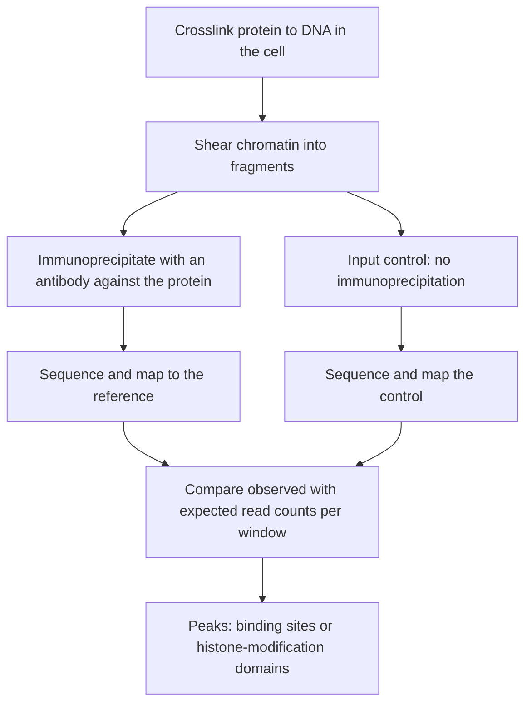

# ChIP-Seq

## Problem

**Input**: cells expressing a DNA-binding protein of interest (a transcription factor, or
a specifically modified histone).
**Output**: the genomic coordinates at which that protein is bound — transcription-factor
binding sites (TFBS) and histone-modification domains.

## Idea

Chromatin immunoprecipitation followed by sequencing. The notes state it compactly:
*experimental detection of protein–DNA binding by sequencing the genomic fragments that
co-precipitate with the DNA-binding protein.* An antibody against the protein pulls down
the protein together with whatever DNA it was holding; sequencing those fragments and
mapping them to the genome shows where the protein sat. Positions covered far more
densely than the background are called **peaks**.

## Pseudocode

```text
CHIP-SEQ(cells, antibody, reference):
  X ← CROSSLINK(cells)                      // fix protein to DNA in place
  C ← FRAGMENT(X)                           // shear chromatin into small pieces
  P ← IMMUNOPRECIPITATE(C, antibody)        // keep fragments bound by the protein
  I ← C                                     // input control: no immunoprecipitation
  P ← REVERSE-CROSSLINK-AND-PURIFY(P)

  R ← SEQUENCE(P)                           // see NGS-PIPELINE
  R_ctrl ← SEQUENCE(I)
  M ← MAP(R, reference)                     // read positions on the genome
  M_ctrl ← MAP(R_ctrl, reference)

  peaks ← ∅
  for each window w of the reference:
    obs ← COUNT(M, w)
    exp ← COUNT(M_ctrl, w) · (|M| / |M_ctrl|)   // normalise library sizes
    if SIGNIFICANT-ENRICHMENT(obs, exp):
      peaks ← peaks ∪ {w}
  return MERGE-ADJACENT(peaks)
```

The last loop above is deliberately schematic: the real enrichment test is the subject of
[[peak-calling]], where MACS2 replaces the single global ratio by a **dynamic local
Poisson background** and adds fragment-length estimation, summit detection and FDR
estimation.

## Worked example

Pull down a transcription factor and sequence. After mapping, a 300 bp window upstream of
gene *X* carries 450 reads where the input control predicts 12. The enrichment is called
as a peak, the window is annotated as a TFBS of that factor, and *X* is added as a
regulatory target — one edge of an [[interaction-network]].

Running the same protocol with an antibody against a modified histone instead yields
broad domains rather than sharp peaks, because nucleosome marks spread over kilobases.

## Complexity

- Dominated by the sequencing and mapping steps; see
  [[next-generation-sequencing]].
- Peak calling itself is a single pass over the mapped reads, `O(|M| + |genome|/w)` for
  window size `w`.

## Variants & pitfalls

- An **input control** is essential: chromatin shears non-uniformly and open regions are
  over-represented even without any specific binding.
- Antibody quality dominates the result; a poorly specific antibody produces a map of its
  cross-reactivity, not of the factor.
- Transcription factors give **sharp** peaks; histone modifications give **broad**
  domains, so different peak callers are required.
- Repetitive regions cannot be assigned unambiguously — the mapping limitation of short
  reads applies here too.
- ChIP-Seq is named in the notes as a **key technology of [[epigenetics]]** because of the
  histone-modification application; the German gloss in part 4 is *"Technik um
  Bindungsstellen von TFs auf der DNA zu detektieren"*.
- Quality of a ChIP-Seq library is assessed with **FRiP**, **PBC**, strand
  cross-correlation (**NSC**) and **IDR** — all defined on [[peak-calling]].

> [!note] Added beyond lecture notes
> Source: general domain knowledge (Skene & Henikoff, *eLife* 6:e21856, 2017 on CUT&RUN;
> Kaya-Okur et al., *Nat. Commun.* 10:1930, 2019 on CUT&Tag; Orlando et al., *Cell Rep.*
> 9:1163, 2014 on spike-in normalisation). Not from the UHH handwritten notes.
>
> **Crosslink-free successors.** The crosslink–shear–immunoprecipitate protocol described
> above needs millions of cells and generates high background. Two successors replace the
> immunoprecipitation with *in situ* targeted cleavage:
>
> - **CUT&RUN** — the antibody tethers a protein A–**MNase** fusion to its target in
>   permeabilised nuclei; MNase cuts only there, and the small released fragments diffuse
>   out and are sequenced. Background is low enough that far fewer reads are needed.
> - **CUT&Tag** — the same tethering, but with the **Tn5** transposase of [[atac-seq]]
>   instead of MNase, so cutting and adapter ligation happen in one step. This works down
>   to single cells.
>
> Both still produce mapped reads for [[peak-calling]], but their very low background
> means a MACS2 run tuned for ChIP-Seq is often too permissive.
>
> **Quantitative comparison needs a spike-in.** Read counts are compositional: a library
> is always normalised to its own total, so a treatment that halves a
> [[histone-modification|histone mark]] *genome-wide* looks unchanged after normalisation.
> Adding a fixed amount of chromatin from another species (ChIP-Rx / spike-in) gives an
> external yardstick and makes between-condition comparisons quantitative. This is the
> same compositional trap that [[data-normalization]] describes for expression data.


## Diagram


The ChIP-Seq pipeline, with the input control running alongside the immunoprecipitated library because only their comparison distinguishes binding from shearing bias.

## Relations

- [[epigenetics]] — histone-modification mapping is one of its central assays.
- [[peak-calling]] — the computational step that turns mapped reads into peaks; MACS2.
- [[histone-modification]] — the marks ChIP-Seq localises, as broad domains.
- [[chromatin]] — chromatin immunoprecipitation is the "ChIP" in the name.
- [[gene-regulation]] — TFBS locations are the direct evidence for regulatory wiring.
- [[interaction-network]] — supplies protein–DNA edges.
- [[next-generation-sequencing]] — the readout technology.
- [[transcription-factor-binding-site]] — the object ChIP-Seq locates; the notes also
  list footprinting and SELEX as the alternative experimental routes.
- [[position-weight-matrix]] — the sequences under the peaks are what a PWM is built
  from.
- [[epigenome-wide-association-study]] — peak intensities are one of the quantifiable
  marks it tests.
- [[atac-seq]] — the antibody-free counterpart: ChIP-Seq asks which protein is bound,
  ATAC-Seq asks which DNA is reachable at all.
- [[bisulfite-sequencing]] — the other central epigenetic assay, reading DNA methylation
  instead of protein–DNA binding.
- [[data-normalization]] — read counts are compositional here too, which is why a
  genome-wide change in a mark is only visible with an external spike-in.
- Appears in [[L05-sequence-comparison-and-networks]],
  [[L12-binding-sites-and-position-weight-matrices]], [[L16-epigenetics]] and
  [[E12-epigenetics-and-peak-calling]].

- [[gene-knockout]] — the complementary perturbation experiment: ChIP asks where a factor binds, a knock-out asks what changes when it is gone.
- [[mirna-target-prediction]] — CLIP-Seq and PAR-CLIP are the RNA-side analogues: crosslink, immunoprecipitate, sequence.

## Appears in

- [[M2L02-sequence-motifs-and-motif-discovery]] — its peak sequences are the input to module-2 de novo motif discovery.

## Sources

- `raw/module1/gsb_part1.pdf`, p. 9.
- `raw/module1/gsb_3.pdf`, p. 5 — experimental approaches to binding-site prediction.
- `raw/module1/gsb_part4.pdf`, p. 4 (ChIP-Seq as the region-level assay for histone
  modifications), pp. 5–6 (peak calling and quality measures), p. 11 (MACS2 exercise).

- `raw/module2/csb_4.pdf`, p. 5 — CLIP-Seq and PAR-CLIP as experimental binding-site evidence.
