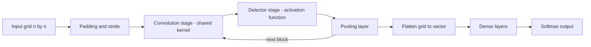

# Convolutional Neural Network

## Problem

**Input**: data with a **spatial or sequential grid structure** — an `n × n` image, or a
1-D signal such as a read or an expression profile — plus a class label.
**Output**: a classifier, trained with far fewer parameters than a fully connected
[[neural-network]] on the same input.

## Idea

Two motivations, both from the notes:

1. **Training a fully connected network is too expensive.** The shallower layers should
   therefore have **connections between close neighbours only**, not to everything.
2. **We want translational equivariance**:
   > when the input is translated by an amount, the output feature map is translated by
   > the same amount.

A small **filter / kernel** is slid across the input, computing the same weighted sum at
every position. The weights are shared across positions, which is what buys both the
parameter saving and the equivariance.

**The three hyper-parameters of a convolutional layer**

| Parameter | Definition from the notes |
|---|---|
| **Input** | `n × n` |
| **Filter / kernel** | `(k, k)`, i.e. `k × k` |
| **Stride** | *how much you want to slide each time* |
| **Padding** | *how many rows / columns you want to add to each side of the input* |

**The convolutional block**, as drawn in the notes:

```text
input to layer
  → convolution stage      (affine transform)
  → detector stage         (non-linearity, i.e. the activation function)
  → pooling layer
  → next layer
```

## Pseudocode

A single 2-D convolutional layer:

```text
CONV-LAYER(I, K, stride s, padding p, bias b, activation g):
  // I is n × n, K is k × k
  Ĩ ← PAD(I, p)                            // add p rows/columns on each side
  m ← ⌊ (n + 2p − k) / s ⌋ + 1             // output feature-map size
  for r ← 1 to m:
    for c ← 1 to m:
      acc ← 0
      for u ← 1 to k:
        for v ← 1 to k:
          acc ← acc + K[u,v] · Ĩ[ (r−1)·s + u , (c−1)·s + v ]
      O[r,c] ← g( acc + b )                // convolution stage, then detector stage
  return O
```

The whole block, and a typical network built from it:

```text
CONV-BLOCK(X, K, s, p, g, poolSize, poolType):
  A ← CONV-LAYER(X, K, s, p, b, g)         // convolution + detector stage
  return POOL(A, poolSize, poolType)       // max or average, see the pooling layer

CNN-FORWARD(X):
  H ← X
  repeat for each convolutional block:
    H ← CONV-BLOCK(H, …)
  H ← FLATTEN(H)                            // grid → vector
  for each dense layer l:
    H ← g( W[l] · H + b[l] )                // ordinary fully connected layers
  return SOFTMAX(H)
```

## Worked example

The Python sketch in the notes builds exactly this stack with Keras for a 1-D signal:

```text
cnn ← Sequential()
cnn.add( Conv1D )        // convolution stage
cnn.add( Dropout )       // regularization
cnn.add( MaxPooling1D )  // pooling layer
cnn.add( Flatten )       // grid → vector
cnn.add( Dense )         // fully connected head
cnn.compile()
cnn.fit(X_train, …)
cnn.predict(test_x)
```

A worked numeric pooling step on a `4 × 4` feature map is given in
[[pooling-layer]] and in [[M2E06-deep-learning]].

## Diagram



One convolutional block is convolution, then detector, then pooling, and the stack of blocks ends in a flattened fully connected head.

## Complexity

For one layer with an `m × m` output and a `k × k` kernel:

```text
time   O( m² · k² )         per filter, per sample
params k² + 1               per filter — independent of n
```

Compare a fully connected layer on the same `n × n` input, which needs `n² · n²`
weights. The parameter count is what the notes mean by "too expensive": weight sharing
turns a quadratic-in-pixels count into a constant one.

## Variants & pitfalls

- **Max pooling versus average pooling** — see [[pooling-layer]]; both reduce the
  spatial dimensions while retaining important features.
- **[[dropout]]** between convolutional blocks, as in the Python sketch, to fight
  [[overfitting]].
- **Equivariance is not invariance**: convolution moves the feature map with the input;
  it is the pooling that makes the answer insensitive to small shifts.
- **1-D convolutions** (`Conv1D`) are the biologically relevant case — a kernel sliding
  along a sequence is structurally the same operation as scanning a
  [[position-weight-matrix]] along a promoter, with the weights learned from labels
  rather than counted from aligned sites.

## Relations

- [[neural-network]] — the fully connected baseline whose cost motivates convolution.
- [[pooling-layer]] — the third stage of every convolutional block.
- [[activation-function]] — the "detector stage".
- [[dropout]], [[overfitting]] — regularisation inside the stack.
- [[backpropagation]], [[gradient-descent]] — training is unchanged; only the weight
  sharing is new.
- [[deep-learning]] — the architecture family this belongs to.
- [[position-weight-matrix]] — the hand-built, count-based ancestor of a learned 1-D
  convolutional filter over DNA.
- [[bias-variance-tradeoff]] — "NN architecture search" is the fix the notes propose for
  both bias and variance, and the kernel/stride/padding choices are that search.
- [[graph-neural-network]] — a GNN generalises convolution from grids to graphs.
- [[recurrent-neural-network]] — the two classical architectures, for spatial and for sequential structure.
- [[sequence-motif]] — a convolution kernel over a sequence is a learned motif detector.

## Appears in

- [[M2L06-deep-learning]]
- [[M2E06-deep-learning]]

## Sources

- `raw/module2/csb_3.pdf`, p. 6 — the motivation, translational equivariance, the
  convolutional layer parameters, max/average pooling, the convolutional block diagram.
- `raw/module2/csb_3.pdf`, p. 11 — the Keras `Sequential` sketch with `Conv1D`,
  `Dropout`, `MaxPooling1D`, `Flatten` and `Dense`.
