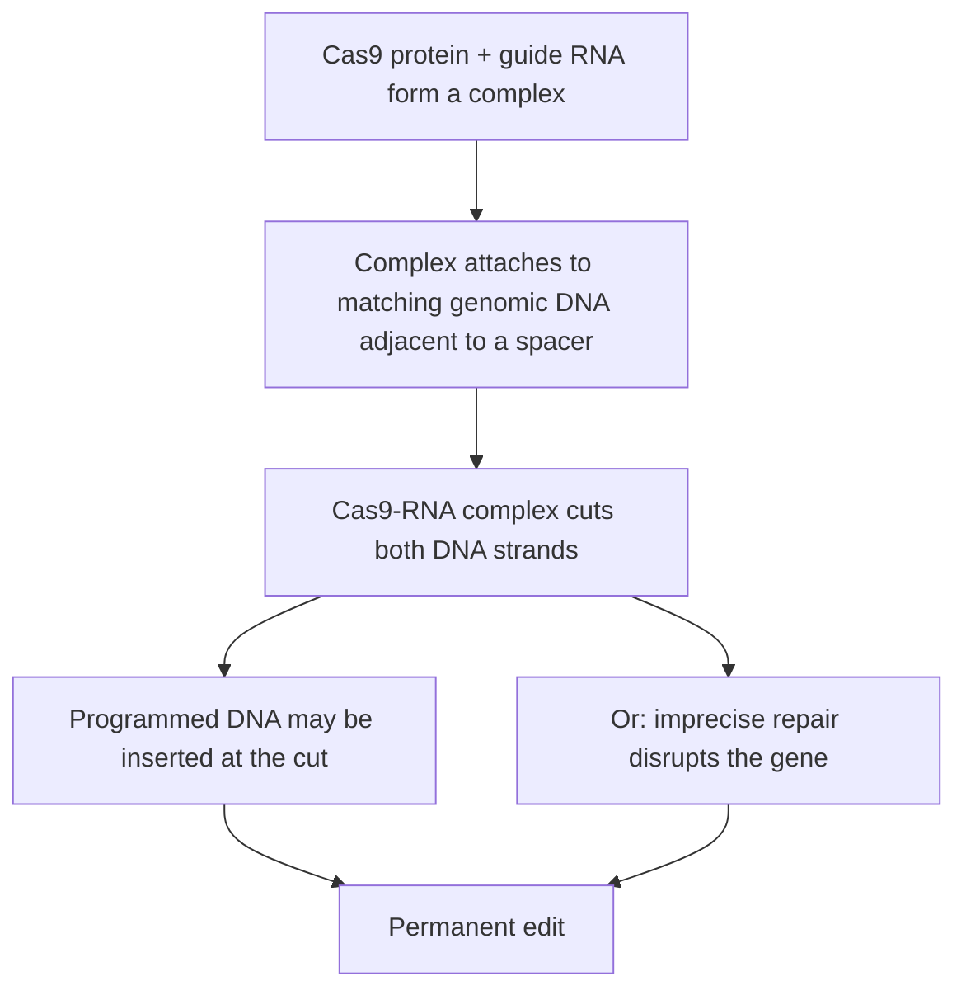

# CRISPR–Cas9

## Problem

**Input**: a cell, and a target locus specified by a short guide RNA sequence.
**Output**: a **permanent** change at that locus — a disrupted gene (**knock-out**), or
a programmed sequence inserted at the cut.

**CRISPR** = **C**lustered **R**egularly **I**nterspaced **S**hort **P**alindromic
**R**epeats.

## Idea

CRISPR is a **natural defense mechanism against viruses found in bacteria**, and a form
of **adaptive immunity**: bacteria **incorporate parts of foreign DNA into their genome
and use it for target recognition upon subsequent infection**. The stored fragments are
the *spacers*, held between the palindromic repeats.

The insight that turned this into a tool was the **cleavage mechanism of RNA-guided
Cas9**, which **predicted its potential use in programmed genome editing**: if the
recognition is supplied by an RNA, the RNA can simply be rewritten.

Note the structural parallel with [[rna-interference]]: in both, a short RNA supplies the
address and a protein does the work. The difference is the payload — RISC degrades an
mRNA, Cas9 cuts the DNA itself, so the change is permanent.

## Pseudocode

```text
CRISPR-CAS9(cell, guide_RNA, donor_DNA):
  // 1. Cas9 protein forms a complex with guide RNA in the cell
  complex ← CAS9 + guide_RNA

  // 2. The complex attaches to a matching genomic DNA sequence adjacent to a spacer
  for each candidate locus L in genome(cell):
    if MATCHES(guide_RNA, L) and ADJACENT-TO-SPACER(L):
      site ← L; break

  // 3. The Cas9-RNA complex cuts the double strands of the DNA
  CUT-DOUBLE-STRAND(site)

  // 4. Programmed DNA may be inserted at the cut
  if donor_DNA ≠ ∅:
    INSERT(donor_DNA, site)                 // programmed genome editing
  else:
    REPAIR(site)                            // error-prone repair disrupts the gene
  return cell
```

The four numbered steps are exactly the four steps of the notes.

## Worked example

To study a transcription factor's role in [[gene-regulation]], design a guide RNA
matching an early exon of its gene and transfect it with Cas9 and no donor DNA. The cut
is repaired imprecisely, the reading frame of the [[genetic-code]] shifts, and the
protein is never made: a permanent [[gene-knockout]]. If instead the gene is essential,
this experiment kills the cells — and that is precisely the case where
[[small-interfering-rna|siRNA]] knockdown must be used instead.

## Complexity

Not an algorithm, so there is no asymptotic cost; the relevant costs are experimental.
The computational burden sits in **guide design**: scanning the genome for off-target
sites that also match the guide, which is the exact-and-approximate string-matching
problem of [[string-matching]] and [[blast]].

## Variants & pitfalls

The notes put CRISPR–Cas9 and RNAi side by side:

| CRISPR–Cas9 | RNAi |
|---|---|
| **Permanent** gene disruption (**knock-out**) | **Temporary** gene disruption (**knockdown**) |
| **Cannot** be used to study essential genes | **Can** be used to study essential genes |
| **Precise** gene targeting with **fewer off-targets** | **More off-target events**, silencing multiple transcripts |
| **Lower** risk of immune response | **High** risk of immune response |

The verdict in the notes is that **RNAi has great potential for targeted therapy, but
CRISPR is better nowadays**. The table shows why that verdict is not unconditional: the
"permanent" column is an advantage for a stable cell line and a fatal flaw for an
essential gene.

## Diagram


The four-step editing mechanism of p. 3.

## Relations

- [[rna-interference]] — the alternative, reversible route to silencing a gene.
- [[small-interfering-rna]] — the reagent of that alternative.
- [[gene-knockout]] — what CRISPR produces; RNAi produces a knockdown instead.
- [[microrna]] — the natural version of "a short RNA addresses a protein complex".
- [[gene-regulation]] — the process these perturbations are used to dissect.
- [[dna-mutation]] — a programmed double-strand break and its repair is an engineered
  version of the structural mutations catalogued there.
- [[string-matching]] — guide design is an off-target search problem.

## Appears in

- [[M2L09-non-coding-rnas]]

## Sources

- `raw/module2/csb_4.pdf`, p. 3 — the CRISPR acronym, bacterial adaptive immunity, and
  the four steps of RNA-guided Cas9 editing.
- `raw/module2/csb_4.pdf`, p. 4 — the CRISPR–Cas9 versus RNAi comparison table.
