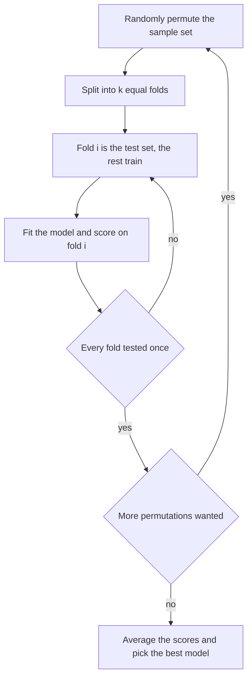

# Cross-Validation

## Problem

**Input**: a labelled dataset and a model-fitting procedure.
**Output**: an honest estimate of how well the fitted model will perform on **unseen**
data, plus a choice of the best model.

A single train/test split is not enough ([[overfitting]], [[machine-learning]]):

- If the dataset is **small**, a large part is **wasted** — it could have been used for
  training.
- The model **looks different depending on which samples ended up in the training set**.

→ **Create multiple splits of the data.**

## Idea

Cross-validation **leaves a certain amount of data out of the training set and tests
afterwards whether the model can correctly predict the left-out data**. Doing this
repeatedly, over **multiple non-overlapping subsets**, gives

1. a **more reliable estimate of the model's ability to generalize** to new data, and
2. training and testing over a **wider range of the data**.

## Pseudocode

**k-fold cross-validation**, exactly as numbered in the notes:

```text
K-FOLD-CROSS-VALIDATION(X, y, fit, score, k, R):
  // step 0: generate random permutations of the sample set
  for r ← 1 to R:                              // step 6: repeat with next permutation
    π ← RANDOM-PERMUTATION(X)
    // step 1: pick a number of folds k
    // step 2: split the dataset into k equal parts
    (F[1], …, F[k]) ← SPLIT(π, k)
    for i ← 1 to k:                            // step 4: until each fold was test once
      // step 3: k-1 folds are the training set, the remaining fold is the test set
      Train ← ⋃_{j ≠ i} F[j]
      Test  ← F[i]
      M[r,i] ← fit(Train)
      s[r,i] ← score(M[r,i], Test)
  // step 5: identify the best model via the average score
  for every candidate model m:
    avg[m] ← (1/(R·k)) · Σ_{r,i} s[r,i] restricted to m
  return argmax_m avg[m], avg
```

**Leave-one-out cross-validation (LOOCV)** — the special case `k = n`:

```text
LEAVE-ONE-OUT(X, y, fit, score):
  n ← |X|
  for i ← 1 to n:
    Test  ← { x_i }                            // a single sample as validation set
    Train ← X \ { x_i }                        // the remaining samples as training data
    s[i]  ← score(fit(Train), Test)
  // repeat until every sample has been used exactly once as validation data
  return (1/n) · Σ_i s[i]                      // k-fold with k = number of samples
```

## Worked example

With `n = 10` patients and `k = 5`:

| Round | Test fold | Training folds | Test samples |
|---|---|---|---|
| 1 | `F₁` | `F₂ F₃ F₄ F₅` | 2 |
| 2 | `F₂` | `F₁ F₃ F₄ F₅` | 2 |
| 3 | `F₃` | `F₁ F₂ F₄ F₅` | 2 |
| 4 | `F₄` | `F₁ F₂ F₃ F₅` | 2 |
| 5 | `F₅` | `F₁ F₂ F₃ F₄` | 2 |

Every sample is tested exactly once, every sample trains in four of the five rounds, and
the reported score is the average of the five. With `k = 10` the same table becomes
leave-one-out.

**When to prefer leave-one-out**: a relatively **small** dataset where one must be sure
of not overfitting to the limited number of observations — for example the patients
available in disease research.

## Diagram



Each fold serves once as the test set and the averaged score over all folds and permutations selects the model.

## Complexity

`R · k` model fits for `R` permutations and `k` folds; `n` fits for leave-one-out. Each
fit sees `n·(k−1)/k` samples. LOOCV is therefore the most expensive and the least biased
variant.

## Variants & pitfalls

- **Cross-validation versus [[bootstrapping]]** — from the exercise:

  | Bootstrapping | Cross-validation |
  |---|---|
  | Random sampling **with replacement** | **Partitioning** of the data into folds |
  | Used for estimating the **sampling distribution of a statistic** or making inferences about a population | Used for **evaluation of the performance of a predictive model** |

- Bootstrapping **leads to lower variance but has a larger bias** than cross-validation.
- The folds must be **equal parts** of a **randomly permuted** sample set; without the
  permutation any ordering in the data leaks into the folds.
- Cross-validation estimates generalization; it does not *prevent* overfitting by itself.

## Relations

- [[overfitting]] — the problem cross-validation is built to detect.
- [[machine-learning]] — the evaluation step of every supervised pipeline here.
- [[bootstrapping]] — the resampling alternative, with the opposite bias/variance
  trade-off.
- [[random-forest]] — gets the same kind of estimate for free from its out-of-bag
  samples.
- [[roc-curve]] — the score function a cross-validation round typically reports.
- [[statistical-testing]] — supplies sensitivity, specificity and accuracy as scores.
- [[bias-variance-tradeoff]] — the training/dev/test error comparison that cross-validation supplies the numbers for; see [[M2L06-deep-learning]].
- [[bootstrap-tree-assessment]] — the phylogenetic analogue: resample the data, refit, and see what survives.
- [[M2E06-deep-learning]] — `train_test_split(..., stratify=y)` is the same class-balance discipline in Keras.
- [[generative-adversarial-network]] — a case where no clean held-out evaluation exists, which is precisely why GANs are hard to assess.
- [[mirna-target-prediction]] — its learned binding model is assessed by independent testing, not by training performance.

## Appears in

- [[M2L03-machine-learning-and-classification]]
- [[M2E03-machine-learning-and-classification]]

## Sources

- `raw/module2/csb_part2.pdf`, p. 2 — the problem with a single test set, the six steps
  of k-fold cross-validation, leave-one-out.
- `raw/module2/csb_part2.pdf`, p. 9 — the exercise answers: how cross-validation helps
  against overfitting, why leave-one-out, bootstrapping versus cross-validation.

- `raw/module2/csb_4.pdf`, p. 5 — the PAR-CLIP machine-learning pipeline ending in independent testing.
