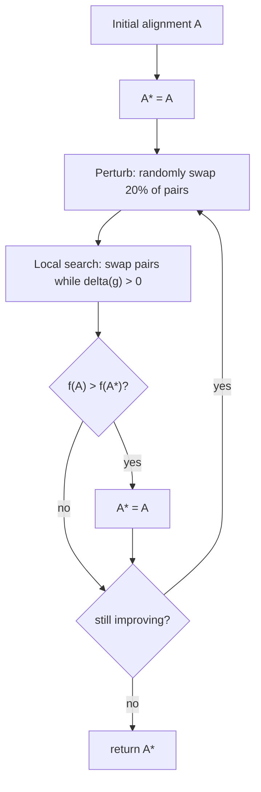

# CytoMCS

## Problem

**Input**: a set of networks `X = {G₁(V₁,E₁), …, G_n(V_n,E_n)}` with `|V₁| ≤ |V_i|` for
all `i ≤ n`.
**Output**: a **multiple alignment** `A* = { f_i : V₁ → V_i | 1 ≤ i ≤ n }` maximising the
number of **fully conserved edges**.

CytoMCS is a **common subgraph detection tool**:

- an **iterative local search algorithm for multiple network alignment**;
- it **aims to optimize the number of conserved edges (MCES)**;
- **while also identifying partially conserved edges**.

## Idea

The MCES objective of [[network-alignment]] is NP-hard, so CytoMCS does not search for an
optimum; it climbs to a local one, kicks the solution, and climbs again — **iterated
local search**. Two procedures alternate:

- **Local search**: *apply local changes to the solution until no improvement can be
  made.* The local change is a **swap** of two nodes' assignments in one network.
- **Perturbation**: *make random changes to the current solution; creates a new starting
  point for local search.* Its purpose is explicitly to **avoid getting stuck in local
  maxima**.

### Fully versus partially conserved edges

The outer objective counts only edges conserved in **every** network:

```text
f(A) = Σ            { 1,  if (f_i(u), f_i(v)) ∈ E_i  ∀ i ∈ [1,n]
      (u,v) ∈ V₁    { 0,  else
```

That function is far too flat to climb: almost every swap leaves it unchanged. So the
**local search optimises a different, smoother function** that also credits **partially**
conserved edges:

```text
g(A) = Σ        c_A(u,v)²                 where   c_A(u,v) = Σ        { 1, if (f_i(u), f_i(v)) ∈ E_i
      (u,v)                                                  i=1..n   { 0, else
```

`c_A(u,v)` is the number of networks in which the edge survives. Squaring it encodes the
design decision stated in the notes:

> **Prioritize fewer well-conserved edges over many poorly conserved ones.**

The example in the notes makes this concrete: an alignment with conservation counts
`{2,3,3,3}` scores `4+9+9+9 = 31`, while one with `{1,3,3,1,3}` scores
`1+9+9+1+9 = 29` — five conserved-somewhere edges lose to four well-conserved ones.

## Pseudocode

```text
CYTOMCS(X):
  // In:  X, a set of networks.   Out: A*, alignment.
  A  ← INITIAL-ALIGNMENT(X)
  A* ← A
  repeat
    A ← PERTURB(A, X)              // random changes, new starting point
    A ← LOCAL-SEARCH(A, X)         // climb until no improvement
    if f(A) > f(A*) then
      A* ← A
    end
  until not improving
  return A*

LOCAL-SEARCH(A, X):
  // In:  A, alignment;  X, networks.   Out: A', alignment.
  A' ← A
  repeat
    for G_i in X, 2 ≤ i ≤ n do
      // Find the swap that produces the greatest increase in g(A')
      (u,v) ← argmax      DELTA(A', u, v)
                u,v ∈ V_i
      if DELTA(A', u, v) > 0 do
        A' ← SWAP(A', u, v)
      end
    end
  until no improvement
  return A'

DELTA(A, u, v):
  return g(SWAP(A, u, v)) − g(A)          // gain of swapping the pair

PERTURB(A, X):
  // randomly swaps 20% of all pairs  -> escaping local maxima
  for 0.20 · |pairs(A)| times:
    (u,v) ← RANDOM-PAIR(A)
    A ← SWAP(A, u, v)
  return A
```

## Worked example

Three networks are aligned; after the local search, the edges of `G₁` carry conservation
counts `3, 3, 2, 1` — one edge survives in all three networks twice over, one in two, one
in only one. Then

```text
g(A) = 3² + 3² + 2² + 1² = 9 + 9 + 4 + 1 = 23
```

This is the exercise computation of p. 18. Note that `f(A)` — fully conserved edges only,
with `n = 3` — would count just the two edges with `c_A = 3`, giving `f(A) = 2`. The
squared, partial-credit score `g` is what the local search actually hill-climbs; `f` is
what the outer loop reports.

## Complexity

- One `LOCAL-SEARCH` sweep evaluates `DELTA` for every node pair in every network:
  `O(n · |V|²)` delta evaluations, each of which can be computed incrementally from the
  edges incident to the two swapped nodes rather than by recomputing `g` from scratch.
- The number of outer iterations is not bounded — the loop runs *until not improving* —
  so the algorithm is **anytime**: it always holds a valid `A*` and simply gets better the
  longer it runs. There is **no optimality guarantee**, because MCES is NP-hard.

## Variants & pitfalls

- **Local maxima** are the central problem; perturbation at 20 % is the only defence, and
  the rate is a tuning parameter, not a derived value.
- **The initial alignment matters**: a random start wastes iterations. Compare
  [[gedevo]], which pre-aligns using [[blast]] similarity or local topology.
- **`f` and `g` disagree.** Optimising `g` can lower `f`; the outer loop guards against
  this by only accepting `A` as the new `A*` when `f` improves.
- **Scales with `n`**: adding a fourth network makes full conservation rarer and `f`
  flatter still, which is precisely why `g` exists.

## Diagram


The iterated local search of CytoMCS: climb, kick, climb again, keep the best.

## Relations

- [[network-alignment]] — the problem, with the MCES objective CytoMCS optimises.
- [[gedevo]] — the alternative heuristic: population-based rather than trajectory-based,
  minimising [[graph-edit-distance]] rather than maximising conserved edges.
- [[interaction-network]] — the networks being aligned.
- [[ant-colony-optimization]] — another metaheuristic in module 2, with the same role:
  a good answer rather than a provable one.
- [[evolutionary-algorithm]] — the population-based sibling family.
- [[k-means]] — the same "assign, improve, repeat until convergence" shape, with the same
  local-optimum caveat.
- [[transclust]] — the other NP-hard graph problem of module 2 solved by a heuristic
  cascade.
- [[algorithmic-complexity]] — why no exact algorithm is offered.

## Appears in

- [[M2L10-network-alignment]]
- [[M2E10-network-alignment]]

## Sources

- `raw/module2/csb_4.pdf`, p. 12 — CytoMCS described, input, multiple alignment, and the
  fully-conserved-edge objective `f(A)`.
- `raw/module2/csb_4.pdf`, p. 13 — the main pseudocode, the perturbation and local-search
  commentary, `g(A)`, `c_A(u,v)` and the fewer-well-conserved-edges principle.
- `raw/module2/csb_4.pdf`, p. 14 — the local-search pseudocode, the delta function, and
  the 20 % perturbation rate.
- `raw/module2/csb_4.pdf`, p. 18 — the `g(A) = 23` exercise.
