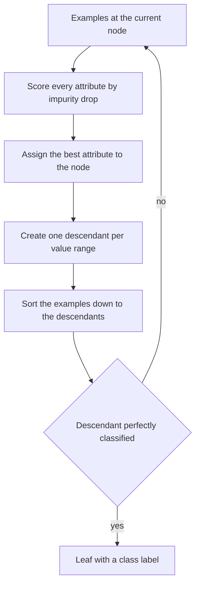

# Decision Tree

## Problem

**Input**: training examples given as **attribute–value pairs**, with a **discrete target
function** (the class label).
**Output**: a tree in which

- **each node tests an attribute**,
- **each branch corresponds to a value range**,
- **each leaf assigns a classification**.

Classification of a new sample then means *following the tree based on the entry data*.

## Idea

Grow the tree **top-down and greedily**: at every node pick the attribute whose split
makes the children as **pure** as possible, send the training examples down, and stop
when a node contains a single class. Purity is measured by [[node-impurity]], and the
greedy choice maximises the impurity drop

```text
Δi(s,t) = i(t) − π(l)·i(l) − π(r)·i(r)
```

The overall aim is to **find a tree with minimal impurity over all splits and all
nodes** — i.e. leaf nodes containing cases of a single class only.

## Pseudocode

**Top-down induction**, exactly the five steps of the notes:

```text
TOP-DOWN-INDUCTION(node, Examples, Attributes):
  I.   A ← the "best" decision attribute for the next node
         A ← argmax_{a ∈ Attributes} Δi( split-on(a), node )
  II.  assign A as decision attribute for node
  III. for each value v of A:
         create a new descendant of node for v
  IV.  sort the training examples to the leaf nodes
         for each descendant d with example set E_d:
  V.      if the training examples in E_d are perfectly classified:
             STOP                                  // d becomes a leaf, label = its class
           else:
             go to step I for d                    // recurse
```

**Impurity functions** used in step I:

```text
RESUBSTITUTION-ERROR(t): return 1 − max_j p(j|t)
GINI(t):                 return Σ_j p(j|t) · (1 − p(j|t))
ENTROPY(t):              return − Σ_j p(j|t) · log p(j|t)
```

**Classification of a new sample**:

```text
CLASSIFY(tree, x):
  t ← root(tree)
  while t is not a leaf:
    A ← attribute(t)
    t ← the child of t whose value range contains x[A]
  return label(t)
```

## Worked example

The notes sketch a tree on a numeric attribute `t`:

```text
            t > 0 ?
         /          \
      true          false
       /               \
   X < 0 ?              X
    /    \
   Z      Y
```

Root: test `t > 0`. The *false* branch is a leaf with class `X`. The *true* branch tests
`X < 0`; its two branches are leaves `Z` and `Y`. Three leaves, two internal nodes, and a
new sample is classified by two comparisons.

**Choosing a split with Gini.** A node with 10 cases, 6 of class `A` and 4 of class `B`:

```text
i(t) = p(A|t)(1−p(A|t)) + p(B|t)(1−p(B|t)) = 0.6·0.4 + 0.4·0.6 = 0.48
```

A split sending `(5A, 0B)` left and `(1A, 4B)` right:

```text
i(l) = 1·0 + 0·1                  = 0            // pure
i(r) = 0.2·0.8 + 0.8·0.2          = 0.32
Δi   = 0.48 − 0.5·0 − 0.5·0.32    = 0.32         // a large drop: a good split
```

## Diagram



Top-down induction picks the attribute with the largest impurity drop, splits the examples, and recurses until every descendant holds a single class.

## Complexity

At each node every attribute must be evaluated over the examples reaching it. With `m`
attributes and `n` examples, one level costs `O(m·n)`; a tree of depth `d` costs
`O(d·m·n)`. Classification of one sample is `O(depth)`.

## Variants & pitfalls

- **Requires** attribute–value pairs and a **discrete** target function. Continuous
  targets need regression trees, which the notes do not cover.
- Stopping only when the training examples are **perfectly classified** is
  [[overfitting]] by construction — the cure taught here is the [[random-forest]], which
  *avoids and prevents overfitting by using multiple trees*.
- The induction is **greedy**: the locally best split is not globally optimal.
- The three impurity measures do not always agree on the best split.
- A single tree is unstable: small changes in the data give a different tree. That
  instability is exactly what bagging in [[random-forest]] averages away.

## Relations

- [[node-impurity]] — the criterion that drives step I.
- [[random-forest]] — hundreds of decision trees, aggregated; the direct sequel.
- [[grandforest]] — a random forest whose splits are constrained by an
  [[interaction-network]].
- [[machine-learning]] — decision trees are the notes' example of a **non-linear**
  classifier.
- [[overfitting]] — the failure mode of a fully grown tree.
- [[information-content]] — the entropy impurity is the same formula used for motif
  columns.
- [[algorithmic-complexity]] — the greedy, level-by-level cost analysis above.
- [[support-vector-machine]] — the other supervised classifier of this lecture, linear
  by construction instead of axis-parallel and recursive.
- [[deep-learning]] — the contrasting model class: interpretable splits versus a learned, opaque feature hierarchy.

## Appears in

- [[M2L03-machine-learning-and-classification]]
- [[M2L05-network-based-disease-modules]]
- [[M2E03-machine-learning-and-classification]]

## Sources

- `raw/module2/csb_part2.pdf`, p. 5 — node/branch/leaf, requirements, top-down induction,
  quality of a split and impurity, resubstitution error.
- `raw/module2/csb_part2.pdf`, p. 6 — Gini impurity and entropy/information gain.
- `raw/module2/csb_part2.pdf`, p. 10 — the exercise: following the tree, feature =
  variable = node.
