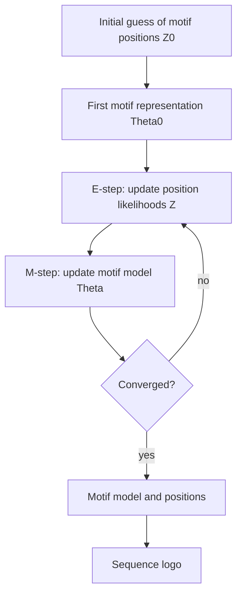
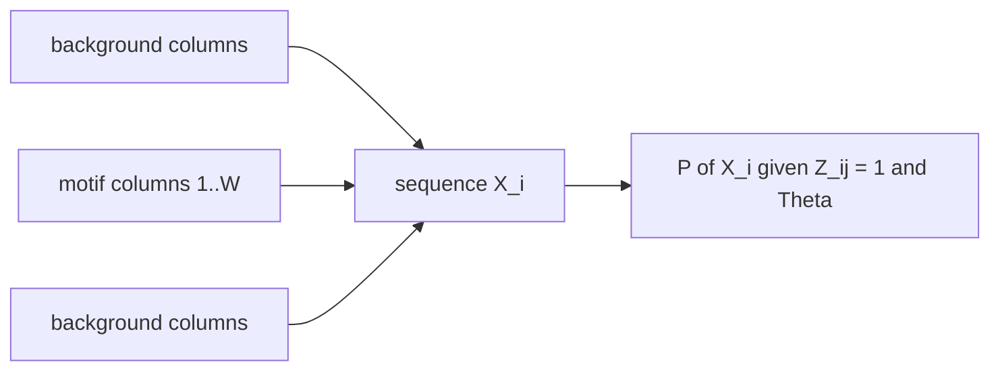

# EM for motif discovery (and MEME)

## Problem

**Input**: a set of sequences `X₁ … X_n`, each of length `L`, each believed to contain
one occurrence of an unknown [[sequence-motif]] of fixed width `W`.
**Output**: the motif model `Θ` — a probability matrix over the alphabet × positions —
and, per sequence, the probability distribution `Z_i` of the motif's starting position.

This is the probabilistic answer to the [[planted-motif-problem]], the alternative to
brute force and to combinatorial approaches.

## Idea

### Assumptions

- The motif has a **fixed length `W`**.
- The motif is generated by **a probability function**.
- The background is generated by **a different probability function**.

### Unknown parameters

- **the motif itself** — the parameters of the probability function;
- **the position of the motif** within each sequence.

Neither can be computed without the other, which is precisely the situation
[[expectation-maximization]] exists for: the position is the latent variable, the motif
model is the parameter.

### Representation

- `Θ = P_{c,k}` = probability of character `c` at position `k` of the motif;
  column `k = 0` holds the **background** distribution.
- `Z = Z_ij` = probability that the motif given by `Θ` starts at position `j` in
  sequence `i`.

### The likelihood of a starting position

```
P(X_i | Z_ij = 1, Θ) =  Π_{k=1}^{j-1}      P_{c_{i,k}, 0}       // before the motif: background
                      · Π_{k=j}^{j+W-1}    P_{c_{i,k}, k-j+1}   // the motif itself: foreground
                      · Π_{k=j+W}^{L}      P_{c_{i,k}, 0}       // after the motif: background
```

and the normalisation that turns likelihoods into the distribution `Z_i`:

```
Z_ij = P(X_i | Z_ij = 1, Θ^{t-1}) / Σ_j P(X_i | Z_ij = 1, Θ^{t-1})
```

— *basically calculate all likelihoods and scale them to sum to 1 for every sequence.*

## Pseudocode

```text
EM-MOTIF(X, W, epsilon):
  // X[1..n], each of length L; W = motif width
  Z ← initial guess of the motif positions                  // Z⁰
  Θ ← MOTIF-MODEL(X, Z)                                     // Θ⁰, first representation

  repeat
    // ---------- E-step: update the position likelihoods ----------
    for i ← 1 to n:
      for j ← 1 to L - W + 1:
        p ← 1
        for k ← 1 to j-1:        p ← p · Θ[X[i,k], 0]       // background before
        for k ← j to j+W-1:      p ← p · Θ[X[i,k], k-j+1]   // foreground
        for k ← j+W to L:        p ← p · Θ[X[i,k], 0]       // background after
        Z[i,j] ← p
      s ← Σ_j Z[i,j]
      for j: Z[i,j] ← Z[i,j] / s                            // normalise to sum to 1

    // ---------- M-step: update the motif model ----------
    for k ← 1 to W:
      for each character c in the alphabet:
        n_ck ← Σ_i Σ_{ j : X[i, j+k-1] = c } Z[i,j]         // weighted counts
    for each character c:
      n_c0 ← n_c - Σ_{k=1}^{W} n_ck                         // the rest is background
    for k ← 0 to W:
      for each character c:
        Θ[c,k] ← n_ck / Σ_b n_bk                            // column normalisation

  until the change in Θ < epsilon                           // convergence
  return Θ, Z
```

The two steps are exactly the lecture's: *use the motif model to update the position
likelihoods `Z^{t+1}`* (**E-step**), then *use these likelihoods to update the motif
model `Θ^{t+1}`* (**M-step**).

## Worked example

A motif model `Θ` of width `W = 3` with column `0` as background (every column sums
to 1):

| | 0 (BG) | 1 | 2 | 3 |
|---|---|---|---|---|
| A | 0.25 | 0.2 | 0.3 | 0.1 |
| C | 0.27 | 0.3 | 0.5 | 0.2 |
| G | 0.23 | 0.1 | 0.1 | 0.4 |
| T | 0.25 | 0.4 | 0.1 | 0.3 |

For the sequence `A A G A A T` with the motif placed at `j = 3`, i.e.
`A A [G A A] T`:

```
P = P_A,0 · P_A,0 · P_G,1 · P_A,2 · P_A,3 · P_T,0
  = 0.25  · 0.25  · 0.1   · 0.3   · 0.1   · 0.25
  = 4.6875e-5
```

The same product is formed for every other starting position `j`, and the whole vector
is then scaled to sum to 1 — that scaled vector is row `i` of `Z`.

## Complexity

- E-step: `O(n · (L − W + 1) · L)` naively; `O(n · L)` with prefix products of the
  background term, since the background factors telescope.
- M-step: `O(n · (L − W + 1) · W)`.
- Multiplied by the number of iterations, which is not bounded.

## Variants & pitfalls

### Problems with EM (as listed in the notes)

- Once a probability is **0**, you will never find that letter at that position of the
  motif. Consequently, **if the motif is not a combination of the initial guesses →
  FAIL**.
- It can be **trapped in local maxima**.
- **Every sequence has to have exactly one motif.**
- It **cannot find more than one motif**.
- It **cannot include previous knowledge**.

### Extensions for MEME

- **Pseudo-counts** in the motif model, to avoid zero probabilities — the same device
  used in [[position-weight-matrix]].
- **A good starting position**: make the start as similar as possible to the actual
  motif by taking **all distinct subsequences of length `W`**, building the motif model
  from each, running **just one EM step**, and choosing the model with the **highest
  likelihood after that one step** as the start model.
- **Prior knowledge** for a good starting point, e.g. an A/T-rich region.

MEME still can be trapped in local maxima. The alternative attack on that specific
weakness is [[gibbs-sampling]].

```text
MEME-START(X, W):
  best ← NIL; best_L ← -infinity
  for each distinct subsequence s of length W occurring in X:
    Θ ← MOTIF-MODEL-FROM(s)              // with pseudo-counts
    Θ ← ONE-EM-STEP(X, Θ)                // run exactly one EM iteration
    if LIKELIHOOD(X, Θ) > best_L:
      best_L ← LIKELIHOOD(X, Θ); best ← Θ
  return best                            // use as Θ⁰ for the full EM run
```

## Diagram


EM alternates between where the motif is and what the motif looks like, until both stop changing.


Every candidate placement splits the sequence into background, motif, background.

## Relations

- [[expectation-maximization]] — the general scheme this instantiates.
- [[gibbs-sampling]] — the stochastic alternative, aimed at the local-maximum problem.
- [[planted-motif-problem]] — the formal problem statement.
- [[sequence-motif]] — the object being discovered.
- [[position-weight-matrix]] — `Θ` *is* a positional probability matrix; the log-odds
  version is the PWM.
- [[sequence-logo]] — how the discovered `Θ` is displayed.
- [[transcription-factor-binding-site]] — the biological target.
- [[gene-knockout]] — supplies the input sequence set.
- [[information-content]] — scores how good the discovered motif is.
- [[baum-welch-algorithm]] — the same E/M structure with a hidden state path instead of
  a hidden position.
- [[rna-seq]] — supplies the differentially expressed genes whose upstream sequences
  are the input set.
- [[maximum-likelihood]] — what the EM iteration maximises here, with the motif position as the latent variable.

## Appears in

- [[M2L02-sequence-motifs-and-motif-discovery]]
- [[M2E02-motif-discovery-and-expectation-maximization]]
- [[L12-binding-sites-and-position-weight-matrices]] — the module-1 lecture that assumes
  the matrix is already known; this method is where it comes from.

## Sources

- `raw/module2/csb_1.pdf`, p. 19 — assumptions, unknown parameters, the algorithm, the
  representations `Θ` and `Z`, and the normalisation of `Z`.
- `raw/module2/csb_1.pdf`, p. 20 — the three-product likelihood formula and the worked
  `Θ` matrix with the `A A [G A A] T` example.
- `raw/module2/csb_1.pdf`, p. 21 — the model update `P_{c,k} = n_{c,k} / Σ_b n_{b,k}`,
  the weighted counts, the background count, the list of EM problems and the MEME
  extensions.
- `raw/module2/csb_1.pdf`, p. 27 — the exercise restatement of the problems and of MEME.
