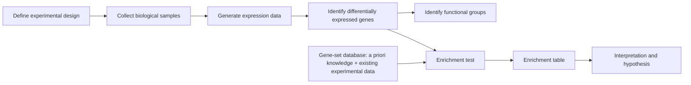

# Enrichment Analysis

## Problem

**Input**: a gene expression dataset (an expression matrix from
[[microarray-expression-analysis]] or [[rna-seq]]) plus a database of a priori
[[gene-set|gene sets]].
**Output**: an **enrichment table** — the gene sets whose members behave unusually in
this dataset, each with a p-value and an FDR.

The underlying goal, as the notes put it, is **identifying functional patterns in gene
expression data**: relating data to biological functions, which are characterised by
gene expression.

## Idea

A list of significant genes is not an answer; it is a new question. Enrichment analysis
answers it by asking, for each a priori gene set, whether the set's members are
**over-represented** among the significant genes, compared to what would be expected by
**random sampling of the array genes**. If the overlap is larger than chance allows, the
function that the set stands for is declared enriched.

There are two families of tests:

| Family | Input | Example |
|---|---|---|
| **Threshold-dependent** | a *thresholded* list of significant genes | [[fishers-exact-test]] |
| **Whole-distribution** | the *entire ranked* gene list | [[gene-set-enrichment-analysis]] |

### The experimental workflow

The notes give the full chain from design to interpretation:

1. Define the experimental design.
2. Collect the biological samples.
3. Generate the expression data.
4. Identify the differentially expressed genes.
5. Identify the functional groups.

### How the gene-level statistic is produced

The test needs *something* to rank or threshold genes by, and that depends on the design:

- **Two-class design** — rank the genes by a differential statistic (e.g. a t-test
  comparing class 1 against class 2), then select **up** and **down** genes by a
  threshold.
- **Time-course design** — cluster the rows of the expression matrix (e.g. **k-means**)
  and treat each gene cluster as the set to be characterised.
- **Other designs** — e.g. a **linear model** applied to the expression matrix, yielding
  significant genes directly.

## Pseudocode

```text
ENRICHMENT-ANALYSIS(E, design, DB, alpha):
  // E   = expression matrix, genes x samples
  // DB  = database of a priori gene sets
  // returns an enrichment table

  // 1. gene-level statistic, depending on the design
  if design = TWO-CLASS:
    for each gene g in E:
      t[g] ← DIFFERENTIAL-STATISTIC(E[g, class1], E[g, class2])
    Sig  ← { g : t[g] ≥ threshold_up }        // UP genes
          ∪ { g : t[g] ≤ threshold_down }     // DOWN genes
  else if design = TIME-COURSE:
    Clusters ← K-MEANS(E)                     // each cluster is a candidate group
    Sig ← Clusters
  else:                                       // e.g. linear model
    Sig ← SIGNIFICANT-GENES(LINEAR-MODEL(E))

  BG ← all genes measured on the array        // background / universe

  // 2. one test per a priori gene set
  for each gene set S in DB:
    a ← |Sig ∩ S|                             // significant and in the set
    b ← |Sig \ S|                             // significant, not in the set
    c ← |S \ Sig|                             // in the set, not significant
    d ← |BG| - a - b - c                      // neither
    p[S] ← FISHER-EXACT(a, b, c, d)           // threshold-dependent route

  // 3. control the multiplicity: one test per set
  q ← BENJAMINI-HOCHBERG(p)

  return sorted table of (S, p[S], q[S]) ordered by DECREASING enrichment score
```

The last line matters for the exercise: for the statistical assessment, the sets are
ordered by **decreasing enrichment score**, so the strongest candidates are read off the
top of the table.

## Worked example

Suppose the array measures `n = 10 000` genes, of which `200` are significantly up
regulated. A gene set `S` of `50` genes contains `15` of those `200`.

| | in `S` | not in `S` | total |
|---|---|---|---|
| significant | `a = 15` | `b = 185` | 200 |
| not significant | `c = 35` | `d = 9765` | 9800 |
| total | 50 | 9950 | 10000 |

Expected overlap by chance: `200 · 50 / 10000 = 1`. Observed: `15`. The
[[fishers-exact-test]] turns that 15-fold excess into a p-value; 2 000 such tests then
require [[multiple-testing-correction]].

## Complexity

- One test per gene set: `O(|DB|)` tests, each `O(1)` once the four counts are known.
- Computing the counts is `O(Σ|S|)` with a hash set of significant genes.
- The expensive part is **not** the test but the permutation null distribution used by
  the whole-distribution route — see [[gene-set-enrichment-analysis]].

## Variants & pitfalls

- **The threshold is arbitrary.** There is no "natural" value for it; different
  thresholds give different results; and thresholding **loses information** — once a gene
  is labelled significant, the *strength* of its change is discarded, so there is **no
  resolution between strengths**. The lecture's conclusion is explicit: *use
  whole-distribution methods wherever possible.*
- **The background matters.** The universe must be the genes actually measured, not the
  whole genome; otherwise every set looks enriched.
- **Annotation bias.** Well-studied processes have larger, better-curated
  [[gene-ontology]] sets and therefore win more often.
- **Sets are not independent.** GO's DAG makes parent and child terms overlap heavily,
  so Bonferroni is conservative here and FDR is the usual choice.
- The **de novo** alternative abandons a priori sets entirely and extracts the group from
  an [[interaction-network]] — see [[keypathwayminer]].

## Diagram


The experimental chain on top, and the enrichment test that joins expression data to a priori knowledge.

## Relations

- [[gene-set]] — the unit being tested.
- [[gene-ontology]] — the usual source of the sets.
- [[fishers-exact-test]] — the threshold-dependent test.
- [[gene-set-enrichment-analysis]] — the whole-distribution test that fixes the
  threshold problem.
- [[keypathwayminer]] — the de novo, network-based alternative.
- [[multiple-testing-correction]] — thousands of sets are tested at once.
- [[statistical-testing]] — supplies the null-hypothesis vocabulary used throughout.
- [[microarray-expression-analysis]] and [[rna-seq]] — the upstream assays.
- [[principal-component-analysis]] and [[data-normalization]] — the preprocessing that
  must happen before any gene-level statistic is trustworthy.
- [[batch-effect]] — an uncorrected batch effect produces gene sets that are "enriched"
  for the processing date.
- [[gene-knockout]] — a perturbation whose differentially expressed genes are a typical
  input to this workflow.
- [[cluster-analysis]] — clusters found without labels are usually annotated afterwards by enrichment, which is how an unsupervised result acquires a meaning.
- [[grandforest]] — its disease-gene module is interpreted the same way.
- [[single-cell-analysis-workflow]], [[single-cell-rna-seq]] — gene-level downstream analysis of single-cell data ends in exactly this step.
- [[rna-interference]] — network enrichment closes the analysis pipeline of a genome-wide RNAi screen.

## Appears in

- [[M2L01-enrichment-analysis]]
- [[M2E01-enrichment-analysis-and-keypathwayminer]]
- [[M2L09-non-coding-rnas]]
- [[L06-expression-profiling]] — the module-1 pipeline whose list of differentially
  expressed genes is the input to this workflow.

## Sources

- `raw/module2/csb_1.pdf`, p. 1 — goal, the five-step workflow, functional groups, the
  definition of gene-set enrichment analysis.
- `raw/module2/csb_1.pdf`, p. 2 — up / down / not significant, gene functions.
- `raw/module2/csb_1.pdf`, p. 3 — the enrichment test as a statistical test and the
  enrichment-table data flow.
- `raw/module2/csb_1.pdf`, p. 4 — two-class, time-course and other designs.
- `raw/module2/csb_1.pdf`, p. 5 — the overlap question and the random-sampling null.
- `raw/module2/csb_1.pdf`, p. 6 — the threshold critique.
- `raw/module2/csb_1.pdf`, p. 10 — exercise: ordering by decreasing enrichment score.

- `raw/module2/csb_4.pdf`, p. 3 — systems biology and network enrichment as the final RNAi screening tasks.
