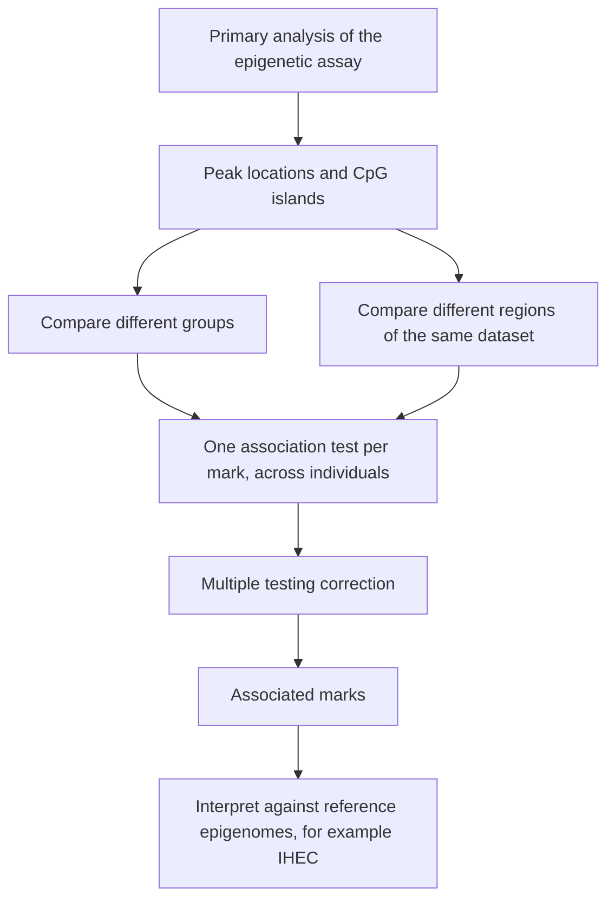

# Epigenome-wide association study

## Problem

**Input**: a genome-wide set of **quantifiable epigenetic marks** — typically
[[dna-methylation]] levels from [[bisulfite-sequencing]], or peak intensities from
[[chip-seq]] — measured in **many individuals**, together with a phenotype.
**Output**: the marks whose variation is **associated** with that phenotype.

The notes define it directly:

> An **epigenome-wide association study (EWAS)** is an examination of a genome-wide set of
> quantifiable epigenetic marks, such as DNA methylation, in different individuals to
> derive associations between epigenetic variation and a particular identifiable
> phenotype.

## Idea

EWAS is the epigenetic sibling of the [[genome-wide-association-study]]. The structure is
the same — one statistical test per genomic feature, across a cohort — but the tested
variable differs:

| | GWAS | EWAS |
|---|---|---|
| Unit tested | SNP genotype | methylation level or peak intensity |
| Variable type | discrete (0/1/2) | continuous, in `[0, 1]` for methylation |
| Stability | fixed for life | **tissue- and time-dependent**, reversible |
| Causality | variant precedes phenotype | the mark may be a **consequence** of the phenotype |

This last row is the fundamental caveat: a genotype cannot be caused by a disease, but a
methylation pattern can be.

### Where EWAS sits in the pipeline

Downstream functional analysis starts once the **primary analysis** of the epigenetic
array or sequencing run is done. Its output is a **set of peak locations and CpG
islands**. Functional analysis then proceeds by **comparing**:

- **different groups** (e.g. disease versus control), or
- **different regions from the same dataset**.

Public databases provide the reference against which a single experiment is interpreted —
the notes name **IHEC** (International Human Epigenome Consortium), which *provides
standardized reference epigenomes for a variety of normal and disease tissues*.

## Pseudocode

```text
EWAS(marks, phenotype, covariates, α):
  // marks[i, j] ← level of epigenetic mark j in individual i
  // phenotype[i] ← the trait of individual i
  // covariates  ← age, sex, batch, cell-type composition, ...

  marks ← NORMALIZE(marks)                    // remove technical variation
  marks ← CORRECT-CONFOUNDERS(marks, covariates)   // batch effects, cell-type mixture

  P ← ∅
  for j ← 1 to #marks:
    p_j ← TEST-ASSOCIATION(marks[·, j], phenotype, covariates)
    P ← P ∪ {p_j}

  P_adj ← MULTIPLE-TESTING-CORRECTION(P)      // Bonferroni for FWER or Benjamini-Hochberg for FDR
  hits ← { j : P_adj[j] < α }

  // downstream functional analysis
  regions ← ANNOTATE(hits)                    // promoter, enhancer, gene body, CpG island
  compare regions against a reference epigenome database such as IHEC
  return hits, regions
```

## Worked example

Methylation levels are measured at 450 000 CpG sites in 200 smokers and 200 non-smokers.
Each site is tested for a difference in mean methylation between the groups. A site in
the gene body of a detoxification gene shows mean levels of `0.71` versus `0.44` with a
raw `p = 2·10⁻⁹`. With Bonferroni at `α = 0.05`, the threshold is
`0.05 / 450 000 ≈ 1.1·10⁻⁷`, so the site survives and is reported.

Interpretation requires care: the smoking caused the methylation change, not the other
way round — the association is real but the direction of causality is the opposite of the
GWAS case.

## Complexity

- One test per mark: `O(m · n)` for `m` marks and `n` individuals, plus the cost of the
  chosen test.
- Correction and sorting of p-values: `O(m log m)` for Benjamini–Hochberg.

## Variants & pitfalls

- **Cell-type composition** is the dominant confounder: whole blood is a mixture, and a
  shift in the proportion of cell types produces a methylation difference that has
  nothing to do with the phenotype.
- **Batch effects** ([[batch-effect]]) are at least as severe here as in expression data,
  because methylation arrays are run in plates.
- **Reverse causation** — see above; EWAS hits are associations, not mechanisms.
- **Multiple testing** — hundreds of thousands of simultaneous tests demand
  [[multiple-testing-correction]].
- **Tissue specificity** — an epigenome is a property of a tissue, so the accessible
  tissue (blood) is often not the tissue of interest (brain).

> [!note] Added beyond lecture notes
> Source: general domain knowledge (Horvath, *Genome Biol.* 14:R115, 2013; Hannum et al.,
> *Mol. Cell* 49:359, 2013; Houseman et al., *BMC Bioinformatics* 13:86, 2012 on cell-type
> deconvolution; Relton & Davey Smith, *Int. J. Epidemiol.* 41:161, 2012 on Mendelian
> randomisation). Not from the UHH handwritten notes.
>
> **How the cell-composition confounder is actually handled.** The pseudocode above calls
> `CORRECT-CONFOUNDERS` without saying how. Two families of method are standard:
>
> - **Reference-based deconvolution** — estimate the proportion of each blood cell type
>   from a panel of cell-type-specific CpGs with known reference profiles, then include
>   those proportions as covariates. This is the Houseman approach.
> - **Reference-free surrogate variables** — when no reference panel exists for the
>   tissue, estimate latent components of the methylation matrix (SVA, RefFreeEWAS,
>   ReFACTor) and adjust for them. They absorb cell composition and
>   [[batch-effect|batch]] together, at the cost of possibly absorbing some of the signal.
>
> **Epigenetic clocks** are the best-known derived phenotype built on EWAS-scale data: a
> weighted sum of a few hundred methylation levels predicts chronological age across
> tissues, and the residual — **age acceleration** — is itself tested as a trait against
> disease and mortality. They turn the whole methylome into one continuous variable, which
> is not something a [[genome-wide-association-study]] has an analogue for.
>
> **Addressing the reverse-causation problem.** The caveat tabulated above is not merely
> noted but attacked, chiefly by **Mendelian randomisation**: a genetic variant that
> controls methylation at a locus (a **meQTL**, the methylation analogue of an
> [[expression-qtl]]) is fixed at conception and cannot be caused by the phenotype, so
> using it as an instrument gives a causal direction that the raw association cannot.
> Longitudinal sampling, which measures the mark before the phenotype appears, is the
> other route.


## Diagram


The downstream route from a finished primary analysis to an interpreted EWAS hit list.

## Relations

- [[genome-wide-association-study]] — the same design applied to genotypes instead of
  marks.
- [[dna-methylation]] — the quantifiable mark EWAS usually tests.
- [[bisulfite-sequencing]] — supplies the per-site methylation levels.
- [[chip-seq]] and [[peak-calling]] — the alternative source of quantifiable marks.
- [[multiple-testing-correction]] — mandatory at epigenome scale.
- [[batch-effect]] — the dominant technical confounder.
- [[epigenetics]] — the field whose population-scale study design this is.
- [[snp]] — the discrete variant unit a GWAS tests, replaced here by a continuous
  methylation level or peak intensity.
- [[expression-qtl]] — the expression analogue of the **meQTL** used as an instrument to
  attack the reverse-causation problem.

## Appears in

- [[L16-epigenetics]]

## Sources

- `raw/module1/gsb_part4.pdf`, p. 9 (downstream functional analysis, IHEC, EWAS
  definition).
