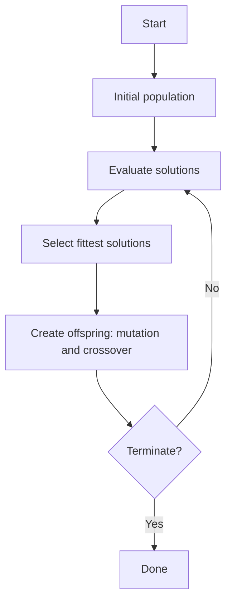

# Evolutionary algorithm

## Problem

**Input**: a search space of candidate solutions and a **fitness function** that scores
them.
**Output**: a good — not provably optimal — solution, found without ever enumerating the
space.

## Idea

An evolutionary algorithm is a **subset of evolutionary computation**. It:

- **maintains a population of candidate solutions**;
- creates **new solutions through mutation and crossover operations**;
- lets **only the fittest solutions survive each generation**.

It is the population-based counterpart to a trajectory-based metaheuristic such as the
iterated local search of [[cytomcs]]: instead of one solution being kicked and re-climbed,
many solutions are kept, recombined, and filtered. The same role is played by
[[ant-colony-optimization]] in [[keypathwayminer]] and [[bicon]] — when the problem is
NP-hard, buy a good answer in polynomial time per run rather than a provable one.

The name is a borrowing, not a biological claim; but the vocabulary of
[[molecular-evolution]] — mutation, selection, generation, fitness — maps onto it exactly.

## Pseudocode

```text
EVOLUTIONARY-ALGORITHM(fitness, population_size, terminate?):
  P ← INITIAL-POPULATION(population_size)        // e.g. random permutations
  repeat
    // Evaluate solutions
    for each individual s in P:
      score[s] ← fitness(s)

    // Select fittest solutions
    S ← SELECT-FITTEST(P, score)

    // Create offspring
    O ← ∅
    for each pair (s1, s2) drawn from S:
      child ← CROSSOVER(s1, s2)                  // combine two parents
      child ← MUTATE(child)                      // random local change
      O ← O ∪ { child }

    P ← SURVIVORS(S ∪ O)                         // only the fittest survive
  until terminate?(P)
  return argmax score[s]  over s in P
```

The loop is exactly the flowchart of p. 15: *start → initial population → evaluate
solutions → select fittest solutions → create offspring → terminate? → no, loop; yes,
done.*

## Worked example

[[gedevo]] is this algorithm instantiated for [[network-alignment]]:

| Generic step | GEDEVO's choice |
|---|---|
| Individual | a node mapping `f : V₁ → V₂` |
| Fitness | `GED(f)`, the [[graph-edit-distance]] — **lower is better** |
| Initial population | random permutations, optionally pre-aligned by [[blast]] similarity or local topology |
| Mutation | partially-mapped crossover mutation; directed mutation on bad pairs |
| Crossover | sort pairs by `pairScore` and merge best-to-worst |
| Survival | health values; the bottom 90 % lose health by rank and die at `H ≤ 0` |
| Termination | after `N` iterations, after `T` minutes, or on stagnation |

## Complexity

Per generation: `O(population_size)` fitness evaluations plus the cost of the crossover
and mutation operators. The number of generations is set by the termination rule, not
derived — so the total cost is chosen by the user, and the algorithm is **anytime**: it
always holds a best-so-far solution. There is **no optimality guarantee**.

## Variants & pitfalls

- **Premature convergence**: if selection is too greedy the population loses diversity
  and the search collapses onto one local optimum. GEDEVO's **health values** exist for
  exactly this reason — they *increase population diversity and help escape local
  optima* by letting mediocre solutions survive for several generations.
- **Operator design is the whole game.** Random mutation on a permutation almost always
  makes it worse; this is why GEDEVO uses *directed* mutation on identified bad pairs.
- **Fitness evaluation dominates the runtime**, so an incremental fitness update beats a
  recomputation.
- **No bound on the result**: the answer is good, not optimal — the same contract as
  [[ant-colony-optimization]] and [[cytomcs]].

## Diagram


The generic evolutionary loop of p. 15, which GEDEVO instantiates.

## Relations

- [[gedevo]] — the instance developed in this lecture.
- [[network-alignment]] — the NP-hard problem it is applied to.
- [[ant-colony-optimization]] — the other metaheuristic of module 2; pheromone memory
  instead of a population of solutions.
- [[cytomcs]] — the trajectory-based alternative: one solution, perturbed and re-climbed.
- [[travelling-salesman-problem]] — the reference NP-hard problem for all of these.
- [[molecular-evolution]] — the source of the vocabulary: mutation, selection, fitness.
- [[algorithmic-complexity]] — the reason a heuristic is used at all.
- [[expectation-maximization]] — a different answer to the same predicament: iterate to a
  local optimum and accept it.

## Appears in

- [[M2L10-network-alignment]]

## Sources

- `raw/module2/csb_4.pdf`, p. 15 — the evolutionary-algorithm flowchart and the four
  defining properties.
- `raw/module2/csb_4.pdf`, p. 17 — offspring generation strategies, health-based
  selection, and termination criteria.
