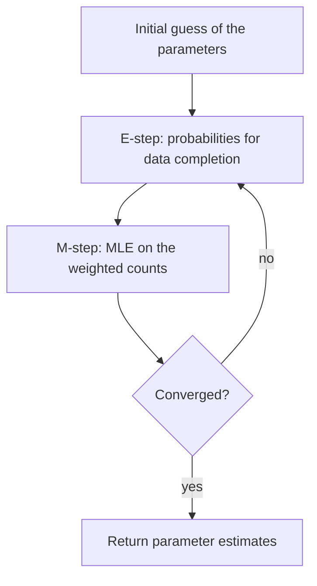
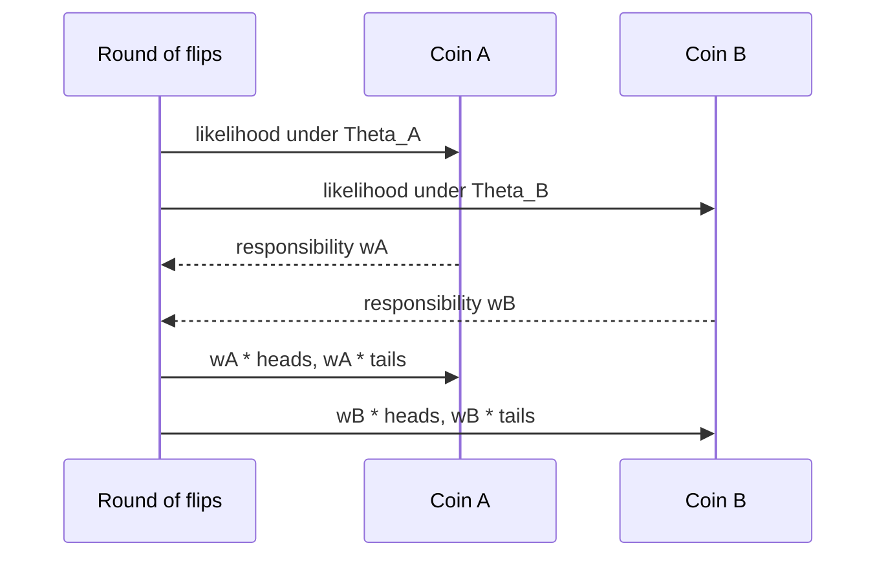

# Expectation Maximization

## Problem

**Input**: observed data, a probabilistic model with parameters `Θ`, and **missing
information** — a latent variable whose value would make estimation trivial.
**Output**: parameter estimates `Θ̂` that locally maximise the likelihood of the observed
data.

> The EM algorithm enables **parameter estimation in probabilistic models with incomplete
> data**.

## Idea

If the data were **complete**, maximum likelihood estimation (MLE) would be a counting
exercise. EM makes the data complete *probabilistically*: it uses the current parameters
to compute, for every datum, the probability of each possible value of the missing
variable, then performs the counting exercise with those probabilities as weights.

The lecture's one-line statement of the general idea: **use probabilities for data
completion and use MLE**. Each hidden alternative "owns" each datum in proportion to its
likelihood.

### The coin-flip example

Two coins `A` and `B`, biased, with `Θ_A` and `Θ_B` the likelihoods of seeing **head**.
`X` rounds of coin flips, `Y` flips per round.

- **Complete information** (we know which coin produced each round):

```
Θ̂_X = (# heads with coin X) / (total count of flips of coin X)
```

- **Incomplete information** (we do **not** know which coin produced which outcome) — an
  iterative process:
  1. guess initial `Θ_A⁰`, `Θ_B⁰`;
  2. calculate which coin is the more likely one for each round;
  3. use that to compute `Θ_A¹`, `Θ_B¹` by MLE;
  4. repeat until convergence.

The crucial refinement is that step 2 is **not** a hard assignment. If coin `A` "owns"
45 % of series 1, then series 1 contributes `45 % · 5H` heads and `45 % · 5T` tails to
coin `A`'s counts.

## Pseudocode

```text
EXPECTATION-MAXIMIZATION(D, Θ⁰, epsilon):
  // D = observed data, Z = latent variable, Θ = parameters
  Θ ← Θ⁰                                         // initial guess
  repeat
    // ----- E-step: complete the data with probabilities -----
    for each datum d in D:
      for each possible value z of the latent variable:
        w[d, z] ← P(d | Z = z, Θ) · P(Z = z)
      normalize w[d, ·] so that Σ_z w[d, z] = 1  // responsibilities

    // ----- M-step: maximum likelihood with the weighted counts -----
    Θ' ← argmax_Θ Σ_d Σ_z w[d, z] · log P(d, Z = z | Θ)

    delta ← |Θ' - Θ|; Θ ← Θ'
  until delta < epsilon                          // convergence
  return Θ

COIN-EM(rounds, Y, Θ_A, Θ_B, epsilon):
  // rounds[i] = a string of Y flips; Y = flips per round
  repeat
    nH_A ← 0; nT_A ← 0; nH_B ← 0; nT_B ← 0
    for i ← 1 to |rounds|:
      h ← number of heads in rounds[i]; t ← Y - h
      // E-step: which coin is the more likely one for this round?
      L_A ← BINOMIAL(h, Y, Θ_A)                  // C(Y,h) · Θ_A^h · (1-Θ_A)^t
      L_B ← BINOMIAL(h, Y, Θ_B)
      wA  ← L_A / (L_A + L_B)                    // equal priors ⇒ Bayes reduces to this
      wB  ← 1 - wA
      // probabilistic data completion
      nH_A ← nH_A + wA · h ; nT_A ← nT_A + wA · t
      nH_B ← nH_B + wB · h ; nT_B ← nT_B + wB · t
    // M-step: MLE on the weighted counts
    Θ_A' ← nH_A / (nH_A + nT_A)
    Θ_B' ← nH_B / (nH_B + nT_B)
    delta ← max(|Θ_A' - Θ_A|, |Θ_B' - Θ_B|)
    Θ_A ← Θ_A'; Θ_B ← Θ_B'
  until delta < epsilon
  return Θ_A, Θ_B
```

The `wA = L_A / (L_A + L_B)` line is Bayes' theorem,

```
P(Z_k | E) = P(E | Z_k) · P(Z_k) / P(E)
           = P(E | Z_A)·P(Z_A) / ( P(E | Z_A)·P(Z_A) + P(E | Z_B)·P(Z_B) )
```

specialised to the case `P(Z_A) = P(Z_B)`, in which the priors cancel.

## Worked example

See [[M2E02-motif-discovery-and-expectation-maximization]] for the full numeric run with
five rounds of ten flips, `Θ_A⁰ = 0.4` and `Θ_B⁰ = 0.6`. Sketch of round 1 of that
exercise:

| round | heads | P(seq given Θ_A⁰) | P(seq given Θ_B⁰) | P(Θ_A given seq) | P(Θ_B given seq) |
|---|---|---|---|---|---|
| 1 | 6 | 0.1111 | 0.25 | 0.307 | 0.693 |
| 2 | 5 | 0.2 | 0.2 | 0.5 | 0.5 |
| 3 | 9 | 0.001 | 0.04 | 0.0243 | 0.976 |

Round 2, with equal numbers of heads and tails, is owned equally by both coins — exactly
what a 5 : 5 outcome should say about two coins biased symmetrically around `0.5`.

## Complexity

Per iteration: `O(|D| · |Z|)` for the E-step plus the cost of the M-step, which for
counting models is `O(|D| · |Z|)` as well. The number of iterations to convergence is not
bounded in general.

## Variants & pitfalls

- **Local maxima.** EM climbs the likelihood surface monotonically but only to the
  nearest peak. The probability of landing in a bad one is reduced by trying different
  starting points — or by replacing the deterministic walk with a random one, which is
  [[gibbs-sampling]].
- **Zero probabilities are absorbing.** If a parameter reaches 0 it can never recover,
  because every weighted count that would revive it is multiplied by 0. Pseudo-counts
  are the standard fix.
- **Hard assignment is not EM.** Assigning each datum to its single most likely latent
  value and counting is *classification EM* (the same relationship that Viterbi training
  has to [[baum-welch-algorithm]]); it converges faster and to a worse optimum.
- **Convergence of likelihood ≠ convergence of parameters.** Flat regions can keep the
  parameters moving while the likelihood barely changes.

### Where EM appears in these modules

- [[em-motif-discovery]] — the latent variable is the **position** of the motif in each
  sequence; this is the main application in the lecture.
- CpG-island discovery — named in the exercise as the second application; see
  [[cpg-island]].
- [[baum-welch-algorithm]] — EM for [[hidden-markov-model|HMM]] parameters, where the
  latent variable is the hidden state path. Module 1 met EM there first, without naming
  the general framework.

## Diagram


The EM loop: probabilistic completion, then ordinary maximum likelihood, repeated.


Each round is split between the two coins in proportion to how well each explains it.

## Relations

- [[em-motif-discovery]] — EM applied to the [[planted-motif-problem]].
- [[gibbs-sampling]] — the stochastic analogue of EM.
- [[baum-welch-algorithm]] — EM for HMMs; the module-1 instance of the same scheme.
- [[hidden-markov-model]] — the model Baum–Welch trains.
- [[probability-distribution]] — the binomial distribution is the likelihood in the coin
  example.
- [[statistical-testing]] — likelihood is the common currency of both pages.
- [[position-weight-matrix]] — the model EM estimates in the motif application.
- [[ant-colony-optimization]] — the other "iterate until convergence" scheme in this
  module, randomised rather than deterministic.
- [[cpg-island]] — the second application named in the exercise.
- [[algorithmic-complexity]] — the per-iteration cost and the absence of any bound on
  the number of iterations are what make EM a heuristic.
- [[k-means]] — the hard-assignment special case of EM for spherical Gaussians: assign is E, recompute the centroid is M.
- [[machine-learning]] — EM sits on the unsupervised branch of that taxonomy.
- [[gradient-descent]], [[cost-function]] — the deep-learning alternative: both are iterative descent on an objective with no closed-form solution, EM by alternating updates and gradient descent by following the slope.
- [[evolutionary-algorithm]] — also an iterate-until-no-improvement scheme, but deterministic and guaranteed to be monotone, where an EA is stochastic and is not.
- [[maximum-likelihood]] — the objective EM climbs; the M-step is an MLE on the weighted counts.

## Appears in

- [[M2L02-sequence-motifs-and-motif-discovery]]
- [[M2E02-motif-discovery-and-expectation-maximization]]
- [[L17-markov-chains-and-hidden-markov-models]] — the module-1 lecture whose HMM
  learning problem is solved by the EM instance [[baum-welch-algorithm]].

## Sources

- `raw/module2/csb_1.pdf`, p. 18 — the EM definition, the coin-flip example, complete
  versus incomplete information, the iterative process and the "data completion by
  probabilities" idea.
- `raw/module2/csb_1.pdf`, pp. 25–27 — the exercise: binomial likelihoods, Bayes with
  equal priors, the responsibility table and the re-estimated parameters.

- `raw/module2/csb_4.pdf`, p. 15 — the evolutionary algorithm loop.
